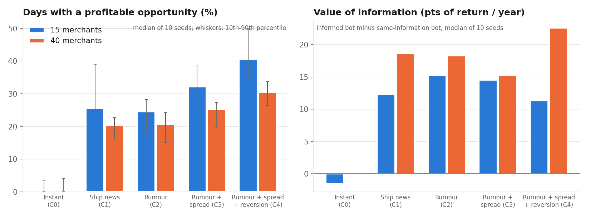

# MediTrader

A 16th-century Mediterranean merchant game whose economy is an agent-based simulation, built experiment by experiment and ported to a bit-exact Rust core.


<sub>Same competent NPC merchants, five ways of spreading and reading price information ([experiment 02](showcase/experiments/02-information-delay.md)).</sub>

## What it is
You play a merchant in the eastern Mediterranean around 1560: no ship, little capital, and news that is always a few weeks old ([vision](showcase/vision.md)). Prices are not scripted. They come from a simulated economy of port markets, storers, shops, peasants, households in three income classes, and hundreds of NPC merchants who follow the same rules as the player. The economy is designed by experiment: each mechanism is chosen from the literature, tested against stated criteria, and classified as either a real economic phenomenon (kept) or an engine artifact (fixed). The simulation was designed in a Python reference engine and now runs in Rust, which reproduces Python bit for bit and runs 30-60x faster.

## What's interesting
- **Opportunities come from frictions, not dumb NPCs.** With instant information, competent NPCs leave a greedy player bot 2.5-3.6% a year, about a bond's return. With information that travels by ship and rumour, opportunities exist on 20-40% of days ([experiments 01](showcase/experiments/01-instant-information.md), [02](showcase/experiments/02-information-delay.md)).
- **Returns are not tuned; they emerge from entry.** Tie merchant entry and exit to a 4% bond, and the speed of entry sets the rent: 19-26% with slow entry, 6-11% with moderate entry, 1-2% with herd entry. Under herd entry, survivors seem to earn 12-22% while the sector as a whole earns 1-2% ([experiment 03](showcase/experiments/03-entry-speed.md)).
- **Phenomenon or artifact?** A seasonal swing in cloth demand looked like an income effect. One ablation showed it was a bug; fixed, it fell from 2.38 to 1.03 ([experiment 04](showcase/experiments/04-cloth-artifact.md), with two more engine bugs in the [experiments overview](showcase/experiments/README.md)).
- **A codex of real economics.** Pork cycles, cobwebs, herding, survivorship bias and the optimizer's curse emerged unscripted. Each has a source and an in-game explanation ([codex](showcase/codex/README.md)); every mechanism records whether it came from the designer, the AI assistant or the literature ([registry](showcase/design/mechanism-registry.md)).
- **Bit-exact Rust port.** Python's compensated `sum`, banker's `round`, glibc `libm` and NumPy's PCG64 and distribution algorithms were reimplemented. A daily per-field state hash proves every field identical; a full 40-run experiment was reproduced with identical output files, apart from one log column that was changed in Python afterwards ([determinism and the Rust port](showcase/engineering/determinism-and-rust-port.md)).

## Status
**Pre-production: design and economic simulation engine; no playable build yet.** Current work: time in port and mixed cargo on a 20-port map ([experiment 05](showcase/experiments/05-port-time.md)), then capital entry and exit for storers and workshops.

## Quick start
Needs Rust (stable) and Python 3.12+ (parity relies on 3.12's `sum()`).
```
cargo build --release --manifest-path core/Cargo.toml
cargo test --release --manifest-path core/Cargo.toml       # Python/NumPy-exact math and RNG
pip install -r requirements.txt
python3 core/tools/parity_check.py                         # Python vs Rust, bit for bit (~2 s)
python3 experiments/d2_two_ports.py                        # experiment 01 (~3 min)
```

## Repo map
| Path | Contents |
|---|---|
| [`showcase/`](showcase/) | English overview: [vision](showcase/vision.md), [design](showcase/design/core-loop.md), [experiments](showcase/experiments/README.md), [codex](showcase/codex/README.md), [engineering](showcase/engineering/architecture.md), [research](showcase/research/literature-map.md) |
| [`docs/`](docs/INDEX.md) | Working notes, Turkish: every decision, experiment report, open question and research note. The source of truth; `showcase/` summarises it. |
| [`core/`](core/) | Rust workspace: `medi-core` library and binaries (`medi`, `trace`, `bench`), tests, maps, Python tools |
| [`sim/`](sim/) | Python reference engine (frozen oracle) |
| [`experiments/`](experiments/) | One script per experiment (D-series) and configs (M-series); outputs are not committed |
| [`CLAUDE.md`](CLAUDE.md) | Working rules for the AI assistant (Turkish) |

## How this is built
Design decisions are Furkan's. Research, experiments and code are produced with an AI-assisted (Claude), spec-driven workflow: every decision, experiment and mechanism is written down in [`docs/`](docs/INDEX.md), with its origin (designer, AI or literature) and status ([registry](showcase/design/mechanism-registry.md)). Verification does not rely on trust: bit-exact tests, daily state hashes, regression runs with new mechanisms switched off, and measurements from the ledger rather than from the agents.

## License
Copyright © 2026 Mehmet Furkan Geçkil. **All rights reserved.** The code and documents are published for viewing only; no licence to use, copy, modify or distribute is granted.

## Author
Mehmet Furkan Geçkil · GitHub [@mgeckil18](https://github.com/mgeckil18) · LinkedIn: LINKEDIN_URL
