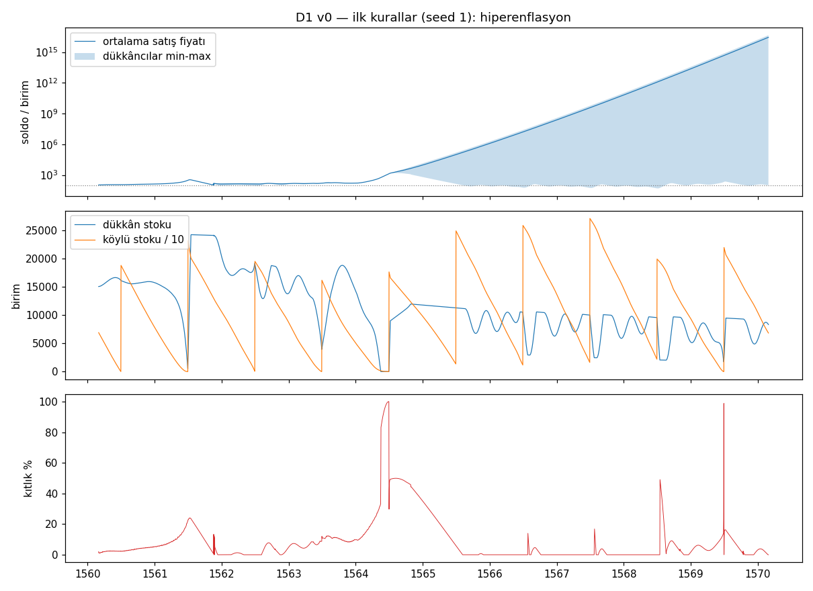
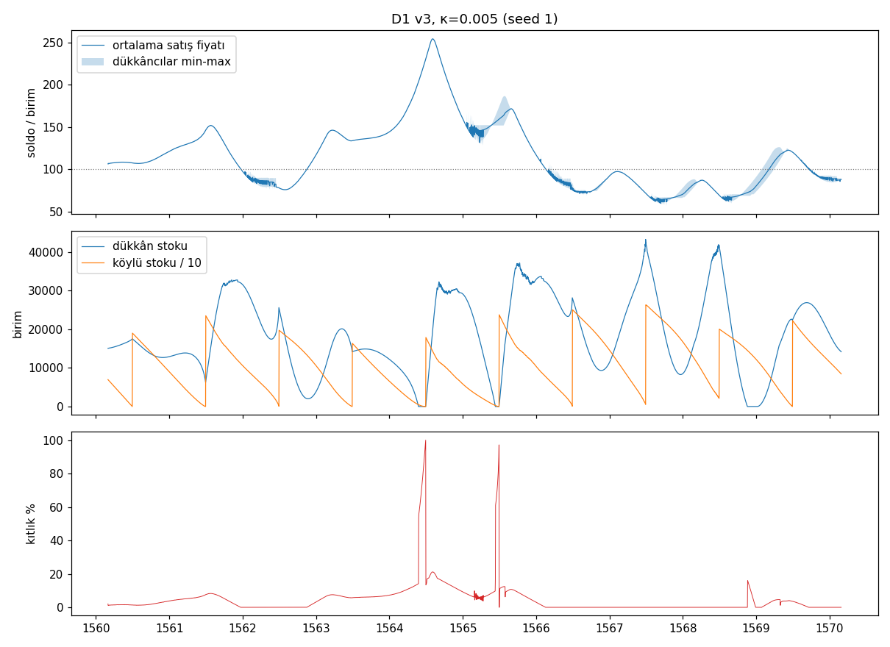
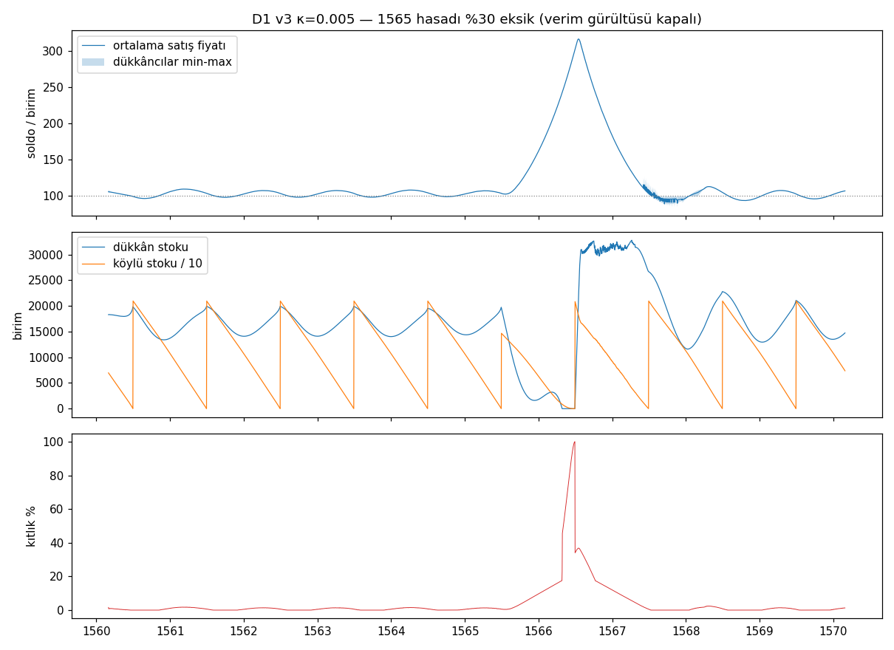
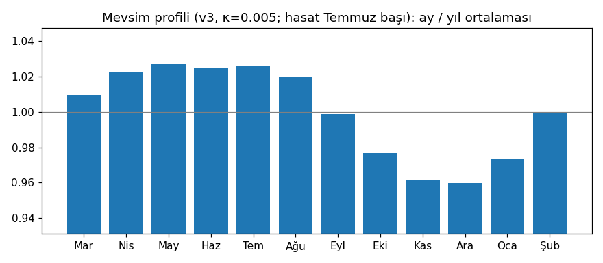
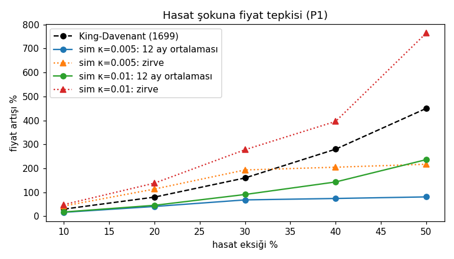

# Deney D1: Tek Liman, Tek Mal
> Durum: tamamlandı (2026-10-22)
> Kod: [`experiments/d1_single_port.py`](../../experiments/d1_single_port.py), [`sim/`](../../sim/)
> Ham sonuçlar: `experiments/out/d1/summary.json` (yeniden üretmek için: `python3 experiments/d1_single_port.py`, ~30 sn)
> İlgili: [simulation-spec §8](../design/simulation-spec.md), [06-doğrulama](../research/simulation/06-validation-and-tuning.md)

## Özet

**Soru:** Tek bir limanda kitle talebi, kırsal arz ve 3 dükkâncıdan oluşan en basit sistem kararlı ve canlı bir fiyat üretebilir mi?

**Cevap:** Evet, ama ancak dördüncü denemede, ve yolda öğrendiklerimiz sonuçtan daha değerli.
- Spesifikasyondaki ilk kurallar (v0) **20 seed'in 16'sında hiperenflasyon** üretti.
- Üç ayrı mekanizma teşhis edildi ve düzeltildi. v3, **hiçbir ayarda patlamıyor** ve muhasebe tutarlı.
- **Hâlâ çözülmemiş temel eksik:** Fiyat kötü hasat haberine anında değil, ~1 yıl gecikmeyle tepki veriyor. Bunu düzeltmek dükkâncı kurallarıyla mümkün değil: **zamanlar arası arbitraj yapan stokçu ve spekülatör ajanlar** gerekiyor. Bu, D2'nin ana girdisi.

## Kurulum

| Öğe | Değer |
|---|---|
| Mal | Buğday; referans fiyat 100 soldo/birim (ölçek yer tutucu) |
| Kent | 100.000 kişi × 2 birim/yıl ≈ 548 birim/gün; esneklik −0.4 |
| Kırsal arz | Hasat 1 Temmuz; ihtiyacın %105'i; yıllık verim şoku σ=0.15 (log) |
| Dükkâncı | 3 adet, spread %10, hedef 30 günlük stok |
| Süre | 1 Mart 1560'tan itibaren 10 yıl; ilk yıl ısınma, ölçüme katılmaz |
| Tekrar | Her ayar için 20 seed |

---

## Yolculuk: v0 → v3

### v0: İlk kurallar → hiperenflasyon

Seed 1'de fiyat 10 yılda 10¹⁶ katına çıktı (logaritmik eksen). Teşhis:

1. **Yapısal açık.** Köylü stoğunun bozulması (yılda ~%9) hasat fazlasından (%4) büyüktü; tahıl sürekli eksik kalıyordu.
2. **Asimetrik mandal.** Fiyat kuralı `−κ(stok/hedef − 1)` idi. Stok 0'a inebilir ama hedefin ancak 1,5 katına çıkabilir. Bu yüzden yukarı tepki (+%2/gün) aşağı tepkiden (−%1/gün) güçlüydü. **Her kıtlık fiyatı bir basamak yukarı kilitledi.**

### v1: "Mantıklı" düzeltmeler → daha kötü

Simetrik kural, arz düzeltmesi ve **uyarlamalı beklentili köylüler** eklendi. Sonuç 12 seed'de 10 patlama oldu.

**Teşhis: beklentiler fiyatı kovaladı.** Fiyat düşünce köylünün beklentisi de düştü (100 → 34). Köylü 80'lik fiyatı "çok yüksek" sanıp stoğunu erken sattı, hasat öncesi kıtlık oldu. Kıtlıkta beklenti fiyatı kovaladı (110 → 244) ve 350 "normal" sayılmaya başlandı. Araştırmada uyarılan olgunun ([01 §7](../research/simulation/01-economic-fundamentals.md), Brock-Hommes) birebir örneği.

**Ablasyon** (her değişikliği tek tek açıp kapamak; 12 seed):

| Kurulum | Patlama |
|---|---|
| v0 | 9/12 |
| Sadece arz düzeltmesi | 8/12 |
| Arz + simetrik (log) kural | **0/12** |
| Arz + log + daha geniş stok aralığı | 9/12 |
| + uyarlamalı köylü (v1) | 10/12 |

Asıl değişkenin **κ (fiyatın stoka tepki şiddeti)** olduğu ortaya çıktı. Geniş stok aralığı κ'yı dolaylı olarak büyütüyordu. κ ≤ 0,005 kararlı ama ölü (yıllık oynaklık %2-8), κ ≥ 0,01 patlıyor. Gecikmeli sistemlerde yüksek kazancın salınım üretmesi kontrol teorisinin klasik bir sonucu.

### v2: Kent bütçesi → sorun derinleşti

Kentin sınırsız ödeyebildiği fark edildi: esneklik −0,4 olduğu için fiyat 10 katına çıkınca harcama 4 katına çıkıyordu. Bütçe kısıtı eklendi; harcama gelirin azami %60'ı olabiliyor. Ayrıca dükkâncılarda biriken nakit (bir dükkâncıda hedef stok değerinin 66 katı) için sahibinin kâr çekmesi eklendi. Bu bir para yutağı.

**Patlamalar devam etti.** Yeni mekanizma bir **likidite sarmalıydı**: Fiyat yükselince dükkâncının nakdi daha az mala yetiyor, stok düşüyor, fiyat daha da yükseliyor. Bütçe kısıtı dükkâncının gelirini sınırladığı için sarmalı hızlandırdı.

**Kök neden:** Dükkâncı fiyatı **stoğunun neden düşük olduğuna bakmadan** ayarlıyordu: müşteri mi çok, yoksa kendisi mi alamıyor?

### v3: Fiyat sinyali = stok / müşteri talebi → kararlı

Gerçek bir dükkâncı "stoğum kaç günlük satışa yeter?" diye bakar. Fiyat çok yükselirse müşteri gelmez, stok "çok gün" yeter ve fiyat düşer. **Sistem kendini düzeltir.** Karşılanamasa bile müşteri talebi kaydedilir.

| κ | Patlama | Aylık oynaklık* | Mevsim (yıl içi maks/min) | Ort. fiyat | Zirve/medyan | Kıtlık % | Dükkâncı dağınıklığı |
|---|---|---|---|---|---|---|---|
| v0 | **16/20** | 0.35 | 1.61 | 200 | 2.4 | 5.5 | 0.53 |
| 0.003 | 0/20 | 0.15 | 1.31 | 114 | 1.8 | 5.0 | 0.01 |
| **0.005** | 0/20 | **0.22** | 1.51 | 118 | 2.1 | 5.2 | 0.03 |
| **0.01** | 0/20 | **0.38** | 1.94 | 124 | 2.7 | 5.5 | 0.09 |
| 0.02 | 0/20 | 0.57 | 2.39 | 136 | 4.3 | 5.9 | 0.12 |

*Aylık ortalama fiyatların log değişiminin yıllıklandırılmış standart sapması; 20 seed medyanı.

**Bir parametreyi seçmek için tarihsel veri gerekli** (⚠️ erken modern tahıl fiyatlarının yıl içi ve yıllar arası oynaklığı; kullanıcının okumaları ve fiyat serileri). Şimdilik **κ = 0,005-0,01** aralığı makul görünüyor.

---

## Bulgular

### B1. Determinizm çalışıyor ✅
Aynı seed iki kez çalıştırıldığında birebir aynı sonucu veriyor, farklı seed farklı sonuç veriyor. Para ve mal muhasebesi her gün doğrulandı ve hiç hata vermedi (P10 ✅).

### B2. Fiyat kuralının "neye baktığı", formülün ayrıntısından önemli
Dört sürümdeki asıl fark katsayılar değil, **sinyalin anlamıydı**. Stok/hedef oranı, likiditeyi ve talebi birbirinden ayıramıyor. Stok/talep oranı ise kendi kendini düzeltiyor. Bu, Gode-Sunder'in "piyasa kurumu ajan zekâsından önemlidir" dersinin ([02 §3](../research/simulation/02-market-mechanisms.md)) bizdeki karşılığı.

### B3. Pozitif geri besleme döngüleri her yerde
Bu tek limanlı, tek mallı küçük sistemde bile üç ayrı patlama mekanizması çıktı: mandal, beklenti kovalama, likidite sarmalı. **Çok limanlı sistemde daha fazlası olacak.** Her yeni davranış eklendiğinde ablasyon ve çoklu seed testi şart (06 §4).

### B4. Kitlenin bütçesi olmalı
Bütçesiz bir kitle fiyatı sınırsız ödüyor. Bütçe aynı zamanda SS-1'in ("kentin parası nereden geliyor?") ilk cevabı: kent geliri açık bir musluk, dükkâncının kâr çekmesi açık bir yutak.

### B5. Kötü hasat tepkisi gecikmeli: en önemli bulgu ⚠️

%30 eksik hasatta (1565) fiyat **hasattan ~1 yıl sonra** zirve yapıyor (+%200), ardından stok fazlasıyla normalin altına iniyor (örümcek ağı salınımı, sönümlü). Tarihsel olarak beklenen ise hasat haberiyle **hemen** yükselişti.

Denenen iki çözüm ve sonuçları:
- **Hasat haberine beklenti sıçraması (D1e):** Dükkâncılar haberi duyunca fiyatı sıçratıyor. Sonuç: işe yaramadı. Stok kuralı birkaç haftada fiyatı geri çekiyor ve zirve yine 377-398. güne kayıyor. **Tek seferlik bir beklenti, sürekli çalışan bir kontrol kuralını yenemiyor.**
- **Köylünün fiyat kovalamasını kaldırmak:** Zirve 377. günden 266. güne çekildi, ama fiyat aylarca yavaş tırmanıyor.

**Sonuç:** Gerçek piyasada ani tepkiyi, kötü hasat haberini alıp ucuzken stoklayan **stokçular ve spekülatörler** üretir. Bu zamanlar arası arbitrajdır (Deaton-Laroque, [01 §4](../research/simulation/01-economic-fundamentals.md)). D1'de bu rol yok. **Dükkâncı rolü tek başına gerçekçi bir zamanlama üretemez.** Bu, rol ayrımı yönünü (Y3) doğruluyor ve yeni bir rol gerektiriyor.

### B6. Mevsimsellik var ama kaymış

Yıl içi fiyat farkı yaklaşık ±%3 (κ=0,005). Beklenen desen "hasat sonrası ucuz, hasat öncesi pahalı" idi. Simülasyonda en ucuz ay Kasım-Aralık, en pahalı Nisan-Temmuz. Desen var ama **2-3 ay gecikmeli**. Neden aynı: fiyatlar beklentiyle değil, gecikmeli stok sinyaliyle hareket ediyor (B5).

### B7. King-Davenant testi: şekil doğru, ölçek ayarlanabilir

- κ=0,01'de 12 aylık ortalama artış dışbükey ve King-Davenant'ın biraz altında, zirve ise üstünde. **Niteliksel olarak doğru şekil.**
- κ=0,005'te büyük şoklarda tepki doyuma ulaşıyor (bütçe kısıtı ve yavaş ayar).
- Stokçular eklendiğinde (B5) bu eğri değişecek; yeniden ölçülmeli.

### B8. Dükkâncılar arası fiyat dağınıklığı küçük ve κ ile artıyor
%1-12 arası. Kirman'ın beklediği "küçük ama sıfır olmayan" dağınıklığa uyuyor (P5 ✅). Bazı dönemlerde, maliyet tabanı ile stok kuralı çatıştığında, günlük titreme görülüyor. Bu küçük bir sorun, sonraya not edildi.

---

### B9. v0'daki "hiperenflasyon" aslında enflasyon değildi (kullanıcı sorusu sonrası ek analiz)
Kullanıcı sordu: "Para madenî ve sınırlıyken nasıl bu kadar enflasyon olabilir?" Muhasebe kayıtlarına bakıldı:
- v0 seed 1'de 10 yılda sisteme giren **toplam para yalnızca 3,0×10⁸ soldo**. Fiyat 10¹⁶ olsaydı tek bir günlük alım bile bundan milyonlarca kat fazla para gerektirirdi.
- Yani o fiyatlardan **neredeyse hiç işlem olmadı.** Rafları boş dükkâncılar, alıcısı olmayan bir **ilan fiyatını** yükseltip durdu. Bu bir fiyat seviyesi (enflasyon) olgusu değil; boş bir piyasada anlamsızlaşan bir sinyal.
- v3'te (κ=0,005) yıllık ortalamalar 74 ile 195 arasında dalgalanıyor ama **eğilim yok**. Bu tek bir malın kıtlık ve bolluğa bağlı **göreli fiyat** hareketi, enflasyon değil.

Ders: "Fiyat" ile "gerçekleşen işlem fiyatı" ayrı izlenmeli. İşlemsiz ilan fiyatı bir metrik olarak yanıltıcı. Sonraki deneylerde hacim ağırlıklı işlem fiyatı da kaydedilecek.

## Simülasyon tasarımına etkileri

| # | Değişiklik | Nereye |
|---|---|---|
| 1 | Dükkâncı fiyat sinyali: **stok / müşteri talebi** (kaç günlük satışa yeter), logaritmik ve simetrik | spec §6.3 |
| 2 | Kent havuzu **bütçe kısıtı** taşır (gelir = musluk) | spec §6.1, SS-1 |
| 3 | Dükkâncı **kâr çekimi** (yutak) | spec §6.11 |
| 4 | Fiyat tepki şiddeti κ **en kritik parametre**; çalışma aralığı 0,005-0,01 | spec §9 |
| 5 | **Yeni rol: stokçu / spekülatör.** Zamanlar arası arbitraj yapar; haberle hareket eder | framework Y3, spec §2.5 |
| 6 | **Beklentiler fiyatı kovalamamalı:** uyarlamalı beklentiler yavaş ve sınırlı olmalı, ya da temelci bir çapası olmalı | spec §6.5 |
| 7 | Haberden fiyat çıkarımı (SS-5) ertelenemez, ama **dükkâncıda değil, spekülatörde** yaşamalı | SS-5 |

## Sonraki adım önerisi

**D1f (küçük):** D1'e tek bir **stokçu** ajan eklemek. Hasat haberini alır, "bu yıl fiyat ne olacak" diye tahmin eder (King-Davenant mantığı), ucuzken alır, pahalıyken satar. Hipotez: kötü hasat tepkisi anında gelir ve mevsim profili düzelir. Başarılı olursa aynı mantık D2-D3'teki gezgin tüccarların depolama kararına (spec §6.7) taşınır.

Sonra **D2**: iki liman, gezgin tüccarlar, anlık bilgi.
