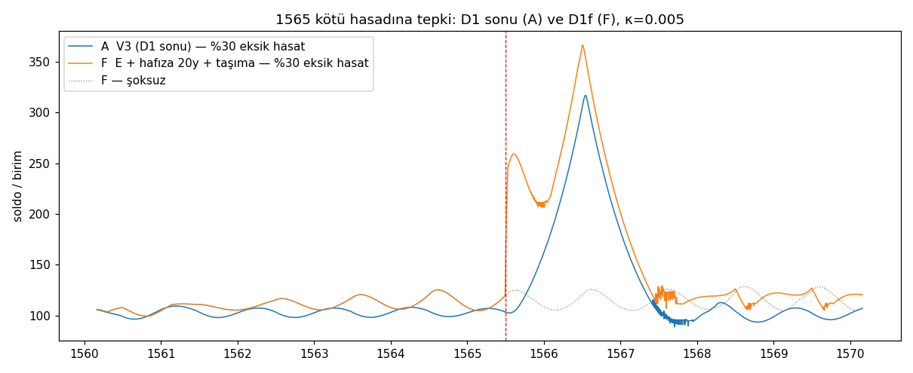
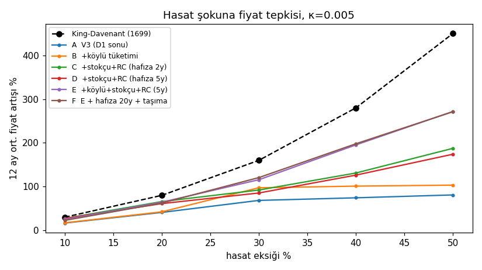
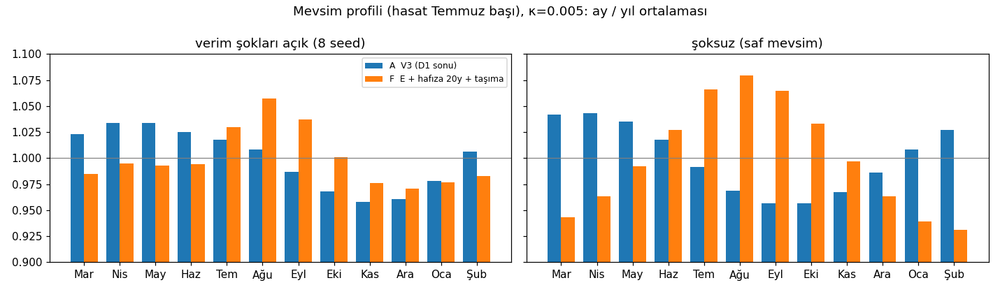

# Deney D1f: Stokçu, Köylünün Kendi Tüketimi ve Yerine Koyma Maliyeti
> Durum: tamamlandı (2026-10-22)
> Kod: [`experiments/d1f_storer.py`](../../experiments/d1f_storer.py); `sim/model.py` (`Storer`, `RuralSupply.self_share`), `sim/engine.py` (ön ayarlar `SELF`, `STORER`, `RC`)
> Yeniden üretmek: `python3 experiments/d1f_storer.py` (~3,5 dk)
> Önceki: [D1](D1.md)

## Özet

D1'in iki açık sorununa yönelik iki hipotez test edildi:

| Hipotez | Sonuç |
|---|---|
| **H1:** Stokçu varken kötü hasata tepki anında gelir | ✅ **Doğrulandı**, ama tek başına değil: dükkâncının **yerine koyma maliyetine** bakması da gerekti. %30 eksik hasattan 1 ay sonra fiyat normalin 1,02 katından **2,07 katına** çıktı. |
| **H2:** Köylünün kendi tüketimi King-Davenant eğrisini tarihsel tabloya yaklaştırır | ✅ **Doğrulandı.** κ=0,01'de simülasyon [22, 63, 152, 218, 415]%, King-Davenant [30, 80, 160, 280, 450]%. |

**Yeni sorunlar:** (1) Stokçunun "normal fiyat" hafızası kıtlıkla kirlenip fiyatlara yapay bir taban oluşturuyor. (2) Hızlı yukarı, yavaş aşağı fiyat ayarı ("roket ve tüy") mevsim desenini ters çeviriyor.

## Eklenen mekanizmalar

| Mekanizma | Ne yapar | Kaynak |
|---|---|---|
| **Köylünün kendi tüketimi** | Normal hasadın %40'ını köylü kendine ayırır; kötü hasatta bunu en fazla %20 kısar. Pazara gelen miktar hasattan orantısız düşer: %30 eksik hasat → pazara %37 az mal. | Kullanıcı ("köylü yemek zorunda"), framework A8 |
| **Stokçu** (2 ajan) | Hasat haberinden sezonun "adil" toptan fiyatını tahmin eder (pazara gelecek miktar ve esneklik üzerinden). Köylüden bunun altında alır, dükkâncılara üstünde satar. Temelci: o günkü fiyatı kovalamaz. | D1 B5, Deaton-Laroque |
| **Yerine koyma maliyeti (RC)** | Stoğu azalan dükkâncı, toptan pazarda kendi teklifinin üstünde işlem görürse fiyatını günde %10 hızla o seviyeye yaklaştırır. | Bu deneyde keşfedildi (aşağıda) |
| **Tutma maliyeti** (F) | Stokçunun beklentisi sezon içinde yıllık %10 tutma maliyeti kadar yükselir. | 01 §4 |

## Yolculuk

1. **Sadece stokçu → hiçbir şey değişmedi**, stokçunun nakdi sıfırlandı. Teşhis: stokçu perakende fiyatı izliyordu ama toptan alıp satıyordu. ~%10'luk fark yüzünden normal yıllarda da her şeyi aldı ve satamadı. → Toptan fiyatı izleyecek şekilde düzeltildi.
2. **Toptan düzeltmesi → stokçu doğru davranıyor ama fiyat yine geç tepki veriyor.** Stokçu kötü hasat haberinde köylüden 2 katı fiyata aldı, dükkânların stoğu boşaldı. Ama dükkâncılar κ sınırı yüzünden günde en fazla ~%0,35 fiyat artırabiliyordu. **Toptan pazarda tahıl 175'ten el değiştirirken dükkâncı hâlâ 96'dan almaya çalışıyordu.** Gerçek bir dükkâncı "bu malı yeniden kaça alırım?" diye bakar. → Yerine koyma maliyeti eklendi.
3. **"Stokçu batıyor" yanılgısı.** Sonuç tablosunda stokçunun nakdi 0 görünüyordu, ama aslında parasını mala bağlamıştı. Kıtlık yılında %19 kâr etmişti. → **Ders: Ajan başarısı nakitle değil net servetle ölçülmeli.**
4. **Kirlenen hafıza.** Kıtlık sonrası 2 yıl fiyatlar %18-25 yüksek kaldı. Ablasyon sorumluyu buldu: Stokçunun "normal" hafızası kıtlık fiyatlarıyla yükseldi, stokçu bu yeni "normal"in altındaki her fiyattan alıp **taban oluşturdu**. Hafıza 2 yıl → 5 yıl: etki aynı. 20 yıl: 1,24 → 1,03. → **Ders: Temelci çapanın kendisi de kirlenebilir.**

## Sonuçlar (20 seed medyanı; şok testleri verim gürültüsü kapalı)

**κ = 0,005**

| Varyant | Aylık oyn. | Kıtlık % | Şok: 1. ay | 2. ay | 6. ay | 11. ay | +2 yıl | KD (10/20/30/40/50%) | Ucuz / pahalı ay | Stokçu getirisi/yıl |
|---|---|---|---|---|---|---|---|---|---|---|
| A: V3 (D1 sonu) | 0.22 | 5.2 | **1.02** | 1.09 | 1.56 | 2.53 | 0.98 | 17/41/68/74/81 | Kas / Nis | — |
| B: +köylü tüketimi | 0.23 | 6.0 | 1.03 | 1.12 | 1.90 | 3.11 | 0.83 | 17/42/97/101/103 | Ara / May | — |
| C: +stokçu+RC (hafıza 2y) | 0.25 | 6.4 | 2.05 | 1.99 | 1.68 | 2.48 | **1.24** | 27/66/92/131/187 | Oca / Ağu | %2.4 |
| D: +stokçu+RC (5y) | 0.27 | 6.1 | 1.68 | 1.60 | 1.63 | 2.59 | **1.25** | 27/61/85/126/174 | Oca / Ağu | %2.6 |
| E: +köylü+stokçu+RC (5y) | 0.29 | 6.8 | 2.17 | 2.07 | 1.88 | 2.72 | 1.18 | 25/64/116/195/272 | Oca / Ağu | %1.5 |
| **F: E + hafıza 20y + taşıma** | 0.28 | 6.4 | **2.07** | 2.04 | 1.94 | 2.87 | **1.03** | 23/62/121/198/271 | Ara / **Ağu** | %1.4 |

**κ = 0,01**

| Varyant | Aylık oyn. | Şok 1. ay | 11. ay | +2 yıl | KD | Ucuz / pahalı |
|---|---|---|---|---|---|---|
| A | 0.38 | 1.04 | 3.08 | 1.01 | 18/46/91/143/236 | Eki / Şub |
| **F** | 0.39 | **2.07** | 4.11 | 1.04 | **22/63/152/218/415** | Kas / Tem |

King-Davenant (1699): 30/80/160/280/450. Patlama: tüm varyantlarda 0/20. Determinizm: ✅. Muhasebe: ✅ (her gün).

## Bulgular

### B1. Ani tepki için üç parça gerekiyor ✅
Kötü hasat haberini fiyata çeviren bir **beklenti** (stokçu), bunu **ucuzken stoklayarak** pazara yansıtan bir eylem (stokçunun alımları) ve bu sinyali perakendeye **aktaran** bir kanal (dükkâncının yerine koyma maliyeti). Herhangi biri eksikse tepki gecikiyor. Bu, bilgi sisteminin (İ5) ekonomiye **nasıl** bağlanacağının ilk somut cevabı: haber → beklenti → stok alımı → fiyat.

### B2. Köylünün kendi tüketimi kıtlığı dışbükey yapıyor ✅
Pazara gelen miktar hasattan orantısız düştüğü için büyük şoklarda fiyat tepkisi King-Davenant'a yaklaşıyor. κ=0,01 F varyantı tarihsel tabloya neredeyse oturuyor. **Tarihsel bir kural, mekanizmadan kendiliğinden çıktı;** formül olarak kodlanmadı.

### B3. Çift zirve: anında sıçrama + hasat öncesi zirve
F'de kötü hasattan sonra fiyat hemen ~2,5 katına çıkıyor, biraz geriliyor, sonra bir sonraki hasattan hemen önce daha yüksek bir zirve yapıyor. Bu, tarih yazınındaki **"soudure"** (hasat öncesi boşluk) olgusuna benziyor: Kıtlık yıllarında en kötü fiyatlar genelde ilkbahar sonunda görülür ⚠️ (Braudel'den doğrulanacak). Simülasyondaki ikinci zirve bu yüzden kısmen gerçekçi olabilir, ama A'dan bile yüksek olması abartılı. Stokçuların sezon sonuna kadar elde tutup taşıma maliyeti yüzünden pahalı satması bunu büyütüyor.

### B4. Temelci çapanın kendisi de kirlenebilir ⚠️
Stokçunun "normal fiyat" hafızası kıtlık yıllarında yükselince stokçu yapay bir taban oluşturuyor ve kıtlık 2 yıl daha "sürüyor". Bu aslında D1'deki beklenti kovalama dersinin (B3) daha sinsi bir hali. Şimdilik 20 yıllık hafıza ile çözüldü. **Tasarım için daha iyi çözüm:** Normal fiyat, yılların **medyanı** gibi aykırı yıllara dayanıklı bir istatistik olmalı. Gerçek tüccarın "olağan fiyat" bilgisi de böyledir.

### B5. "Roket ve tüy" asimetrisi mevsim desenini ters çeviriyor ❌ (açık sorun)
Şoksuz dünyada A'da doğru yönde bir desen var (pahalı Mart-Nisan, ucuz Eylül-Ekim; yalnızca ~2 ay kaymış). F'de ise desen **ters**: en pahalı Ağustos, en ucuz Şubat.

**Neden:** Yerine koyma maliyeti dükkâncıyı yukarı **hızla** çekiyor (günde %10), aşağı yönde ise sadece yavaş stok kuralı çalışıyor (κ). Hasat öncesi fiyat hızla yükseliyor, hasat sonrası yavaş iniyor ve zirve hasat sonrasına kayıyor. Ekonomide buna gerçekten "rockets and feathers" deniyor (akaryakıt fiyatları), ama burada **modelin bir asimetrisi** ve tarihsel olarak yanlış.

**Aday çözümler** (sonraki adım):
- Simetrik bir aşağı sinyal: Hasat sonrası köylüler dükkâncıların alabileceğinden fazlasını satmak istiyorsa (fazla arz), dükkâncı fiyatını hızla düşürür.
- Köylüleri pasif fiyat alıcı olmaktan çıkarıp **satış fiyatı teklif eden** satıcılar yapmak: Bolluğu ucuz teklifle kendileri duyurur.
- Rekabet: Ucuz maliyetli dükkâncının fiyat kırması (cost-plus tabanının alt sınırı).

### B6. Stokçu mütevazı bir iş ✅
Net servet getirisi yılda %1,4-2,6. Kıtlık yıllarında kazanıyor, bazı yıllarda kaybediyor. **Bu iyi bir işaret:** Stokçuluk "bedava para" değil ve oyuncu için de bir istismar olmayacak gibi görünüyor (06 §6). Kesin sonuç için oyuncu botuyla test edilmeli.

### B7. Tekrarlayan tema: hızlı ve yavaş kanalların asimetrisi
D1 v0'daki mandal, beklenti kovalama, kirlenen hafıza ve roket ile tüy. **Hepsi aynı ailenin üyesi:** Bir yönde hızlı, öteki yönde yavaş çalışan bir mekanizma, fiyatı zamanla bir yöne kaydırıyor. **Tasarım ilkesi önerisi:** Her fiyat kanalı simetrik olmalı ya da asimetrisi bilinçli ve tarihsel gerekçeli olmalı.

## Tasarıma etkileri

| # | Değişiklik | Nereye |
|---|---|---|
| 1 | Köylü önce kendini doyurur (kendi tüketimi + tohumluk) | spec §6.2 |
| 2 | **Stokçu / spekülatör rolü** (temelci, toptan fiyatı izler, hasat haberine tepki verir) | spec §2.5, framework Y3 |
| 3 | Dükkâncının **yerine koyma maliyeti** sinyali, ama simetrik olacak şekilde yeniden tasarlanmalı (B5) | spec §6.3 |
| 4 | "Normal fiyat" hafızası aykırı yıllara dayanıklı olmalı (medyan) | spec §6.5, information-model |
| 5 | Ajan başarısı **net servetle** ölçülür | spec §7 |
| 6 | **Simetri ilkesi:** Hızlı ve yavaş kanalların asimetrisi bilinçli olmalı | framework (yeni ilke adayı) |

## Sonraki adım önerisi

**D1g (küçük):** Fiyat ayarının simetrik hale getirilmesi (B5). Hedef: Şoksuz dünyada doğru mevsim deseni (ucuz Ağustos-Eylül, pahalı Mayıs-Haziran) ve şokta anında tepkinin korunması. Başarı ölçütü A'nın mevsim yönü + F'nin şok tepkisi.

Ardından **D2** (iki liman, gezgin tüccarlar). Tek limanlı model D1g ile yeterince olgunlaşmış olacak.
