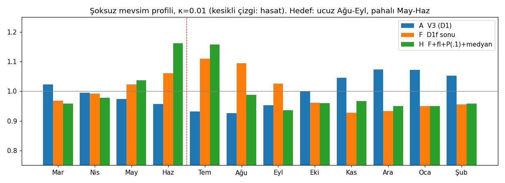
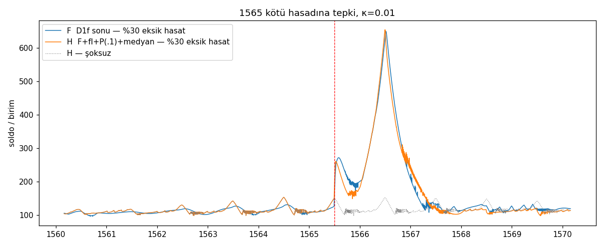
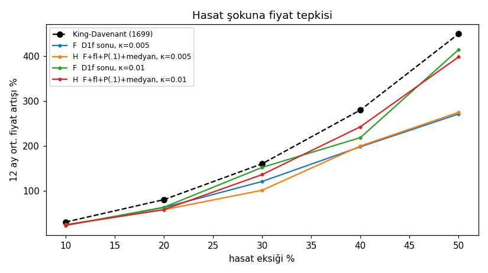

# Deney D1g: Mevsim Desenini Düzeltmek
> Durum: tamamlandı (2026-10-22). **D1 serisini kapatır.**
> Kod: [`experiments/d1g_symmetry.py`](../../experiments/d1g_symmetry.py); ön ayar `H` (`sim/engine.py`)
> Yeniden üretmek: `python3 experiments/d1g_symmetry.py` (~4,5 dk)
> Önceki: [D1](D1.md) → [D1f](D1f.md)

## Özet

**Hedef:** D1f'nin sonunda (F) şoksuz dünyada mevsim deseni tersti: en pahalı ay Ağustos, en ucuz ay Şubat. Tarihsel desen ise hasat sonrası ucuz, hasat öncesi pahalı. Kötü hasata anında tepki korunmalıydı.

**Sonuç: Büyük ölçüde başarıldı.** Önerilen sürüm **H** (κ=0,01):
- Şoksuz dünyada en ucuz ay **Eylül**, en pahalı ay **Haziran**. Kalan gecikme ~1 ay.
- Kötü hasattan 1 ay sonra fiyat **1,83×** (anında tepki korunuyor).
- King-Davenant uyumu: simülasyon **24/58/136/243/398%**, King-Davenant **30/80/160/280/450%**.
- Kıtlık sonrası kalıcı etki yok (+2 yıl: 0,94). Patlama yok (0/20). Determinizm ✅.

**Ama başlangıçtaki hipotezim yanlıştı.** Sorunun kaynağı "roket ve tüy" değildi. Asıl nedenler başkaydı ve bulmak için üç tur teşhis gerekti.

## Teşhis yolculuğu

### Tur 1: Fazla arz sinyali → hiç tetiklenmedi
Hipotez: Yerine koyma maliyeti fiyatı yukarı hızla çekiyor, aşağı çeken bir sinyal yok. Simetrik karşılığı eklendi: köylü satamadığı mal varsa dükkâncılar fiyatı hızla düşürür.
Sonuç: Şoksuz dünyada **sinyal hiç tetiklenmedi**, profil birebir aynı kaldı. Gün gün izlemede şoksuz dünyada **stokçunun da hiç devrede olmadığı** görüldü (stok hep 0). Yani sorun ne stokçu ne de RC asimetrisiydi.

### Tur 2: Asıl neden kontrol teorisinden: integral gecikmesi
Gün gün izleme şunu gösterdi:
- Hasattan önce köylü günde ~500 birim satıyor, kent ~540 tüketiyor. Stok yavaşça eriyor.
- Hasattan sonra köylü ~610 satıyor, stok yeniden doluyor.
- Dükkâncının kuralı stok azsa fiyatı **her gün biraz daha** yükseltmek. Yani fiyatın *seviyesi* değil, *değişim hızı* kıtlığa bağlı. **Fiyat, kıtlığın integralini izliyor.**
- Mevsimsel bir dalga integralden geçince **çeyrek dalga (~3 ay) gecikir.** Fiyat stoğun en düşük olduğu anda (hasat öncesi) değil, stok dolmaya başlayana kadar yükselmeye devam eder.

Gerçek piyasada fiyatın **seviyesi** kıtlığa bağlıdır (depolama teorisi: fiyat = f(mevcut stok)).
→ **Çözüm: PI kontrolcüsü.** Mevcut yavaş integral bileşeni uzun dönem seviyeyi bulmaya devam ediyor; ona bugünkü kıtlığa anında tepki veren bir **oransal bileşen** eklendi. Araştırmada (01 §8) Kumar & Shubik'in Walras sürecini PID'ye genellediği not edilmişti; burada pratikte karşılık buldu.

Ama oransal bileşen tek başına yetmedi. Dükkâncının kıtlık ölçüsü **kendi stoğuydu** ve dükkâncı köylüden sürekli alarak onu hedefte tuttuğu için mevsimsel kıtlığı göremiyordu. Mevsimsel stok köylünün elindeydi.

### Tur 3: Eksik tarihsel mekanizma: köylünün hasat sonrası nakit ihtiyacı
Köylü satışlarını yıl boyunca eşit yayıyordu. Tarihsel olarak vergi, kira ve borç vadeleri hasada denk gelirdi; köylü hasattan hemen sonra satmak zorundaydı. Hasat sonrası pazara bol mal gelir, fiyat düşer; stoku taşıyan tüccar da tutma maliyetini karşılayacak bir fiyat artışı ister.
→ Köylünün satış hızı sezon başında %30 fazla, sonunda %30 az yapıldı.

### Tur 4: Stokçular mevsimsel arbitraj yapmıyordu → medyan hafıza
Mevsimsel salınım çok büyüktü (her normal yılda hasat öncesi %50-75 sıçrama). Normalde stokçular bunu törpüler, ama yapmıyorlardı. **Sermayelerini iki katına çıkarmak hiçbir şeyi değiştirmedi:** Sorun para değil, fiyat eşikleriydi. D1f'deki geçici çözüm (20 yıllık hafıza) stokçuyu başlangıç tahminine kilitlemişti; gerçek fiyat seviyesini öğrenemiyordu.
→ D1f'de önerilen kalıcı çözüm uygulandı: **"normal fiyat" = son 7 sezon ortalamasının medyanı.** Tek bir kıtlık yılı medyanı kirletemez, ama birkaç normal yıl gerçek seviyeyi öğretir. Sonuç: Stokçular normal yıllarda da alıp satıyor, salınım 1,50 → 1,24'e indi.

## Ablasyon sonuçları (20 seed; şok testleri verim gürültüsü kapalı)

**κ = 0,01**

| Varyant | Patl. | Aylık oyn. | Dağınıklık | Şoksuz ucuz / pahalı | Mevsim genliği | Şok 1. ay | 11. ay | +2 yıl | KD % | Stokçu getirisi |
|---|---|---|---|---|---|---|---|---|---|---|
| A: V3 (D1) | 0/20 | 0.38 | 0.091 | Ağu / Ara | 1.16 | 1.04 | 3.08 | 1.01 | 18/46/91/143/236 | — |
| F: D1f sonu | 0/20 | 0.39 | 0.034 | Kas / Tem | 1.20 | 2.07 | 4.11 | 1.04 | 22/63/152/218/415 | %1,5 |
| F + köylü nakit ihtiyacı (fl) | 0/20 | 0.38 | 0.036 | Oca / Tem | 1.36 | 1.86 | 3.60 | 0.98 | 22/59/134/236/395 | %1,6 |
| F + fl + oransal (P=0,2) | 0/20 | 0.38 | 0.057 | **Eyl / Haz** | 1.57 | 1.68 | 3.67 | 1.07 | 21/55/141/245/471 | %0,7 |
| F + fl + fazla arz | 0/20 | **0.52** | 0.068 | Eyl / Tem | 1.37 | 1.84 | 3.62 | 1.06 | 22/57/131/242/387 | %0,7 |
| G: F + fl + fazla arz + P | 0/20 | 0.50 | 0.088 | Şub / Haz | 1.56 | 1.78 | 3.63 | 1.10 | 22/55/144/244/464 | %0,5 |
| **H: F + fl + P(0,1) + medyan** | 0/20 | 0.40 | 0.042 | **Eyl / Haz** | **1.24** | **1.83** | 3.91 | **0.94** | **24/58/136/243/398** | %1,6 |

King-Davenant: 30/80/160/280/450%. κ=0,005 sonuçları `summary.json`'da; H orada da Eki/Tem, genlik 1,21.

## Bulgular

### B1. Fiyat seviyesi kıtlığa, değişim hızı uzun dönem dengeye bağlı olmalı (PI) ✅
Tek limanlı modelin en önemli mimari dersi. Sadece integral (κ) gecikme yaratıyor, sadece oransal ise kalıcı dengeyi bulamıyor. **Oransal kazanç dikkatli seçilmeli:** P=0,5'te sistem 12 seed'in 5'inde patladı, P=1'de hepsinde. Güvenli aralık **0,1-0,2**.

### B2. Mevsim deseninin kaynağı fiyat kuralı değil, insan davranışı
Doğru deseni "köylünün hasattan sonra nakde ihtiyacı var" ve "stokçu tutma maliyetini karşılamak ister" mekanizmaları üretti. **Tarihsel ekonomik davranış eklemek, fiyat formülünü ayarlamaktan daha etkili oldu.** Bu, "her şeyi gerçekten simüle et" yaklaşımının lehine bir kanıt.

### B3. Fazla arz sinyali reddedildi ❌
Faydası çok az, oynaklığı ve dükkâncılar arası titremeyi belirgin şekilde artırıyor (aylık oynaklık 0,38 → 0,52). Kod kaldı ama varsayılan olarak kapalı.

### B4. Medyan hafıza: kirlenmeye dayanıklı ve öğrenebilir ✅
D1f'deki iki uç da başarısızdı: kısa hafıza kirleniyordu, uzun hafıza öğrenemiyordu. **Yılların medyanı ikisini birden çözüyor.** Bu ilke bilgi modeline de taşınmalı: ajanların "olağan fiyat" bilgisi aykırı yıllara dayanıklı olmalı.

### B5. Teşhis yöntemi: hipotez → ölçüm → gün gün iz → ablasyon
Bu deneyde iki hipotezim yanlış çıktı (roket ve tüy; sermaye eksikliği). İkisini de gün gün izleme ve tek değişkenli testler çürüttü. **Toplu metrikler neyin yanlış olduğunu, ama nedenini söylemiyor.** Sonraki deneylerde ajan bazında iz kaydı baştan planlanmalı (06 §7 okunabilirlik ilkesi).

### B6. Açık sorunlar
1. **Hasat öncesi kıtlık zirvesi aşırı:** %30 eksik hasatta zirve normalin ~6 katı (κ=0,01), 12 aylık ortalama ise makul (+136%). Tarihsel ağır kıtlıklarda en yüksek fiyatlar normalin 3-5 katı civarındaydı ⚠️ (doğrulanmalı). Olası nedenler: stokçu sermayesinin küçüklüğü, kentin karşılanmayan talebinin birikmesi, köylünün kendine ayırdığı payın katılığı. Kalibrasyon konusu.
2. **Dükkâncılar arası titreme:** Bazı dönemlerde (özellikle kıtlık sonrası) günlük titreme var. Maliyet tabanı ile kıtlık çarpanı çatışıyor gibi. Görselde rahatsız edici, metriklerde küçük.
3. **Kalan ~1 aylık gecikme:** Zirve Haziran-Temmuz, tarihsel beklenti Mayıs-Haziran.
4. **Mevsim genliği ve oynaklık tarihsel veriyle ayarlanmalı:** Erken modern Venedik ve Akdeniz buğday fiyatlarının yıl içi değişimi ⚠️ kullanıcının okumalarından.

## D1 serisi: tek limanlı modelin son hali

**Önerilen ayar:** `H` ön ayarı, κ = 0,01 (`sim/engine.py`).

| Bileşen | Kural | Nereden geldi |
|---|---|---|
| Kent | Esnek talep (−0,4) + bütçe kısıtı + karşılanmayan ihtiyacın kısmen birikmesi | D1 |
| Köylü | Önce kendini doyurur (%40, kıtlıkta en fazla %20 kısar); hasat sonrası satışlar yoğun | D1f, D1g |
| Dükkâncı | Sabit marj; **PI fiyat kuralı:** integral = stok/talep oranı (κ), oransal = bugünkü kıtlık (P=0,1); yerine koyma maliyeti (yukarı); kâr çekimi | D1, D1f, D1g |
| Stokçu | Temelci; normal fiyat = 7 sezonun medyanı; hasat haberi → adil fiyat; tutma maliyeti %10; %4 pay | D1f, D1g |

**Tekrar eden ders (D1-D1g'nin tamamı):** Her deneyde sorun bir **asimetri** ya da **gecikme** çıktı: mandal, beklenti kovalama, likidite sarmalı, kirlenen hafıza, integral gecikmesi. Bunların hepsi geri besleme döngülerinin yapısıyla ilgili, katsayılarla değil. Çok limanlı sistemde haber gecikmeleri bu yapıları çoğaltacak. **D2'de her yeni geri besleme döngüsü için aynı teşhis disiplini gerekecek.**

## Sonraki adım

**D2: İki liman, tek mal, gezgin tüccarlar.** İskenderiye (üretici) → İstanbul (tüketici). Her limanda bu deneydeki H modeli çalışır, aralarında gemiyle taşıyan tüccarlar olur. Önce anlık bilgiyle (fiyat farkı taşıma maliyetine yakınsıyor mu?), sonra gecikmeli bilgiyle.
