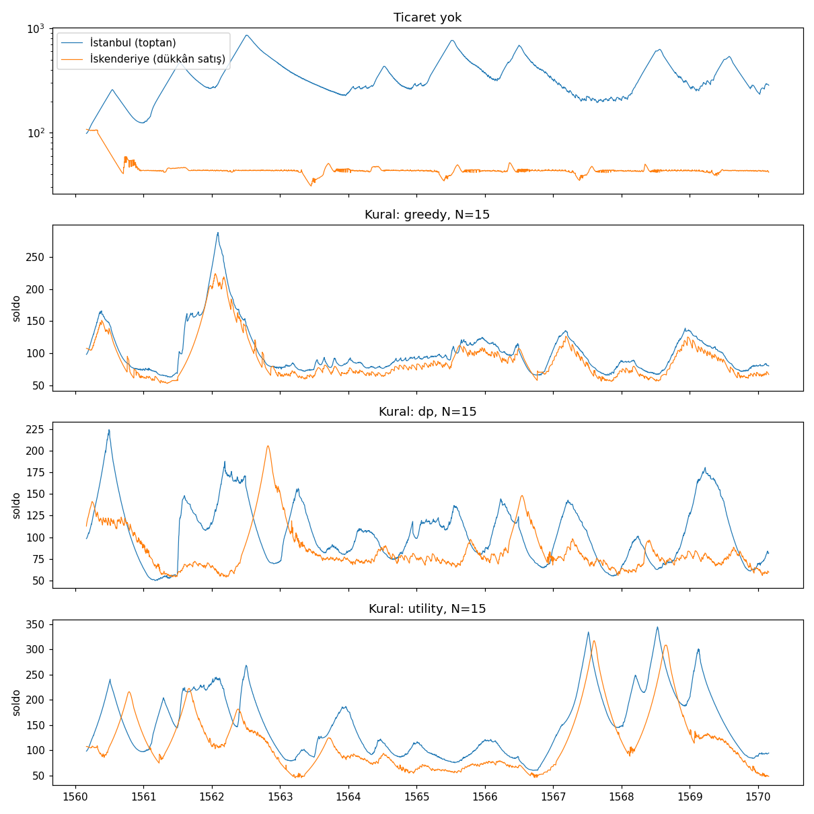
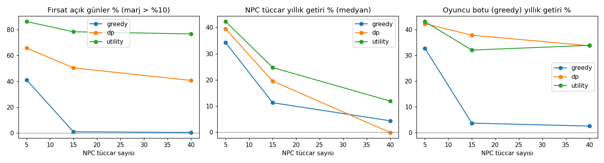
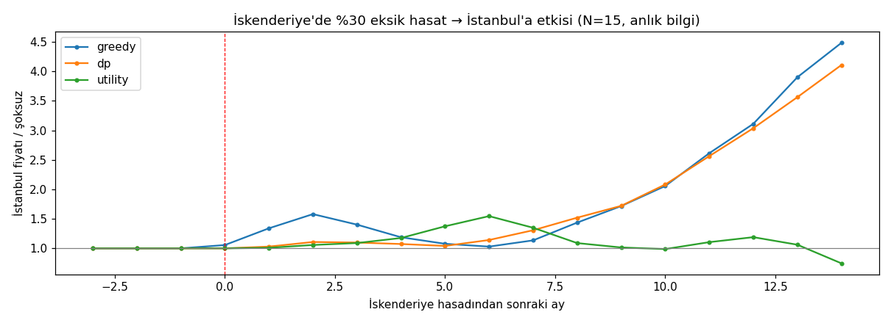

# Deney D2: İki Liman, Gezgin Tüccarlar (Anlık Bilgi)
> Durum: tamamlandı (2026-10-23)
> Kod: [`sim/world.py`](../../sim/world.py), [`experiments/d2_two_ports.py`](../../experiments/d2_two_ports.py)
> Yeniden üretmek: `python3 experiments/d2_two_ports.py` (~3 dk)
> Yöntem: [deney stratejisi](README.md). Yarışan yuva: **tüccar karar kuralı.** Parametreler varsayılan, ince ayar yok.

## Özet

| Soru | Cevap |
|---|---|
| **S1:** Taşıma fiyat farkını taşıma maliyetine yaklaştırıyor mu? | ✅ **Evet.** Açgözlü tüccarlarla (N≥15) fiyat farkı taşıma maliyetinin **1,06 katı**. Tek fiyat yasası mekanizmadan kendiliğinden çıkıyor. |
| **S2:** Fırsatlar yaşıyor mu? | ❌ **Anlık bilgi ve verimli NPC'lerle hayır.** Açgözlü kural ve N≥15'te fırsat açık günlerin oranı **%0,5-1**, oyuncu botunun getirisi yılda **%2,5-3,6**. **Bannerlord sorunu birebir üretildi.** |
| **S3:** Kurallar nasıl farklı? | Kural seçimi aslında **fırsat rejimi** seçimi. Açgözlü kural fırsat bırakmıyor. DP ve fayda tabanlı kurallar fırsat bırakıyor ama **verimsizlikleri sayesinde**, ve oyuncu yılda %32-43 kazanıyor (fazla kolay). |

**Ana sonuç:** Fırsatlar "aptal NPC'lerden" değil, **sürtünmelerden** gelmeli: bilgi gecikmesi, sermaye ve kapasite kısıtı, risk çeşitliliği. Anlık bilgiyle verimli NPC'ler fırsatları yok ediyor; D3'ün (bilgi gecikmesi) neden oyunun kalbi olduğunu bu deney ölçülebilir şekilde gösteriyor.

## Kurulum

| Öğe | Değer (yer tutucu ⚠️) |
|---|---|
| İskenderiye (ALE) | 50.000 kişi; ihtiyacının 2,1 katını üretir; hasat Mayıs |
| İstanbul (IST) | 100.000 kişi; ihtiyacının yarısını üretir; hasat Temmuz |
| Her liman | D1 serisinin son modeli (ön ayar H, κ=0,01): dükkâncılar, stokçular, köylüler, kent |
| Taşıma | Yazın ~14 gün, kışın ~21 gün; navlun 8 soldo/birim (~%8); İstanbul gümrüğü %3; sefer başına kayıp yazın %1,5, kışın %5 |
| Tüccar | Kapasite 2000 birim, sermaye ~240.000 soldo. İskenderiye dükkânlarından alır (dükkâncı stoğunun yarısını yerel müşteriye ayırır), İstanbul dükkânlarına satar, boş döner. İflas edenin yerine yeni tüccar girer. |
| Oyuncu botu | Her senaryoda NPC'lerle aynı kısıtlarda, **açgözlü** kuralla oynayan bir tüccar daha |
| Bilgi | **Anlık ve küresel:** herkes iki limanın bugünkü fiyatını biliyor |
| Tekrar | Her kural × N ∈ {5, 15, 40} × 10 seed |

### Yarışan kurallar

| Kural | Varış fiyatı beklentisi | Karar |
|---|---|---|
| **greedy** (açgözlü) | İstanbul'un bugünkü fiyatı | Maliyetler sonrası %5 marj varsa al |
| **dp** (Doran-Parberry) | Kendi satışlarından öğrenilen inanç aralığından rastgele bir değer | Aynı |
| **utility** (fayda tabanlı) | Bugünkü fiyat, **yoldaki rakip kargo ve kendi kargosu** kadar düşürülür | Kişiliğe göre risk iştahı ve yıllık %10-40 sermaye getirisi beklentisi; yüklemeye başladıysa atalet |

## Sonuçlar (10 seed medyanı)

| Senaryo | İst. kıtlık % | İst. fiyat | İsk. fiyat | Fark / taşıma maliyeti | Fırsat açık gün % | Ort. fırsat süresi (gün) | Varış düzensizliği (CV) | NPC getiri %/yıl | **Oyuncu botu %/yıl** | İflas/yıl |
|---|---|---|---|---|---|---|---|---|---|---|
| Ticaret yok | **55** | 432 | 44 | 12,7 | 100 | — | — | — | — | — |
| greedy N=5 | 7,8 | 132 | 107 | 1,40 | 41 | 42 | 0,56 | 34 | 33 | 0 |
| **greedy N=15** | **6,3** | 123 | 112 | **1,07** | **1,0** | 4 | 0,64 | 11 | **3,6** | 0,2 |
| greedy N=40 | 6,6 | 124 | 115 | 1,06 | 0,5 | 2,5 | 0,73 | 4 | 2,5 | 0,7 |
| dp N=5 | 9,6 | 143 | 95 | 2,55 | 66 | 68 | 0,53 | 39 | 42 | 0 |
| dp N=15 | 8,6 | 135 | 101 | 1,60 | 50 | 56 | 0,57 | 20 | 38 | 0,1 |
| dp N=40 | 8,2 | 131 | 108 | 1,09 | 41 | 57 | 0,55 | **0** | 34 | 0,7 |
| utility N=5 | 11,0 | 150 | 98 | 3,10 | 86 | 84 | 0,68 | 42 | 43 | 0 |
| utility N=15 | **16,1** | 180 | 131 | 2,44 | 78 | 37 | **1,00** | 25 | 32 | 0 |
| utility N=40 | 13,3 | 166 | 121 | 2,23 | 77 | 49 | 0,94 | 12 | 34 | 0,2 |

"Fırsat açık" = tüm maliyetler (navlun, gümrük, beklenen kayıp) sonrası beklenen marj > %10. Patlama: 0/10 (hepsi). Determinizm ✅. Muhasebe dünya düzeyinde her gün ✅.

## Bulgular

### B1. Tek fiyat yasası kendiliğinden ortaya çıkıyor ✅
Açgözlü tüccarlar ve yeterli kapasiteyle iki limanın fiyatları birlikte hareket ediyor ve aradaki fark taşıma maliyetine oturuyor (1,06-1,07×). Ticaret yokken İstanbul'da %55 kıtlık ve 10 kat fiyat farkı var. **Mekânsal arbitraj mekanizması doğru çalışıyor.**

### B2. Bannerlord sorunu ölçülebilir şekilde üretildi ⚠️
Anlık bilgi ve verimli NPC'lerde fırsatlar neredeyse hiç açılmıyor (günlerin %0,5-1'i, ortalama 2-4 gün). Oyuncu botu yılda %2,5-3,6 kazanıyor; bu, senede yatırmaktan farksız. **K-004 ("NPC'ler oyuncuyla aynı kurallara tabi") ile anlık bilgi bir araya gelince oyun ölüyor.** Araştırmada (04 §8) öngörülen risk artık bir ölçümle doğrulandı.

### B3. DP ve fayda tabanlı kurallar fırsat bırakıyor, ama yanlış nedenle
- **DP:** Tüccarlar varış fiyatını yalnızca kendi satışlarından, yavaş ve gürültülü öğreniyor. N=40'ta NPC'ler **%0 kazanırken** aynı dünyada açgözlü oyuncu botu **%34** kazanıyor. İki limanın fiyatları sık sık ters fazda salınıyor (grafik): arbitraj bağı zayıf.
- **Fayda tabanlı:** Rakip kargoyu hesaba katmak iyi bir fikir, ama yüksek getiri beklentisi (%10-40) ve risk kaçınması tüccarları **fazla temkinli** yapıyor. İstanbul'da kıtlık %13-16'ya çıkıyor, varışlar düzensiz (CV ≈ 1), oyuncu %32-34 kazanıyor.
- **İkisi de "aptal NPC" yoluyla fırsat yaratıyor.** Oyuncu bu NPC'lerin hatalarını sömürüyor. Bu ne gerçekçi ne de istediğimiz oyun hissi.

### B4. Kapasite de bir sürtünme
Açgözlü kuralla N=5'te fırsat günlerin %41'inde açık, N=15'te %1. Tüccar sayısı ve sermayesi (toplam taşıma kapasitesi) fırsat rejimini yapısal olarak belirliyor. Oyunda bu, "piyasada kaç rakip var?" sorusunun ekonomik karşılığı.

### B5. Kıtlık yayılımı: önce hızlı, sonra gecikmeli ve büyük
İskenderiye'de %30 eksik hasat, açgözlü dünyada İstanbul fiyatını 2 ayda %58 artırıyor (anlık bilgi sayesinde hızlı). Ardından 8-14. aylarda İstanbul fiyatı şoksuz dünyanın **3-4,5 katına** çıkıyor. Hipotez: tüccarlar fiyat farkı oldukça İskenderiye'den ihracata devam ediyor, İskenderiye'nin stokları erken tükeniyor, hasat öncesi iki liman birlikte kıtlığa giriyor. Bu tarihsel olarak gerçek bir dinamik: **Osmanlı'nın kıtlıkta tahıl ihracatını yasaklaması** (1594) tam olarak buna bir tepkiydi. Kurumların düzey 1 tepkisel kurallarının (framework A4) ilk somut gerekçesi. ⚠️ Büyüklük, D1g'deki aşırı hasat öncesi zirve sorunundan etkileniyor olabilir.

### B6. Kural seçimi = fırsat rejimi seçimi
Üç kural üç farklı ekonomi üretiyor:

| Rejim | Kural | Oyun hissi |
|---|---|---|
| Verimli piyasa | greedy, N≥15 | Fırsat yok, oyun ölü |
| Gürültülü piyasa | dp | Fırsat bol ama NPC'ler aptal görünüyor |
| Temkinli piyasa | utility | Fırsat bol, şehirler aç kalıyor |

**İstenen rejim:** NPC'ler yerel olarak yetkin olsun (aptalca hata yapmasın, açgözlüye yakın), ama **sürtünmeler** (bilgi gecikmesi, sermaye, kapasite, risk çeşitliliği) fırsatları ılımlı düzeyde açık tutsun.

## Tasarıma etkileri

| # | Etki | Nereye |
|---|---|---|
| 1 | Tüccar kuralı için **açgözlü çekirdek + rakip kargo farkındalığı** (fayda tabanlının iyi fikri), ama yüksek getiri beklentisi olmadan | spec §6.5 |
| 2 | **Fırsatlar sürtünmeden gelir, NPC aptallığından değil.** İlke adayı. | framework |
| 3 | Kıtlıkta **ihracat yasağı** gibi tepkisel kurumsal kurallar ilk sürüme girmeli (B5) | framework A4 |
| 4 | Oyun için "doğru fırsat rejimi" tanımlanmalı: tasarım kararı (aşağıda) | open-questions |
| 5 | Ölçüt seti: fırsat açık gün %, fırsat süresi, oyuncu botu getirisi, NPC getirisi, şehir kıtlığı. Bu metrikler bundan sonra her deneyde ölçülecek. | 06, README |

## Kullanıcıya açık soru: hedef fırsat rejimi

Simülasyonu ayarlamadan önce **oyun tasarımı** olarak şunu belirlememiz gerekiyor: Yetenekli bir oyuncu yılda ne kadar kazanabilmeli? Fırsatlar günlerin ne kadarında açık olmalı?

Kaba bir başlangıç önerisi (⚠️ tartışmalık):
- Fırsat açık günler %10-30
- Yetenekli oyuncu yılda %15-30 (riskli seferlerle daha fazlası, ama kayıpla)
- NPC tüccar medyanı %5-15
- Senet getirisi (Y10) bunun belirgin altında, %3-5

Tarihsel karşılaştırma için Venedikli tüccarların sermaye getirileri bir veri noktası olur ⚠️ (Lane'de olabilir).

## Sonraki adım: D3

**Soru:** Bilgi gecikmesi, verimli (açgözlü + rakip farkındalıklı) NPC'lerle bile fırsatları canlı tutuyor mu? Herkesin aynı haberle aynı limana koşması (örümcek ağı salınımı) patlıyor mu?
**Yarışan yuva:** Bilgi yayılımı (anlık / gemiyle fiziksel taşıma / söylenti) ve beklenti (son gözlem / yaşla genişleyen inanç).
**Hipotez:** Açgözlü NPC + gerçekçi bilgi gecikmesi = istenen rejim.
