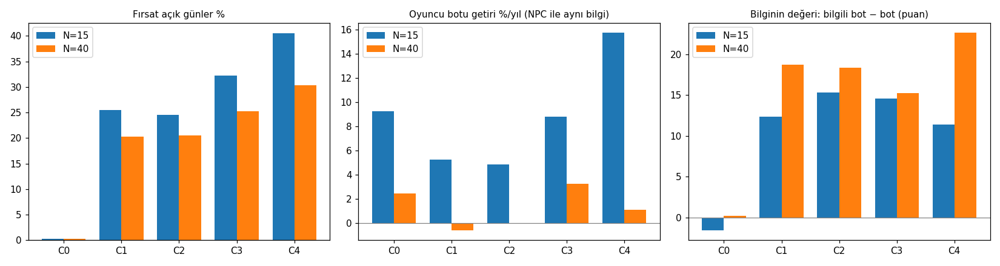
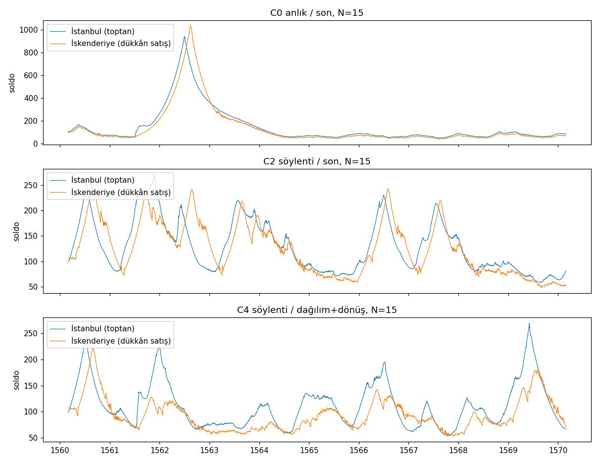
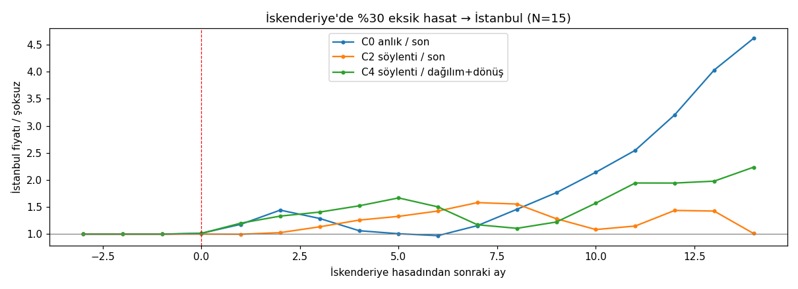

# Deney D3: Bilgi Gecikmesi
> Durum: tamamlandı (2026-10-23)
> Kod: [`sim/world.py`](../../sim/world.py) (bilgi ve beklenti yuvaları), [`experiments/d3_information.py`](../../experiments/d3_information.py)
> Yeniden üretmek: `python3 experiments/d3_information.py` (~4,5 dk)
> Önceki: [D2](D2.md). Yöntem: [deney stratejisi](README.md). Parametreler varsayılan, ince ayar yok.

## Özet

**Hipotez:** Yetkin (açgözlü) NPC'ler, gerçekçi bir bilgi gecikmesiyle birleşince fırsatlar canlı kalır (D2'deki Bannerlord sorunu çözülür).

**Sonuç: ✅ Büyük ölçüde doğrulandı.**

| | Anlık bilgi (D2 / C0) | Bilgi gecikmesi (C1-C4) |
|---|---|---|
| Fırsat açık günler | %0,3 | **%20-40** |
| Ortalama fırsat süresi | ~1 gün | **15-30 gün** |
| Bilginin değeri (bilgili bot − normal bot) | ~0 | **+11 ile +23 puan/yıl** |
| Bilgili oyuncu botu | — | **%18-28/yıl** |

Kullanıcının "doğru ticareti seçen kazansın" ilkesi ilk kez ölçülebilir hale geldi. **Daha iyi bilgiye sahip olan, aynı kurallarla oynayan NPC'lerden yılda 11-23 puan fazla kazanıyor**, ve bu kazanç %50 gibi uç değerlere ulaşmıyor.

**Bedeli:** Eski bilgiyle hareket eden tüccarlar **sürü halinde aynı yöne koşuyor** (örümcek ağı salınımı). İstanbul'da kıtlık artıyor (%7,5 → %9-17), iflaslar artıyor. **"Dağılım + olağana dönüş" beklentisi (C4)** bu bedeli en çok azaltan aday oldu. Kullanıcının olasılık dağılımı fikri ile medyan "olağan fiyat" bilgisinin birleşimi.

## Kurulum

D2 ile aynı dünya: İskenderiye → İstanbul, her limanda H modeli. Tüccar kuralı **açgözlü çekirdek** (D2'nin kontrol kuralı). Değişen yalnızca bilgi ve beklenti:

| Yuva | Aday | Ne yapar |
|---|---|---|
| **Bilgi** | instant | Herkes İstanbul'un bugünkü fiyatını bilir (kontrol) |
| | ship | İstanbul'dan dönen her gemi, kalkış günündeki fiyatı getirir; İskenderiye'deki herkes hemen öğrenir |
| | rumor | Aynı haber, ama her tüccar onu her gün %30 olasılıkla duyar (Daley-Kendall'ın basit hali) |
| **Beklenti** | last | Son gözlem varışta da doğru kabul edilir |
| | dist | Bilgi eskidikçe genişleyen log-normal dağılım ([information-model](../design/information-model.md)); temkinli tüccar dağılımın kötü ucuna bakar |
| | revert | dist + eski bilgi, tüccarın kendi gözlemlerinin medyanına (olağan fiyat) doğru zamanla döner |

**İki oyuncu botu:** biri NPC'lerle aynı bilgide, biri **anlık bilgili** (en iyi haber ağına sahip tüccar). Aradaki fark = bilginin değeri.

## Ön not: rakip farkındalığı başarısız oldu (yan bulgu)

D2'nin önerdiği "yoldaki rakip kargoyu hesaba kat" eki iki sürümde de başarısız oldu:
- **Asimetrik sürüm** (sadece aşağı düzeltme): tüccarlar aşırı temkinli. Anlık bilgide bile fırsatlar günlerin %94'ünde açık kaldı, İstanbul aç kaldı.
- **Simetrik sürüm** ("yolda az mal var → fiyat yükselecek"): **sürü davranışı.** Herkes aynı sinyali aynı anda görüp pahalıya aldı, fiyat farkı eksiye düştü, botlar battı.

D3'ü bilgiye odaklı tutmak için bu ek kapatıldı (λ=0). Rakip davranışını tahmin etmek ayrı ve zor bir soru olarak not edildi.

## Sonuçlar (10 seed medyanı)

| Senaryo | Patl. | İst. kıtlık % | Fark / taşıma maliyeti | Fırsat gün % | Fırsat süresi (gün) | Varış düzensizliği | NPC %/yıl | Bot %/yıl | **Bilgili bot %/yıl** | **Bilginin değeri** | Bilgi yaşı (gün) | İflas/yıl |
|---|---|---|---|---|---|---|---|---|---|---|---|---|
| C0 anlık/son, N15 | 1/10 | 7,6 | 1,06 | **0,3** | 1 | 0,65 | 10,2 | 9,2 | 7,0 | −1,6 | 0 | 0,1 |
| C0 anlık/son, N40 | 0/10 | 7,5 | 1,08 | 0,2 | 1 | 0,68 | 4,1 | 2,4 | 2,8 | 0,2 | 0 | 0,6 |
| C1 gemi/son, N15 | 0/10 | 12,5 | 0,89 | 25 | 20 | 0,92 | 10,7 | 5,2 | 18,7 | 12,3 | 52 | 0,7 |
| C1 gemi/son, N40 | 0/10 | 17,0 | 0,46 | 20 | 18 | 1,14 | 3,8 | −0,6 | 18,1 | 18,7 | 52 | 1,6 |
| C2 söylenti/son, N15 | 0/10 | 10,8 | 0,81 | 25 | 18 | 0,91 | 9,1 | 4,8 | 20,1 | 15,3 | 53 | 0,5 |
| C2 söylenti/son, N40 | 0/10 | 17,1 | 0,42 | 21 | 22 | 1,16 | 1,9 | 0,0 | 21,0 | 18,3 | 55 | 2,2 |
| C3 söylenti/dağılım, N15 | 0/10 | 12,9 | 1,20 | 32 | 15 | 0,87 | 12,6 | 8,8 | 24,8 | 14,6 | 56 | 0,2 |
| C3 söylenti/dağılım, N40 | 0/10 | 14,1 | 0,86 | 25 | 15 | 0,96 | 4,2 | 3,2 | 20,1 | 15,2 | 49 | 1,8 |
| **C4 söylenti/dağılım+dönüş, N15** | 0/10 | **9,0** | 1,31 | **41** | **30** | **0,73** | **15,9** | **15,7** | 28,4 | 11,4 | 39 | **0,1** |
| **C4 söylenti/dağılım+dönüş, N40** | 0/10 | 10,8 | 0,94 | 30 | 29 | 0,76 | 3,4 | 1,1 | 24,3 | 22,6 | 40 | 0,5 |

Fırsat = tüm maliyetler sonrası gerçek (anlık) fiyatlarla marj > %10. Determinizm ✅, muhasebe ✅.

## Bulgular

### B1. Bilgi gecikmesi fırsatları canlı tutuyor ✅
Aynı yetkin NPC'lerle, sadece bilgiyi gerçekçi yapmak fırsat açık günleri %0,3'ten %20-40'a çıkarıyor. Fırsatlar artık 15-30 gün sürüyor: bir oyuncunun fark edip harekete geçebileceği bir süre. **Oyunun "bilgi kalbi" (İ5) ekonomik olarak gerekli olduğunu kanıtladı.** Fırsatlar aptal NPC'lerden değil, sürtünmeden doğuyor (İ10).

### B2. Bilginin bir değeri var ve ölçülebilir ✅

> **Atıf notu:** Bilginin değeri ve bilgi maliyeti varken piyasanın tam verimli olamayacağı Stigler (1961) ve Grossman & Stiglitz (1980) ile bilinir. Simülasyon bunu yeniden üretti; buradaki yeni olan yalnızca bizim dünyamızdaki **büyüklüğü** (+11-23 puan/yıl).

Anlık bilgili bot, NPC'lerle aynı bilgiye sahip bottan **yılda 11-23 puan** fazla kazanıyor; anlık bilgi dünyasında bu fark sıfır. Bilgili bot yılda %18-28 kazanıyor. Kullanıcının istediği çerçeveye (S-012, Y10b) uyuyor: iyi bilgiyle bazın üstünde, ama %50 değil. **Oyun tasarımı için en önemli sonuç:** Temsilciler (K-008), haber ağları ve ilişkiler (Kirman) oyuncuya **ölçülebilir bir ekonomik avantaj** sağlayacak. Bunların oyunda "satın alınabilir" bir şey olması anlamlı.

### B3. Sürü davranışı ve örümcek ağı: eski haber herkesi aynı yöne koşturuyor ⚠️
Son gözlemle hareket eden tüccarlarda (C1, C2) İskenderiye fiyatı İstanbul'un birkaç ay gecikmeli kopyası gibi salınıyor. Eski "İstanbul pahalı" haberini duyan herkes aynı anda İskenderiye'de alım yapıyor, mal İstanbul'a toplu varıyor ve fiyat çöküyor. Araştırmada (01 §5) öngörülen dinamik, bilgi gecikmesinden kendiliğinden doğdu. Sonuçları:
- Fark/maliyet oranının medyanı **1'in altına** düşüyor (0,4-0,9): tüccarlar çoğu zaman zararına ticaret yapıyor.
- N=40'ta NPC'ler yılda %2-4 kazanıyor (senet getirisinin altında), iflaslar artıyor (yılda 1,6-2,2).
- İstanbul daha sık aç kalıyor (%11-17).

Bu tarihsel olarak gerçekçi bir dinamik (tüccarlar eski haberle kaybederdi). Oyuncu için de anlamlı bir risk: "herkes bu haberi duydu mu?"

### B4. "Dağılım + olağana dönüş" (C4) en iyi aday ✅
Bilgi eskidikçe hem belirsizliği artıran hem de tahmini olağan fiyata doğru çeken beklenti:
- Sürü salınımını sönümlüyor: varış düzensizliği 0,91 → 0,73, iflas 0,5 → 0,1/yıl.
- İstanbul kıtlığı anlık bilgiye en yakın seviyede: %9.
- NPC'ler ve normal bot makul kazanıyor (N15: %16), bilgili bot yine öne geçiyor (%28).
- Fırsatlar daha uzun yaşıyor (30 gün), çünkü temkinli NPC'ler eski bir haberle her fırsata atlamıyor.

**Kullanıcının olasılık dağılımı fikri ve medyan olağan fiyat (Y3c) birlikte ilk kez test edildi ve en iyi sonucu verdiler.**

### B5. Tüccar sayısı piyasaya göre fazlaysa getiriler senedin altına düşüyor
Bütün gecikmeli senaryolarda N=40, NPC getirilerini %2-4'e, normal botu %0-3'e indiriyor: senet getirisinin (%4) altı. Gerçek dünyada bu tüccarlar ticareti bırakıp parasını senede koyardı. Tüccar sayısı içsel olmadığı için model bunu yapamıyor. **D3b'nin (senete bağlı serbest giriş-çıkış) gerekliliğinin doğrudan kanıtı.** Kullanıcının "baz ticaret = senet + risk" dengesini (Y10b) bu mekanizma üretmeli.

### B6. Kıtlık yayılımı bilgiyle değişiyor
İskenderiye'de %30 eksik hasat:
- **Anlık bilgide** İstanbul 2 ayda %44 artıyor, ardından ihracat İskenderiye'yi boşaltınca 14. ayda **4,6×** büyük bir kıtlık oluyor (D2 B5).
- **Söylenti/son gözlemde** tepki gecikmeli ve yumuşak (zirve 8. ayda %58).
- **C4'te** kademeli artış (%67, 6. ay), sonra 14. ayda 2,2×.

Bilgi gecikmesi kıtlığın yayılmasını yavaşlatıyor ama ihracatın kaynağı boşaltması sorunu sürüyor. Kurumsal ihracat yasağı (D2 B5) hâlâ gerekli.

### B7. Küçük not
C0 N15'te 10 seed'in 1'inde patlama ölçütü tetiklendi (anlık bilgide büyük bir kıtlık yayılımı epizodu, grafikte 1562). Anlık bilgi + ihracatın kaynağı boşaltması aşırı uçlara gidebiliyor.

## Tasarıma etkileri

| # | Etki | Nereye |
|---|---|---|
| 1 | **Bilgi fiziksel olarak taşınır** (gemi + söylenti) | spec §6.8, İ5 doğrulandı |
| 2 | **Beklenti = yaşla genişleyen dağılım + olağan fiyata (medyan) dönüş** | spec §6.9, information-model, Y9 |
| 3 | **Bilgi avantajı ekonomik olarak ölçülebilir** (+11-23 puan/yıl) → temsilci, haber ağı ve ilişki mekanikleri anlamlı | vision, K-008 |
| 4 | Rakip farkındalığı (yoldaki kargo) iki sürümde de başarısız: hem aşırı temkin hem sürü. Ertelendi. | open-questions |
| 5 | **D3b gerekli:** serbest giriş-çıkış olmadan fazla tüccar getirileri senedin altına itiyor | README yol haritası |

## Sonraki adım: D3b

**Soru:** Senet getirisine (%4) bağlı serbest giriş-çıkışla tüccar sayısı içsel hale gelince:
- "Baz ticaret = senet + risk" dengesi kendiliğinden oluşuyor mu?
- Tüccar nüfusu salınıyor mu (kâr → giriş → marj erir → çıkış → ...)?
- Fırsat rejimi ve bilginin değeri bu dengede nasıl görünüyor?

**Kurulum:** C4 (söylenti + dağılım + olağana dönüş) sabit; tüccar sayısı başlangıçta 15, sonra içsel.
