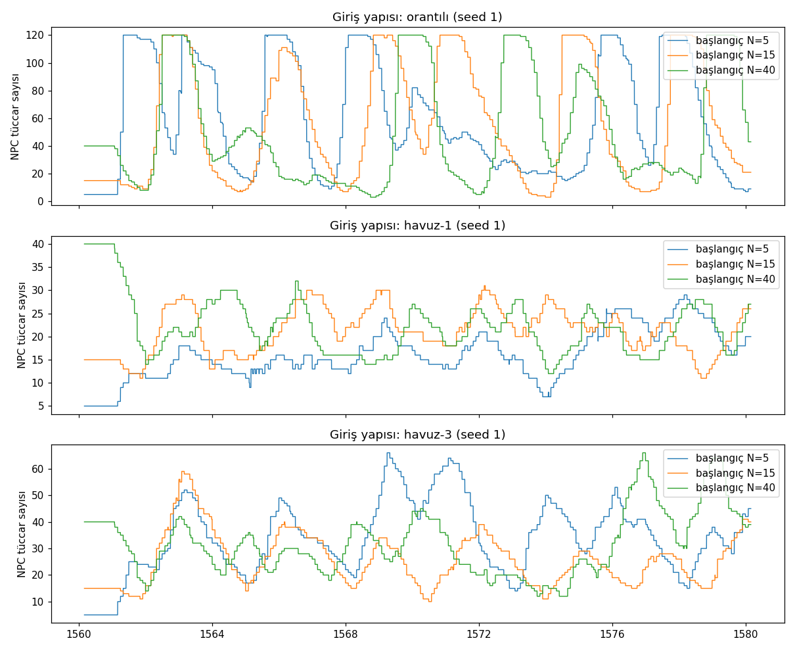
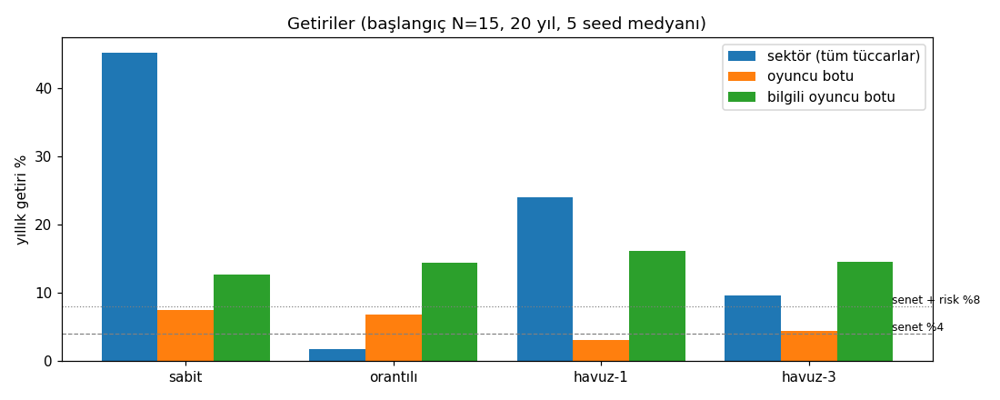

# Deney D3b: Senete Bağlı Serbest Giriş-Çıkış
> Durum: tamamlandı (2026-10-23)
> Kod: [`sim/world.py`](../../sim/world.py) (`_monthly`), [`experiments/d3b_entry_exit.py`](../../experiments/d3b_entry_exit.py)
> Yeniden üretmek: `python3 experiments/d3b_entry_exit.py` (~12 dk)
> Önceki: [D3](D3.md). Yöntem: [deney stratejisi](README.md). Yarışan yuva: **giriş dinamiği.**

## Özet

**Soru:** Kullanıcının çerçevesi (Y10b) şuydu: senet ≈ %4; "baz ticaret" = senet + risk primi; rekabetçi dengede ekstra kâr yok; iyi ticaret bazın üstünde, ama %50 değil. Serbest giriş-çıkış bunu kendiliğinden üretiyor mu?

**Cevap: ✅ Evet, ama giriş hızına bağlı.** Giriş hızı, piyasanın nerede durduğunu belirleyen yapısal düğme:

| Giriş yapısı | Sektör getirisi (tüm tüccarlar) | Ne oluyor |
|---|---|---|
| Havuz-1 (ayda ~1 yeni tüccar) | **%19-26** | Yavaş giriş → içerdekiler **rant** elde ediyor |
| **Havuz-3 (ayda ~3 yeni tüccar)** | **%6-11** | **Kullanıcının dengesi: senet + risk ≈ %8** |
| Orantılı (mevcut sayıyla orantılı) | **%1-2** | Herding girişi → şiddetli pork cycle (5 ↔ 120, yapay üst sınıra dayanıyor) → sektör senedin altında |

Her dengede **bilgili oyuncu botu yılda %13-17** kazanıyor; NPC'lerle aynı bilgideki bot %3-10. Yani "baz ticaret" yapan sıradan tüccar senet + risk civarında kalıyor, daha iyi bilgisi olan bazın 7-10 puan üstüne çıkıyor. %50 yok. **Kullanıcının tarif ettiği tablo simülasyondan kendiliğinden çıktı.**

## Kurulum

- Dünya: D3'ün en iyi kurulumu (C4: söylenti + dağılım + olağana dönüş), açgözlü tüccar çekirdeği.
- **20 yıl** (dengeye oturmayı görmek için), 5 seed, başlangıç tüccar sayısı 5 / 15 / 40.
- **Kâr payı:** Tüccarlar ihtiyaç fazlası nakdi (bir yüklük alımın 1,2 katının üstünü) her ay çeker. Getiri birikip boşta duran nakitle sulandırılmaz.
- **Çıkış:** En az 1 yıldır ticaret yapan, limanda boşta bekleyen ve son 12 ayda senedin (%4) altında kazanan tüccar her ay %10 olasılıkla parasını senede koyup çıkar (orantılıda %25). İflas eden çıkar; yerine otomatik kimse gelmez.
- **Giriş:** Aktif tüccarların son 12 aylık medyan getirisi senet + risk primini (%4 + %4) aşıyorsa yeni tüccarlar girer.
  - *Orantılı:* aylık beklenen giriş = N × fazla getiri (Doran-Parberry'nin "en kârlı mesleğe geç" mantığı).
  - *Havuz-k:* giriş dışarıdan sınırlı bir akış (çıraklık, sermaye, ortaklık gerektirir); fazla getiri ≥%10 olduğunda ayda ~k kişi.
- **Sektör getirisi (yeni ölçüm):** Tüm tüccar sermayesinin yıllık getirisi = (çıkanların parası + iflas edenlerin kalan parası + tüm kâr payları + son servet − giren tüm sermaye) / ortalama sermaye / yıl. **Hayatta kalanlar yanılgısından arınmış.**

## Sonuçlar (5 seed medyanı, son 10 yıl)

| Senaryo | Ort. tüccar | Sayı dalgalanması (CV) | Hayatta kalan medyan getiri % | **Sektör getirisi %** | Bot % | **Bilgili bot %** | Fırsat gün % | İst. kıtlık % | Giriş/yıl | Çıkış/yıl | İflas/yıl |
|---|---|---|---|---|---|---|---|---|---|---|---|
| sabit N=5 | 5 | 0 | — | 163 | 19,6 | 20,4 | 60 | 6,0 | 0 | 0 | 0,2 |
| sabit N=15 | 15 | 0 | — | 45 | 7,6 | 12,7 | 45 | 9,3 | 0 | 0 | 0,7 |
| sabit N=40 | 40 | 0 | — | 7,7 | −7,8 | 11,7 | 38 | 9,1 | 0 | 0 | 2,9 |
| orantılı N0=5 | 52 | **0,70** | 15,1 | **1,7** | 10,2 | 14,3 | 27 | 6,7 | 37 | 33 | 1,1 |
| orantılı N0=15 | 53 | 0,71 | 12,5 | 1,8 | 6,8 | 14,4 | 33 | 9,0 | 35 | 34 | 0,8 |
| orantılı N0=40 | 57 | 0,73 | 21,8 | 1,0 | 5,0 | 15,3 | 34 | 7,0 | 35 | 31 | 1,5 |
| havuz-1 N0=5 | 21 | 0,25 | 16,5 | 25,6 | 10,5 | 16,7 | 38 | 7,5 | 5,9 | 4,4 | 0,8 |
| havuz-1 N0=15 | 21 | 0,28 | 14,8 | 24,1 | 3,1 | 16,1 | 42 | 8,8 | 5,7 | 5,2 | 0,6 |
| havuz-1 N0=40 | 20 | 0,27 | 18,1 | 19,4 | 2,9 | 15,9 | 44 | 9,9 | 5,9 | 6,3 | 0,7 |
| **havuz-3 N0=5** | 34 | 0,38 | 12,6 | **10,9** | 8,5 | 13,3 | 33 | 8,1 | 13,4 | 11,7 | 0,9 |
| **havuz-3 N0=15** | 28 | 0,32 | 8,9 | **9,7** | 4,5 | 14,5 | 31 | 5,4 | 11,5 | 9,7 | 0,8 |
| **havuz-3 N0=40** | 33 | 0,40 | 7,8 | **5,7** | 2,6 | 15,7 | 34 | 6,4 | 11,7 | 12,1 | 1,2 |

Determinizm ✅, muhasebe ✅.

## Bulgular

### B1. Kullanıcının dengesi kendiliğinden oluşuyor ✅
Havuz-3'te sektör getirisi %6-11: senet (%4) + risk primi (%4) civarı. Rekabet fazla kârı eritiyor, ama sıfıra değil. Kullanıcının "doğru ticareti seçip rakipsiz kalmak mümkün olmayacak, rekabet marjları eritir" sezgisi doğrulandı.

### B2. Giriş hızı = rant ile aşırı rekabet arasındaki düğme

> **Atıf notu (2026-10-23):** Giriş engellerinin rant yarattığı ve serbest girişin ekonomik kârı sıfıra (burada senet + risk primine) indirdiği endüstriyel organizasyonun temel sonuçlarıdır (Bain 1956, Stigler 1968). Bu deney onları **keşfetmedi**, simülasyonda **yeniden üretti**; modelin doğru çalıştığının bir göstergesi.

- **Yavaş giriş (havuz-1):** İçerdekiler %19-26 kazanıyor. Tarihsel karşılığı: **giriş engelleri.** Loncalar, vatandaşlık hakları (Venedik'te Levant ticareti patrizilere ve cittadini'ye açıktı ⚠️), sermaye ve bağlantı gereksinimi.
- **Orta (havuz-3):** Rekabetçi denge.
- **Sürü halinde giriş (orantılı):** Patlama-çöküş döngüsü. Sektör **senedin altında** (%1-2) kazanıyor: kârlı dönemde giren kalabalık, marjlar çöktüğünde kaybediyor.

**Oyun tasarımı için anlamı:** Giriş engelleri (lonca, imtiyaz, vatandaşlık) **ekonomik rantı doğrudan belirliyor.** Oyuncunun bir imtiyaz elde etmesi ya da bir loncaya girmesi ölçülebilir bir ekonomik değer taşıyacak. Bu, S-009 (toplumsal statü) ve dinamik kurumlar (A4) ile doğrudan bağlantılı.

### B3. Yol bağımsızlığı ✅ (havuz yapılarında)
5, 15 veya 40 tüccarla başlayan dünyalar ~2 yıl içinde aynı banda yakınsıyor (havuz-1: ~20, havuz-3: ~30). Denge başlangıç koşullarına değil, ekonominin yapısına bağlı. Simülasyonun sağlamlığı için önemli.

### B4. Pork cycle: gerçek bir fenomen, ama orantılı girişte artifact boyutunda

> **Düzeltme notu (2026-10-23, kullanıcı itirazı sonrası):** Bu bölüm ilk yazıldığında pork cycle'ı kaçınılması gereken bir hata gibi anlattı. Bu yanlış bir çerçeveydi. Pork cycle (hog cycle) karar ile sonuç arasında süre olan her piyasada doğal olarak oluşan, belgelenmiş bir fenomen (Hanau 1928; tarım, gemicilik, navlun). Oyunda görülmesi istenir (framework İ11). Orantılı girişin reddedilme nedeni döngünün varlığı değil: (1) mikro-davranış gerçekçi değil (yeni tüccar sayısı mevcut tüccar sayısıyla orantılı olmaz; çıraklık, sermaye ve bağlantı sınırlıdır); (2) genlik yapay üst sınıra (120) dayanıyor. Havuz girişi de pork cycle üretiyor (havuz-3'te ~12-60 arası), ve bu korunacak.

Orijinal metin:
Orantılı girişte tüccar sayısı 5 ile 120 arasında 3-4 yıllık döngüler yapıyor. Neden yine bir gecikme: Giriş kararı **son 12 ayın** getirisine bakıyor ve mevcut tüccar sayısıyla orantılı. Kârlı dönemde herkes girer, marjlar çöker, herkes çıkar. Tarımdaki "domuz döngüsü" (hog cycle) ve örümcek ağı modelinin nüfus versiyonu. Başarısızlık kataloğuna eklendi.

### B5. Hayatta kalanlar yanılgısı büyük ⚠️
Hayatta kalan tüccarların medyan getirisi %8-22, sektörün gerçek getirisi %1-26. Orantılıda fark en büyük: hayatta kalanlar %12-22 görünürken sektör %1-2. **Hayatta kalanlara bakarak "ticaret çok kârlı" sonucuna varmak yanıltıcı.** Ayrıca ilk ölçümde çıkan tüccarların kâr payları kayboluyordu; muhasebe defterinden alınarak düzeltildi. **Yöntem dersi:** Getiriyi her zaman sistem düzeyinde, defterden ölç.

İlginç bir yan not: Simülasyondaki tüccarlar da giriş-çıkış kararını *hayatta kalanların* medyan getirisine bakarak veriyor. Bu tarihsel olarak gerçekçi: insanlar başarılı tüccarları görür, batanları değil. Bu yanılgı orantılı girişteki aşırılığı besliyor olabilir.

### B6. Bilginin değeri her dengede korunuyor ✅
Bilgili bot her giriş yapısında %13-17 kazanıyor; normal botun 5-13 puan üstünde. Rekabet sıradan tüccarın kârını eritiyor, ama **bilgi avantajını eritmiyor.** Oyuncunun büyüme yolu (temsilciler, haber ağı, ilişkiler) dengede de anlamlı.

### B7. Fırsatlar ve şehirler
Serbest girişte fırsat açık günler %27-44, İstanbul kıtlığı %5-10. D3 ile aynı bantta; serbest giriş fırsat rejimini bozmuyor.

## Tasarıma etkileri

| # | Etki | Nereye |
|---|---|---|
| 1 | **Tüccar nüfusu içsel:** senete bağlı çıkış + sınırlı giriş akışı. Giriş hızı yapısal bir parametre (rant ↔ rekabet). | spec §6.11, Y10b |
| 2 | **Giriş engelleri = rant.** Lonca, imtiyaz ve vatandaşlık gibi kurumlar ekonomik değeri doğrudan belirler. | framework, S-009, A4 |
| 3 | Orantılı giriş reddedildi: mikro-davranışı gerçekçi değil ve genliği yapay sınıra dayanıyor. **Pork cycle'ın kendisi korunur** (İ11); havuz girişi ılımlı döngüler üretiyor. | spec, İ11 |
| 4 | Getiriler sistem düzeyinde ve defterden ölçülür (hayatta kalanlar yanılgısı) | 06, lessons |
| 5 | Kâr payı çekimi: getiri biriken nakitle sulandırılmaz | spec §6.11 |

## Sonraki adım önerisi

Tek mallı, iki limanlı ekonominin temel yapısı artık yerinde: fiyat oluşumu, arbitraj, bilgi, giriş-çıkış. Yol haritasındaki sıradaki adım **D4: çok mal ve ortak bütçe** (kıtlık lüks malları vuruyor mu, mallar arası ikame).
