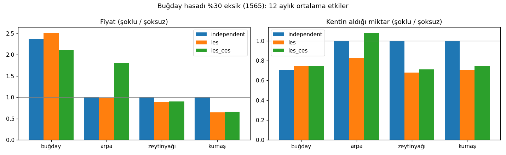
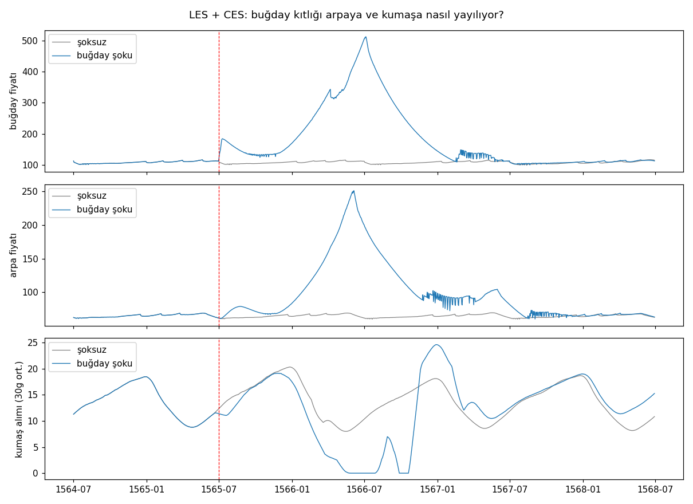

# Deney D4: Çok Mal ve Ortak Bütçe
> Durum: tamamlandı (2026-10-23)
> Kod: [`sim/multigood.py`](../../sim/multigood.py), [`experiments/d4_multigood.py`](../../experiments/d4_multigood.py)
> Yeniden üretmek: `python3 experiments/d4_multigood.py` (~1 dk)
> Yöntem: [deney stratejisi](README.md). Yarışan yuva: **talep yapısı.** Parametreler varsayılan.

## Özet

| Soru | Cevap |
|---|---|
| **S1:** Buğday kıtlığı lüks malları vuruyor mu? (income effect, Labrousse) | ✅ LES ve LES+CES'te evet. %30 eksik buğday hasadında kumaş harcaması **%43-47 düşüyor**, zirvede kumaş alımı birkaç ay sıfıra iniyor. Independent modelde hiçbir etki yok. |
| **S2:** Buğday pahalanınca arpaya kayılıyor mu? (substitution effect) | ✅ Sadece LES+CES'te. Arpa fiyatı **+%81**, arpa tüketimi **+%8**. Buğday-arpa fiyat korelasyonu 0,10 → **0,83**. Düz LES'te arpa tüketimi bile düşüyor (−%17); bu gerçekçi değil. |
| **S3:** Ortak bütçe kararsızlık yaratıyor mu? | Patlama yok (0/10). Ama şoksuz dünyada kumaş alımında beklenmeyen bir mevsimsel salınım var. **Sınıflandırılmadı** (Y16), açık soru. |

**Kazanan aday: LES + CES (two-stage budgeting).** Hem income effect'i hem substitution effect'i üreten tek model.

## Kurulum

Tek liman, 100.000 kişi, 4 mal. Her mal kendi D1 motorunda (H ön ayarı, κ=0,01): kendi üreticisi, dükkâncıları, stokçuları var. Kentin alımı ortak bir talep modeliyle yapılıyor.

| Mal | Kişi başı/yıl | Referans fiyat | Hasat | Köylünün kendi payı | Stokçu | LES subsistence |
|---|---|---|---|---|---|---|
| Buğday (WHT) | 1,4 | 100 | Temmuz | %40 | 2 | 1,0 |
| Arpa (BRL) | 0,6 | 60 | Haziran | %40 | 1 | 0,4 |
| Zeytinyağı (OIL) | 0,3 | 150 | Kasım | %20 | 1 | 0,1 |
| Yünlü kumaş (CLO) | 0,05 | 800 | sürekli üretim | — | 0 | 0 |

⚠️ Bütün değerler yer tutucu. Bu 4 mal, referans fiyatlarda gelirin %60'ını oluşturuyor; geri kalan "diğer harcamalar".

**Yarışan talep modelleri:**

| Model | Ne yapar | Kaynak |
|---|---|---|
| **independent** | Her malın kendi esnekliği ve bütçe sınırı; mallar birbirini görmez | D1 (kontrol) |
| **LES** | Linear Expenditure System. Önce subsistence miktarları karşılanır, kalan gelir ("supernumerary income") sabit marjinal paylarla bölünür. Gelir zorunluları bile karşılamıyorsa yalnızca zorunlular alınır. | Stone (1954), Stone-Geary |
| **LES + CES** | LES kategoriler üzerinde (tahıl, yağ, kumaş, diğer); tahıl kategorisi içinde buğday ve arpa CES ile ikame edilebilir (σ = 2) | Two-stage budgeting (Gorman) |

Her model referans fiyatlarda aynı normal miktarları üretecek şekilde otomatik kalibre ediliyor.

## Sonuçlar

### Kararlılık (10 seed medyanı)

| Model | Patlama | Harcama/gelir | Aylık oynaklık (buğday / arpa / yağ / kumaş) | corr(buğday fiyatı, kumaş alımı) | corr(buğday fiyatı, arpa fiyatı) |
|---|---|---|---|---|---|
| independent | 0/10 | 0,66 | 0,39 / 0,35 / 0,27 / 0,49 | −0,11 | 0,16 |
| LES | 0/10 | 0,61 | 0,37 / 0,38 / 0,26 / 0,49 | **−0,25** | 0,10 |
| **LES + CES** | 0/10 | 0,61 | 0,36 / 0,32 / 0,25 / 0,48 | **−0,26** | **0,83** |

### Buğday şoku (1565 hasadı %30 eksik; verim gürültüsü kapalı; 12 aylık ortalama, şoklu/şoksuz)

| Model | Buğday fiyat / miktar | Arpa fiyat / miktar | Yağ fiyat / harcama | Kumaş fiyat / miktar / **harcama** |
|---|---|---|---|---|
| independent | 2,36 / 0,71 | 1,00 / 1,00 | 1,00 / 1,00 | 1,00 / 1,00 / 1,00 |
| LES | 2,52 / 0,74 | 0,99 / **0,83** | 0,89 / 0,65 | 0,64 / 0,71 / **0,53** |
| **LES + CES** | 2,11 / 0,75 | **1,81 / 1,08** | 0,90 / 0,68 | 0,67 / 0,75 / **0,57** |

Determinizm ✅, muhasebe (4 mal, ortak defter) ✅.

## Bulgular

### B1. Income effect: kıtlık lüksü vuruyor ✅ (fenomen)
LES ve LES+CES'te buğday pahalanınca subsistence harcaması bütçeden daha büyük pay alıyor, geriye kalan gelir daralıyor. Kumaş harcaması **%43-47** düşüyor, kumaş fiyatı **%33-36** geriliyor (stok birikiyor), zeytinyağı harcaması da %32-35 düşüyor. Tarih yazınındaki **Labrousse tezinin** (agrarian crisis → industrial crisis via demand) mekanizmadan kendiliğinden çıkan karşılığı ⚠️ (Labrousse 18. yy Fransa'sı için; 16. yy Akdeniz'i için doğrulanmalı).

**Oyun için anlamı:** Bir tahıl kıtlığı haberi kumaş tüccarı için de kötü haber. Mallar arası bu bağ, bilgi sisteminin değerini artırıyor: "Apulia'da hasat kötü" haberini kumaş satıcısı da okumalı.

### B2. Substitution effect: sadece LES+CES'te ✅ (fenomen)
- **LES+CES:** Buğday pahalanınca talep arpaya kayıyor. Arpa fiyatı +%81, tüketimi +%8. Buğday fiyatındaki artış biraz yumuşuyor (2,52 → 2,11): ikame, kıtlığın yükünü iki tahıla dağıtıyor.
- **Düz LES:** Arpa buğdayın ikamesi olmasına rağmen arpa tüketimi de düşüyor (−%17), çünkü LES'te mallar arasında yalnızca income effect var. **Bu bir artifact:** Gerçekte kıtlıkta insanlar ucuz tahıla yönelir.
- Tahıl fiyatlarının birlikte hareket etmesi (korelasyon 0,83) tarihsel fiyat serilerinde iyi bilinen bir olgu ⚠️.

### B3. Kumaş talebinin "sıfıra inmesi": fenomen, ama büyüklüğü aşırı olabilir
Kıtlığın zirvesinde (1566 baharı-yazı) kumaş alımı birkaç ay boyunca sıfır. Bunun nedeni, gelirin subsistence'ı bile karşılayamaması; model o noktada yalnızca zorunlulara harcıyor. Kriz geçince kumaş ucuzladığı için alım normalin üstüne fırlıyor (1567 başı).
- **Sınıflandırma (Y16):** Yön ve mekanizma gerçekçi (fenomen). Tamamen sıfır olması ise tek bir homojen kent sınıfının sonucu. Gerçekte zenginler kıtlıkta da kumaş alır. **Kent sınıfları** (patrizi / cittadini / popolani, ya da zengin / orta / yoksul) eklendiğinde yumuşaması beklenir. Bu, çok sınıflı talep için ilk somut gerekçe.

### B4. Şoksuz dünyada kumaş alımında mevsimsel salınım: ~~sınıflandırılmadı~~ → **artifact** ([D4b](D4b.md))

> **Düzeltme notu (2026-10-23):** D4b'deki ablasyon bunun bir artifact olduğunu gösterdi. Sürekli üretilen kumaşın üreticisi satış hızını "hasada kalan gün"e göre ayarlıyordu. Düzeltildi. Bu dokümandaki kumaş oynaklığı (0,48-0,49) ve kumaş şok sayıları bu artifact'la üretildi; yön değişmiyor.

Orijinal metin:
Şoksuz dünyada kumaş alımı yıl içinde ~8 ile ~20 (günlük birim, 30 günlük ortalama) arasında salınıyor; üretim ise sabit. İki olası açıklama:
- **(a) Fenomen:** Tahıl fiyatlarının mevsimsel oynaması (±%10) bütçe yoluyla kumaş talebine yansıyor. Kumaşın bütçe payı küçük olduğu için, artık gelirdeki küçük bir değişim kumaş talebinde büyük bir oransal değişim yaratıyor.
- **(b) Artifact:** Kumaşın kendi fiyat dinamiğinde, sürekli üretim + dükkâncı PI kuralı etkileşiminden doğan bir cobweb.

İkisini ayırmak için tek bir ablasyon yeterli: tahıl fiyatlarını sabitleyip kumaşın salınıp salınmadığına bakmak. Bir sonraki deneye eklendi.

### B5. Ortak bütçe yeni bir patlama kanalı açmadı ✅
Üç modelde de 0/10 patlama; oynaklıklar independent modelle aynı bantta. D1 serisinde kurulan liman içi fiyat yapısı çok mallı ortamda da sağlam.

## Tasarıma etkileri

| # | Etki | Nereye |
|---|---|---|
| 1 | **Kent talebi = LES + CES** (two-stage budgeting): kategoriler arası income effect, kategori içinde substitution | spec §6.1, framework A6-A7 |
| 2 | **Kent sınıfları gerekli** (en az zengin / yoksul): homojen bir kent, kıtlıkta lüks talebini sıfıra indiriyor | spec, S-009 bağlantısı |
| 3 | Mallar arası haber etkisi: tahıl haberi kumaş tüccarını da ilgilendirir → bilgi sistemi mal kategorilerini aşar | Y9, Y14 |
| 4 | B4'teki salınım sınıflandırılmalı (ablasyon) | sonraki deney |

## Sonraki adım önerisi

- **D4b (küçük):** B4'ün sınıflandırılması (tahıl fiyatları sabitken kumaş salınıyor mu?) + **iki kent sınıfı** (zengin / yoksul, farklı gelir ve marjinal paylar). Hedef: kıtlıkta lüks talebi düşmeli ama sıfıra inmemeli.
- Ardından **D5**: tam dilim (6 liman, 8 mal), istismar botları ve ölçek testi.
