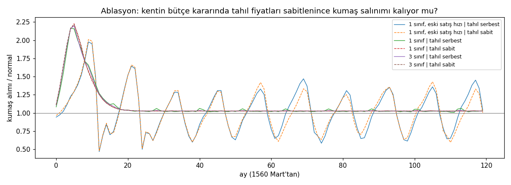
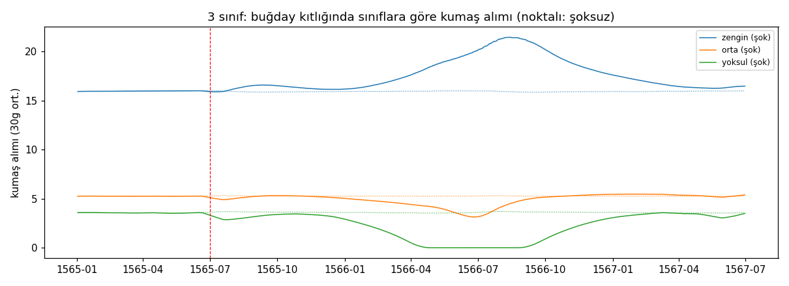

# Deney D4b: Kumaş Salınımının Sınıflandırılması ve Kent Sınıfları
> Durum: tamamlandı (2026-10-23)
> Kod: [`sim/multigood.py`](../../sim/multigood.py) (`ClassSpec`, `CLASSES_3`), [`experiments/d4b_classes.py`](../../experiments/d4b_classes.py)
> Yeniden üretmek: `python3 experiments/d4b_classes.py` (~1 dk)
> Önceki: [D4](D4.md). Profil kaynağı: [consumer-profiles-16c](../research/history/consumer-profiles-16c.md)

## Özet

| Soru | Cevap |
|---|---|
| **D4'teki kumaş salınımı fenomen mi, artifact mı?** (Y16) | **Artifact.** Kentin bütçe kararında tahıl fiyatları sabitlense de salınım aynı kalıyor (genlik 2,3). Neden: sürekli üretilen kumaşın üreticisi satış hızını "hasada kalan gün"e göre ayarlıyordu (Ocak'ta hasat varmış gibi). Düzeltildi: genlik 2,3 → **1,03**, kumaş oynaklığı 0,49 → 0,05. |
| **Kent sınıfları kıtlıkta lüks talebinin sıfıra inmesini önlüyor mu?** | ✅ **Evet.** Tek sınıfta kıtlığın zirvesinde kumaş alımı sıfıra iniyor. Üç sınıfta en kötü ay normalin %93'ü. |
| **Kıtlığın yükü sınıflara nasıl dağılıyor?** | Yoksulun kumaş alımı ~5 ay **sıfır** (12 aylık ortalama −%42); orta sınıf −%10; **zengin +%7** (zirvede +%35). Yoksul talebi çökünce ucuzlayan kumaş zengine akıyor. |

## Kurulum

D4 dünyası (tek liman, 4 mal, LES + CES talebi), iki değişiklikle:

1. **Ablasyon:** Kentin talep kararında buğday ve arpa fiyatları referans değerde sabitlenir (`freeze_cereal`). Gerçek alım fiyatları değişmeye devam eder.
2. **Üç sınıf** ([profil §4](../research/history/consumer-profiles-16c.md)):

| Sınıf | Nüfus | Kişi başı gelir (yoksul = 1) | Bütçe payı: tahıl / yağ / kumaş | Subsistence: tahıl / yağ | Tahılda buğday payı |
|---|---|---|---|---|---|
| Zengin | %10 | 12 | 0,08 / 0,03 / 0,15 | %30 / %30 | %95 |
| Orta | %20 | 3 | 0,20 / 0,06 / 0,10 | %60 / %40 | %85 |
| Yoksul | %70 | 1 | 0,35 / 0,07 / 0,06 | %85 / %50 | %70 |

Malların normal miktarları sınıf bütçelerinden türetiliyor. Her sınıf kendi LES + CES talebiyle alım yapıyor; toplam talep sınıfların toplamı.

## Sonuçlar

### 1. Ablasyon (şoksuz, verim gürültüsü kapalı; yıl içi en yüksek/en düşük ay oranı)

| Kurulum | Kumaş alım genliği | Kumaş fiyat genliği | Buğday fiyat genliği |
|---|---|---|---|
| 1 sınıf, **eski satış hızı**, tahıl serbest | **2,38** | 2,10 | 1,12 |
| 1 sınıf, **eski satış hızı**, tahıl sabit | **2,31** | 2,07 | 1,78 |
| 1 sınıf, düzeltilmiş, tahıl serbest | 1,06 | 1,07 | 1,12 |
| 1 sınıf, düzeltilmiş, tahıl sabit | 1,03 | 1,03 | 1,78 |
| 3 sınıf, düzeltilmiş, tahıl serbest | 1,03 | 1,04 | 1,12 |

Tahıl sabitlense de salınım kalıyor → **tahıldan gelmiyor** → artifact. Kaynağı kodda bulundu ve düzeltildi.

### 2. Buğday şoku (%30 eksik hasat, 12 aylık ortalama, şoklu/şoksuz)

| | Buğday miktar | Arpa miktar | Yağ miktar | **Kumaş miktar** | En kötü ayda kumaş / normal | Buğday fiyat |
|---|---|---|---|---|---|---|
| 1 sınıf | 0,75 | 1,08 | 0,71 | 0,67 | **0,00** | 2,11 |
| **3 sınıf, toplam** | 0,74 | 1,09 | 0,87 | **0,96** | **0,93** | 2,20 |
| — zengin | 0,66 | 0,97 | 0,98 | **1,07** | | |
| — orta | 0,74 | 1,08 | 0,90 | 0,90 | | |
| — yoksul | 0,77 | 1,10 | 0,76 | **0,58** | | |

Kararlılık (3 sınıf, 10 seed): patlama 0/10; aylık oynaklık buğday 0,36, arpa 0,34, yağ 0,24, kumaş 0,05. Determinizm ✅.

## Bulgular

### B1. Kumaş salınımı artifact'tı; Y16 protokolü işe yaradı ✅
Sınıflandırma adımı olmasaydı bu salınımı "bütçe yoluyla tahıl mevsimselliği" diye yorumlayıp fenomen olarak bırakabilirdik. Tek bir ablasyon (tahıl fiyatlarını sabitlemek) bunu çürüttü ve kodda kaynağı bulundu: sürekli üretilen mal için "hasada kalan gün" mantığı. **Ders:** Her yeni mal türü (sürekli üretim, ara mal, ithal mal) motorun mevsimsel varsayımlarını yeniden sorgulamalı.

> **D4 için düzeltme notu:** D4'teki kumaş sonuçları bu artifact'la üretildi. Yön değişmiyor (tek sınıfta kumaş −%25-33, zirvede sıfır), ama kumaş oynaklığı (0,48-0,49) ve şoksuz salınım (B4) artifact'tı.

### B2. Sınıflar kıtlığı "insanlaştırıyor" ✅ (fenomen)
- **Yoksul:** Kumaş alımı kıtlığın zirvesinde ~5 ay sıfır; yağ −%24; buğdaydan arpaya kayıyor (+%10).
- **Orta:** Kumaşı geçici olarak %40'a kadar kısıyor.
- **Zengin:** Ekmek harcaması bütçesinde küçük olduğu için etkilenmiyor. Kumaş ucuzlayınca **daha fazla** alıyor (zirvede +%35).

Kıtlıkta mal yoksuldan zengine akıyor: yoksul talebi çöküyor, fiyat düşüyor, zengin ucuz malı topluyor. Tarihsel olarak belgelenmiş bir dağılım dinamiği ⚠️ (doğrulanmalı), ve fiyat ile sınıf mekanizmasından kendiliğinden çıktı.

### B3. Toplam Labrousse etkisi zayıfladı; çünkü "kumaş" tek mal
Üç sınıfta toplam kumaş talebi yalnızca −%4. Neden: Kumaş harcamasının çoğu zenginden geliyor (gelirin ~%42'si × bütçenin %15'i). Gerçekte zenginin aldığı ince kumaş (Floransa yünlüsü, ipek, kadife) ile yoksulun aldığı kaba kumaş **farklı mallar ve farklı üreticiler**. Labrousse'un tarif ettiği sanayi krizi, kaba kumaş üreten zanaatkârları vurur.
→ **Öneri:** Kumaşı en az iki mala ayırmak: **kaba yünlü** (yoksul ve orta) ve **ince kumaş / ipekli** (zengin). O zaman kaba kumaş üreticisi kıtlıkta çöker, ince kumaş üreticisi etkilenmez. Oyun için de zengin bir ayrım: hangi kumaşı taşıdığın, kıtlıkta kazanıp kaybetmeni belirler.

### B4. Yöntem dersi: paylaşılan değiştirilebilir yapılar
İlk çalıştırmada sınıflı model malların ortak tanım listesini (`GOODS`) yerinde değiştirdi. Sonraki bütün çalıştırmalar bozuk miktarlarla çalıştı: tek sınıfta kumaş tamamen sıfır, hasat şoku anlamsız. Düzeltme: her dünya kendi kopyasını alıyor. **Ders:** Konfigürasyon nesneleri değiştirilmez, kopyalanır. Determinizm testi bunu yakalayamazdı, çünkü aynı sırayla çalıştırınca aynı (yanlış) sonucu veriyordu. Ancak beklenen bir sonucun (D4'teki 0,75) tekrar üretilememesi yakaladı.

## Tasarıma etkileri

| # | Etki | Nereye |
|---|---|---|
| 1 | **Kent talebi sınıflıdır:** her sınıfın kendi LES + CES talebi (başlangıç: zengin / orta / yoksul) | spec §6.1, consumer-profiles §4 |
| 2 | Sürekli üretilen mallarda satış hızı sabit ufuklu (artifact düzeltmesi) | spec §6.2 |
| 3 | **Kumaş iki mala ayrılmalı:** kaba yünlü ve ince kumaş / ipekli | spec §2.3 (mal listesi) |
| 4 | Kıtlığın sınıflara göre dağılımı oyuncu için okunabilir olmalı (kimin talebi çöküyor?) | Y14 |
| 5 | Konfigürasyon nesneleri kopyalanır, değiştirilmez | lessons |

## Sonraki adım

Yol haritasında **D5: tam dilim** (6 liman, 8 mal, sınıflı kentler, tüccarlar, bilgi, giriş-çıkış) + istismar botları + ölçek testi. Bu, şimdiye kadar ayrı ayrı test edilen bütün yuvaların ilk kez bir arada çalışacağı deney.
