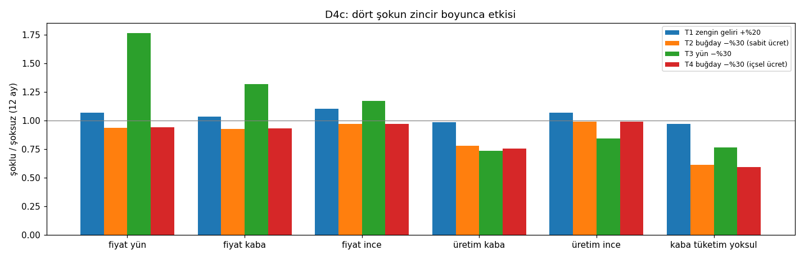
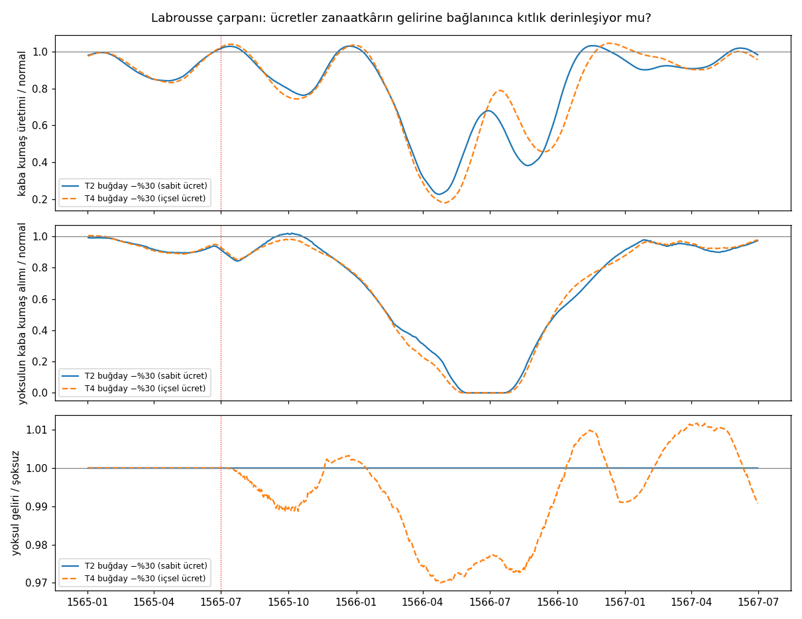

# Deney D4c: Üretim Zinciri (Yün → Kaba ve İnce Kumaş)
> Durum: tamamlandı (2026-10-23)
> Kod: [`sim/production.py`](../../sim/production.py), [`experiments/d4c_production.py`](../../experiments/d4c_production.py)
> Yeniden üretmek: `python3 experiments/d4c_production.py` (~2,5 dk)
> Tasarım: [production-chains](../design/production-chains.md). Önceki: [D4b](D4b.md)

## Özet

İlk üretim zinciri modele girdi: **yün (hammadde) → kaba ve ince yünlü kumaş (son ürün)**. Ayrıca **üretici havuzları** (bireysel ajan değil) ve iki aşamalı ücret modeli eklendi.

| Test | Beklenen | Sonuç |
|---|---|---|
| **T1:** Zengin geliri +%20 | İnce kumaş ↑ → yün ↑ → **kaba kumaş da pahalanır** | ✅ İnce kumaş fiyatı +%11, yün +%7, **kaba kumaş +%3**, yoksulun kaba kumaş tüketimi −%3 |
| **T2:** Buğday −%30, sabit ücret | Kaba kumaş üretimi ↓, yün ↓, ince kumaş korunur | ✅ Kaba üretim −%22 (en kötü ayda normalin %24'ü), yün −%6, ince üretim değişmiyor |
| **T3:** Yün −%30 | İki kumaş da pahalanır, kaba daha çok | ✅ Yün +%76, **kaba +%32**, ince +%17 |
| **T4:** Buğday −%30, ücretler kent gelirine bağlı | Labrousse çarpanı: T2'den derin | ⚠️ **Çok zayıf:** kaba üretim −%25 (T2: −%22), yoksul geliri −%1 |

Patlama 0/10 (iki aşamada da). Determinizm ✅. Muhasebe (7 mal + üretici havuzları) ✅.

**Not (atıf):** T1-T3'ün yönleri standart üretim ve girdi-çıktı teorisinin beklentileri (Leontief; ortak girdi üzerinden fiyat aktarımı). T2 ve T4'ün hedeflediği mekanizma Labrousse'un tezidir. Simülasyon bunları keşfetmedi; **yeniden üretip üretmediğini test etti.** Modele özgü bulgu B3'tedir.

## Kurulum

D4b'nin 3 sınıflı kenti (zengin / orta / yoksul), kumaş ikiye ayrılmış ve üretim zinciri eklenmiş hali.

| Mal | Tür | Kaynak | Referans fiyat ⚠️ |
|---|---|---|---|
| Buğday, arpa, zeytinyağı | Tüketim | Kırsal havuz (hasat) | 100 / 60 / 150 |
| **Yün** | Hammadde | Kırsal havuz (kırkım Mayıs) | 10 |
| **Şap + boya** | Hammadde | Dışsal sürekli arz | 50 |
| **Kaba yünlü kumaş** | Son ürün | Üretici havuzu | 22 |
| **İnce yünlü kumaş** | Son ürün | Üretici havuzu | 60 |

**Reçeteler (Leontief, ⚠️ yer tutucu):**
- Kaba = 1,0 yün + 4 işgünü
- İnce = 1,5 yün + 0,2 şap/boya + 12 işgünü
- Ücret: 2,5 soldo/işgünü

**Kumaş bütçe payları:** Zengin: kaba %1, ince %14. Orta: kaba %7, ince %3. Yoksul: kaba %6, ince %0.

**Üretici havuzu davranışı:** Her gün sırayla:
1. Kullanım × kapasite kadar üretir (girdi ve ücret nakdiyle sınırlı).
2. Ürünü dükkâncılara satar; ürün stoku şiştikçe maliyetin altına inmeye razı olur.
3. 30 günlük hedef girdi stokuna kadar girdi alır.
4. Kullanım oranını marja ve ürün stokuna göre ayarlar (seviye hedefi + yavaş yaklaşma; D1g dersi).
5. Ayda bir kapasiteyi ayarlar: yüksek kullanım ve kâr varsa %1 büyür, düşük kullanımda %1 küçülür.
6. Fazla nakdi kâr payı olarak çeker.

**Ücret aşamaları:** Aşama 1'de ücretler sistemden çıkar, kent geliri sabittir. Aşama 2'de ücret toplamındaki değişim orta (%30) ve yoksul (%70) sınıfın gelirine eklenir.

## Sonuçlar (verim gürültüsü kapalı; 12 aylık ortalama, şoklu/şoksuz)

| | Yün fiyatı | Kaba fiyatı | İnce fiyatı | Kaba üretim | İnce üretim | Yoksulun kaba tüketimi | Zenginin ince tüketimi | Yoksul geliri | Kaba üretim en kötü ay |
|---|---|---|---|---|---|---|---|---|---|
| T1 zengin +%20 | 1,07 | **1,03** | 1,11 | 0,99 | 1,07 | 0,97 | 1,09 | 1,00 | 0,78 |
| T2 buğday −%30 | 0,94 | 0,93 | 0,97 | **0,78** | 0,99 | 0,61 | 1,00 | 1,00 | 0,24 |
| T3 yün −%30 | **1,76** | **1,32** | 1,17 | 0,74 | 0,84 | 0,77 | 0,86 | 1,00 | 0,38 |
| T4 buğday −%30, içsel ücret | 0,94 | 0,93 | 0,97 | **0,75** | 0,99 | 0,59 | 1,00 | **0,99** | 0,21 |

**Kararlılık (10 seed):** Patlama 0/10. Aylık oynaklık: buğday 0,33, yün 0,27, kaba kumaş 0,14, ince kumaş 0,08. Kaba kumaş kapasitesi 10 yılda %3 küçülüyor (medyan). Aşama 2'de değerler neredeyse aynı.

## Bulgular

### B1. Ortak hammadde, mallar arasında beklenen bağı kuruyor ✅ (yeniden üretim)
- **T1:** Zenginlerin gelir artışı ince kumaş üzerinden yün fiyatını yükseltiyor; kaba kumaş da pahalanıyor ve yoksulun tüketimi hafifçe düşüyor. Kullanıcının "hammaddeler belli ölçüde ortak, bu bir fark yaratmalı" sezgisinin modeldeki karşılığı. Etki küçük (+%3), çünkü yün kaba kumaşın maliyetinin yarısından azı ve yün arzı da tepki veriyor.
- **T3:** Yün kıtlığı kaba kumaşı daha çok vuruyor (+%32 vs +%17), çünkü yünün maliyetteki payı kaba kumaşta daha yüksek (~%50 vs ~%27). Girdi-çıktı teorisinin standart sonucu.

### B2. Tahıl kıtlığı üretici tarafında kaba kumaşı çökertiyor ✅ (yeniden üretim)
T2'de yoksulun kaba kumaş talebi −%39; kaba kumaş üretimi 12 ayda −%22, kıtlığın zirvesinde normalin **%24'üne** iniyor. Yün ucuzluyor (−%6), ince kumaş üretimi etkilenmiyor. Labrousse'un tarif ettiği "tarım krizi → sanayi krizi" aktarımının üretici tarafı.

### B3. Labrousse çarpanı zayıf, çünkü sektör yalnızca yerel tüketim için üretiyor (modele özgü bulgu)
Ücretler kent gelirine bağlanınca (T4) etki çok küçük: üretim −%22 → −%25, yoksul geliri −%1.
- **Sınıflandırma (Y16):** Artifact değil. Mikro-davranış doğru, ama **sektörün kent ekonomisindeki ağırlığı** küçük. Kumaş ücretleri yoksul gelirinin yalnızca ~%14'ü (kaba kumaş ~%4'ü).
- **Neden:** Model kapalı tek bir kent. Kumaş sadece kentin kendi tüketimi için üretiliyor. Gerçek tekstil kentleri (Venedik, Floransa) ise büyük ölçüde **ihracat** için üretirdi ⚠️ (Levant'a Venedik yünlüleri). Sektör kentin gelirinin çok daha büyük bir kısmını oluşturuyor, dolayısıyla çarpan çok daha güçlü olmalıydı.
- **Sonuç:** Labrousse çarpanının anlamlı test edilmesi **ihracatlı çok limanlı dünyayı** (D5) gerektiriyor. Orada Venedik kumaşı Levant'a gider; Levant'ta bir kıtlık, Venedik zanaatkârını işsiz bırakabilir.

### B4. Üretici havuzları kararlı ✅
Kullanım oranı ve kapasite seviye + yavaş düzeltme kuralıyla salınmadan çalışıyor. Kaba kumaş oynaklığı 0,14, ince 0,08; tahıllardan (0,33) belirgin düşük. İşlenmiş malların fiyatlarının hammadde fiyatlarından daha istikrarlı olması da gerçek dünyada bilinen bir desen ⚠️.

### B5. Gözlemler (sınıflandırılacak)
- Şoksuz dünyada kaba kumaş kullanım oranı ~0,80, ince ~0,88; kapasite 10 yılda %3 küçülüyor. Kaba kumaş biraz pahalı kalıyor (24,6 vs referans 22), çünkü yün referansın üstünde (12,6 vs 10). Kalibrasyon konusu (Y13), yapısal değil.
- Şap ve boya fiyatı referansın yarısında (26 vs 50): Sabit arz talebin üstünde. Kalibrasyon konusu.

## Tasarıma etkileri

| # | Etki | Nereye |
|---|---|---|
| 1 | **Üretim zincirleri:** Leontief reçeteli üretici havuzları (bireysel ajan değil); ortak hammadde | spec §2.5, production-chains (öneri → yön) |
| 2 | Kumaş en az ikiye ayrılır (kaba / ince); hammaddeleri ortak | spec §2.3 |
| 3 | Ücretler kent gelirine bağlanır (Aşama 2); çarpan ihracatlı dünyada test edilecek | D5 |
| 4 | Üretici havuzu kuralları: seviye + yavaş düzeltme, aylık kapasite ayarı, stok şişince fiyat esnemesi | spec |

## Sonraki adım

**D5: tam dilim.** Artık bütün yuvalar ayrı ayrı test edildi:
- Liman içi fiyat (D1 serisi)
- Taşıma ve arbitraj (D2)
- Bilgi (D3)
- Giriş-çıkış (D3b)
- Ortak bütçe (D4)
- Sınıflar (D4b)
- Üretim zinciri (D4c)

D5 bunları ilk kez birlikte çalıştıracak. Venedik kumaşının Levant'a ihracatı Labrousse çarpanını da gerçekçi biçimde test edecek.
