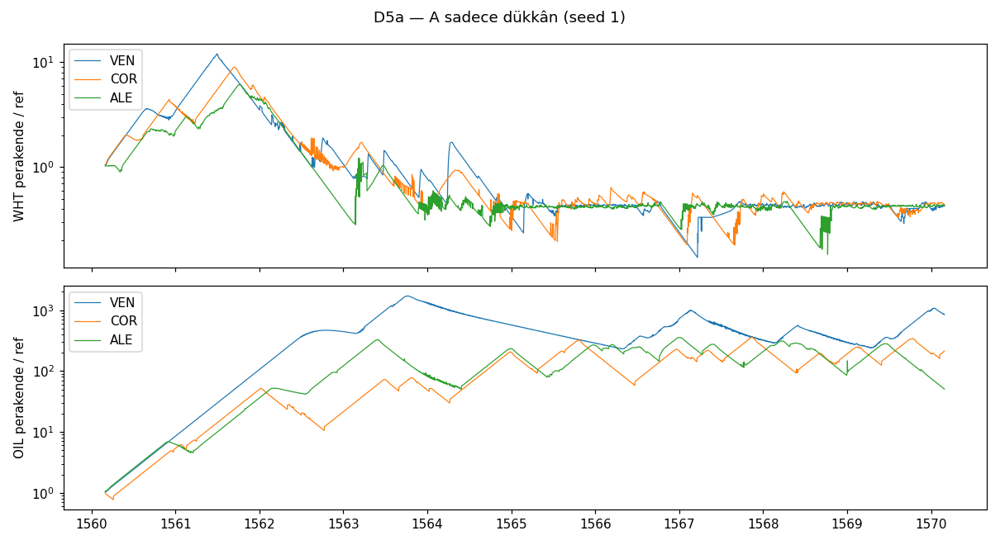
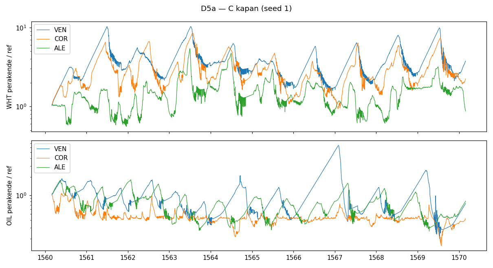

# Deney D5a: Kurumsal Toptan Pazar (Kapan)
> Durum: tamamlandı (2026-10-23)
> Kod: [`sim/world5.py`](../../sim/world5.py) (`_kapan`, `_step_wholesale`; `wholesale=True`), [`experiments/d5a_wholesale.py`](../../experiments/d5a_wholesale.py)
> Yeniden üretmek: `python3 experiments/d5a_wholesale.py` (~1,5 dk)
> Tasarım: [wholesale-and-behavior](../design/wholesale-and-behavior.md) (K-013). Önceki: [D5](D5.md)

## Özet

**Soru:** D5'teki darboğaz ve likidite sorunları, el yaması olmadan, gerçek bir kurumla (kapan) çözülüyor mu?

**Cevap: ✅ Evet.** Kapan, D5'teki dört ayrı el müdahalesinin (doğrudan üreticiden alım, iskele satışı, yeniden sermayelendirme, anlık derinlik paylaşımı) yaptığını hiçbiri açık olmadan yapıyor:
- Patlama 5/5 → **0/5**.
- Likidite tuzağındaki dükkân 5/18 → **0/18** (yeniden sermayelendirme kapalı olduğu halde).

K-013'teki kural (kullanıcı) gereği **toptancı ajanlara şimdilik gerek yok.**

**Kalan sorun (kapana özgü değil):** Limanlar arası fiyat farkları taşıma maliyetinin 3-5 katı; yani ticaret hâlâ yetersiz. Bu D5 yamalarında da var.

## Kurulum

| Liman | Rolü |
|---|---|
| Venedik | İthalatçı (buğdayın %40'ını kendi üretir, yağ üretmez) |
| Korfu | Zeytinyağı ihracatçısı |
| İskenderiye | Buğday ihracatçısı |

Mallar: buğday ve zeytinyağı. 10 yıl, 5 seed. Tüccarlar homojen (çeşitlilik D5b'nin konusu).

**Kapan mekanizması:** Her limanda her mal için günlük toptan takas.
- **Satış emirleri:** köylüler (arz eğrisi), stokçular, gelen tüccarlar, üretici havuzları.
- **Alış emirleri:** dükkâncılar (perakende yenilemesi), ihracatçı tüccarlar, stokçular, üretici havuzları (girdi).
- Talep ve arz eğrilerinin kesiştiği **tek fiyattan** işlem; %1 kapan resmi.
- Toptan fiyat limanda herkese açık.
- Dükkâncılar perakendeye çekildi; yerine koyma maliyetleri toptan fiyat.

## Sonuçlar (5 seed medyanı, son 5 yıl; fiyatlar perakende / referans)

| Kurulum | Patlama | VEN buğday | VEN yağ | COR yağ | ALE buğday | Fark/maliyet buğday | Fark/maliyet yağ | Satış bekleyen | Tüccar | Tuzaktaki dükkân |
|---|---|---|---|---|---|---|---|---|---|---|
| A: sadece dükkân | **5/5** | 0,47 | **388** | **131** | 0,43 | 0,26 | 9,1 | %72 | 26 | **5/18** |
| B: D5 yamaları | 0/5 | 3,44 | 1,04 | 0,78 | 2,11 | 3,8 | 2,9 | %22 | 44 | 0/18 |
| **C: kapan** | **0/5** | 3,57 | 0,70 | 0,42 | 1,57 | 5,5 | 3,1 | %25 | 32 | **0/18** |

Determinizm ✅, muhasebe ✅.

## Bulgular

### B1. Gerçek bir kurum, dört el müdahalesinin yerini aldı ✅
Kapan, satıcıları ve alıcıları tek bir takasta buluşturuyor. Kapasite darboğazı yapısal olarak ortadan kalkıyor: Takas odasının deposu yok; malı satıcılar getirip alıcılar götürüyor. Kuramsal karşılığı aracılık teorisi (Rubinstein & Wolinsky 1987; Spulber 1996) ve piyasa kurumunun önemi (Gode & Sunder 1993). Simülasyon bunu yeniden üretti. **Modele özgü bulgu:** Bizim modelimizdeki dört ayrı sorun tek bir eksik kurumun belirtisiymiş.

### B2. Likidite tuzağı kendiliğinden kayboldu ✅
Yeniden sermayelendirme kapalı olduğu halde tuzaktaki dükkân yok. Neden: Dükkâncılar artık her gün açık bir toptan fiyattan, ihtiyacı kadar mal alabiliyor; dev bir gemi yükünü tek seferde almak zorunda kalmıyor. Tuzak, kurumun eksikliğinden doğuyordu.

### B3. Perakende ile toptan arasındaki asimetri (artifact, düzeltildi)
İlk kapan çalıştırmasında Venedik'te toptan yağ fiyatı referansın 0,36'sı, perakende ise 1,65'iydi. Dükkâncılar toptan fiyat yükselince fiyatlarını yükseltiyor, düşünce indirmiyordu: perakende katmanında İ9 asimetrisi. Toptan fiyat herkese açık bir sinyal olduğu için yerine koyma maliyeti iki yönlü yapıldı. Kalan perakende-toptan farkı (örneğin İskenderiye buğday) dükkâncı marjı ve stok dinamiği; makul.

> **Düzeltme notu (2026-10-23, [D5a2](D5a2.md)):** Bu düzeltme teşhis edilmeden yapılmıştı (Y16'ya aykırı) ve rekabetin kendisini değil sonucunu taklit eden bir el kuralıydı. Kullanıcının itirazı üzerine D5a2'de teşhis edildi ve yerine rekabetçi perakende (K-016) kondu.

### B4. Kalan sorun: ticaret yoğunluğu yetersiz ⚠️
Fiyat farkları taşıma maliyetinin 3-5 katı. İhracatçı İskenderiye'de bile buğday referansın üstünde (1,57), çünkü ihracatçı tüccarların alımı fiyatı itiyor; ithalatçı Venedik'te ise 3,57. Bu B'de de var, yani kapana özgü değil. Olası nedenler:
1. **Filo büyüklüğü ve giriş hızı:** Başlangıç filosu ihtiyaçtan türetildi (14), ortalama 32'ye çıkıyor; giriş akışı (ihtiyacın %5'i/ay) yavaş olabilir.
2. **Beklenti modeli:** C4'ün olağan fiyata (medyan) dönüşü, kalıcı olarak yüksek fiyatları "geçici" sanıp tüccarları temkinli tutabilir. Olağan fiyat hafızası başlangıçtaki referans fiyatlarla dolu.
3. **Homojen tüccarlar:** Hepsi aynı kurala ve aynı temkin seviyesine sahip.

İkinci ve üçüncü neden D5b'nin (tüccar çeşitliliği) doğal konusu. Birinci neden kalibrasyon (Y13) ya da giriş yapısının ölçeği.

## Tasarıma etkileri

| # | Etki | Nereye |
|---|---|---|
| 1 | **K-013 doğrulandı:** toptan ticaret kurumsal pazarla (kapan); toptancı ajanlara şimdilik gerek yok | decisions, spec |
| 2 | D5'in el yamaları (doğrudan üreticiden alım, iskele satışı, yeniden sermayelendirme) toptan modda kapalı kalır | spec |
| 3 | ~~Perakende yerine koyma maliyeti açık toptan fiyata iki yönlü bağlı~~ → yerini rekabetçi perakende aldı ([D5a2](D5a2.md), K-016) | spec §6.3 |
| 4 | Ticaret yoğunluğu sorunu D5b'de tüccar çeşitliliğiyle birlikte incelenecek | D5b |

## Sonraki adım

**D5b:** Bu dünyaya tüccar çeşitliliği (level-k, taklit eğilimi, risk-servet, aşırı güven) ve rakip bilgisinin söylentiyle yayılmasını eklemek (K-014). Bir de değerli bir niş mal (biber) eklemek. Sorular:
- En kârlı niş herding'i tamponlanıyor mu, yoksa çağlayan mı doğuyor?
- Ticaret yoğunluğu (fark/maliyet) iyileşiyor mu?
