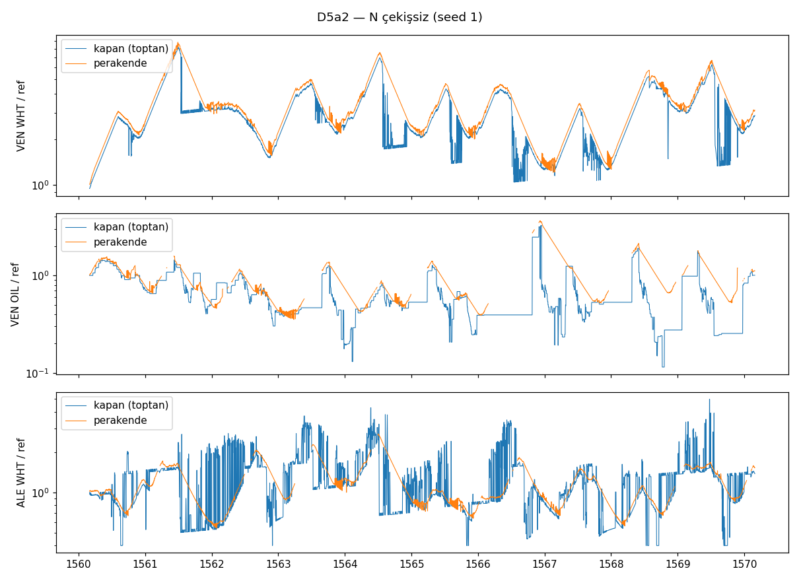
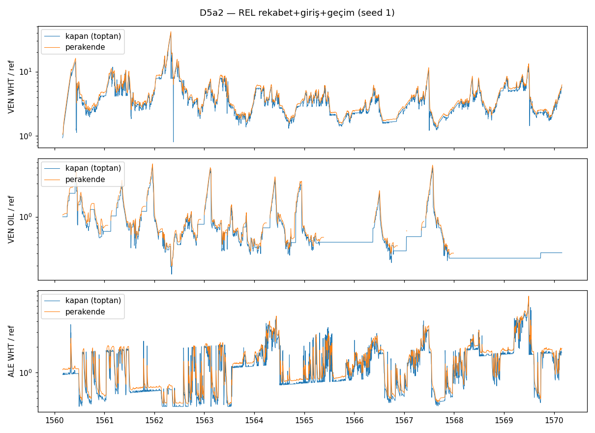

# Deney D5a2: Rekabetçi Perakende
> Durum: tamamlandı (2026-10-23)
> Kod: [`sim/world5.py`](../../sim/world5.py) (`retail_rule="compete"`: `_set_markups`, `_shop_schedule`, `_buy_compete`, `_update_shares`, `_retail_entry_exit`; `shop_living_cost`), [`sim/model.py`](../../sim/model.py) (`Shopkeeper.pricing="lerner"`), [`experiments/d5a2_retail.py`](../../experiments/d5a2_retail.py)
> Yeniden üretmek: `python3 experiments/d5a2_retail.py` (~4 dk)
> Karar: [K-016](../decisions.md). Önceki: [D5a](D5a.md). Tasarım: [wholesale-and-behavior §1b](../design/wholesale-and-behavior.md). İlgili: S-013

## Özet

**Soru (kullanıcı):** D5a'da perakende fiyatını toptan fiyata **mekanik olarak** çeken bir kural eklemiştik. Kullanıcının itirazı:
- Toptan fiyat düşünce dükkâncının fiyatını kendiliğinden indirmemesi beklenir. Fiyatı indirecek olan **rekabettir**.
- Toptan fiyat artınca maliyet arttığı için satış fiyatı da artar. Ama fiyat yükseltmenin **rekabetçi bir maliyeti** olmalı.

**Cevap: ✅ Rekabet mekanik çekişin yerini aldı.**
- Perakende marjı piyasa yapısından çıkıyor: 3 dükkânda %14; serbest giriş ve dükkâncı geçimiyle büyük pazarlarda %9-11, en küçük pazarda %13. Değerler kuramın öngördüğü düzeyde.
- Dükkân sayısı pazar büyüklüğüne göre kendiliğinden belirleniyor: Venedik buğdayında 31, Korfu yağında 4.
- Toptan fiyattaki değişim bir hafta içinde %60-80, bir ay içinde %80-100 oranında perakendeye yansıyor. Mekanik çekiş olmadan eski sabit marjlı dükkânlar bir ayda ancak %25 aktarıyordu.

**Yan bulgu (fenomen):** Yapışkan perakende kıtlığı **boş rafla**, rekabetçi perakende **fiyatla** paylaştırıyor (B4).

**Beklenmeyen sonuçlar:**
- Rockets and feathers kendiliğinden **çıkmadı**: aktarım iki yönde de aynı hızda (B5).
- Kıtlık zirveleri büyüdü. Kök neden arz tarafının zayıf tepkisi (B6).
- **D5a'nın ölçütlerinin gizlediği bir sorun:** Venedik'te yağ, bütün kurulumlarda günlerin %26-42'sinde rafta yok (B7).

## Teşhis: D5a'daki perakende-toptan farkı neden kalıcıydı? (Y16)

D5a'da düzeltmeyi teşhis etmeden yapmıştım. Bu deney önce teşhisle başladı (N kurulumu: kapan var, çekiş yok, gün gün iz kaydı). Üç neden bulundu:

1. **Fiyatın seviyesini bulan integral bileşen yavaş ve stoka bakıyor.** Dükkân fiyatı günde en fazla κ·ln(oran) ≈ %0,7 değişebiliyor. Toptan fiyat bir haftada yarıya inse de perakende aylarca iniyor (grafikte N'nin düzgün "üçgen" rampaları).
2. **Sinyal kendini doğruluyor.** Dükkân stoğunu müşteri talebine göre ayarlıyor: 30 günlük talep kadar mal tutuyor. Fiyat yüksekse müşteri az alıyor, dükkân da az stok tutuyor. Stok/talep oranı 1 civarında kalıyor, yani sinyal "fiyat yüksek" demiyor. Yüksek fiyat + düşük hacim kendi kendini sürdüren bir denge.
3. **Tarihsel maliyetin altına satmama kuralı.** Pahalı aldığı malı maliyetinin altına satmıyor (disposition effect'e benzer). Rakipleri ucuza yenilese de fiyat yüksek kalıyor.

Üç neden de aynı şeye işaret ediyor: **Dükkâncıyı fiyat indirmeye zorlayan bir rakip yok.** Üç dükkân aynı kuralı izliyor, kimse fiyat kırmıyor, yeni dükkân açılmıyor.

## Mekanizma (K-016)

| Parça | Model | Kaynak |
|---|---|---|
| **Maliyet** | Yerine koyma maliyeti = açık toptan fiyatın 3 günlük ortalaması. İşlem olmayan günlerde: kapandaki en ucuz satış teklifi (kimse bunun altında satmıyor). | Replacement cost pricing |
| **Müşteri payı** | Logit seçim: hedef pay ∝ fiyat^−β (β = 12). Gerçek pay hedefe 30 günde yaklaşır (müşteri değiştirmenin maliyeti, alışkanlık). Mal bulamayan müşteri o dükkândan kopar. | McFadden (1974); Anderson, de Palma & Thisse (1992); Klemperer (1987) switching costs |
| **Marj** | Dükkânın karşılaştığı esneklik ε_i = β(1−s_i) + ε_pazar·s_i. Kâr maksimize eden marj (Lerner): μ = 1/(ε_i − 1). Payı büyük dükkân daha yüksek marj alabilir; rakip çoğaldıkça marj düşer. | Lerner (1934); logit oligopol |
| **Fiyat yükseltmenin maliyeti** | Rakiplerinden pahalı dükkân müşteri kaybeder: hemen değil, bir ay içinde. Kullanıcının istediği "rekabetçi maliyet" bu. | — |
| **Alış (türetilmiş talep)** | Dükkânın kapandaki alış emri, müşterilerinin talebinden türer: toptan fiyat w iken hedef stok = 30 günlük satış × (w/ref)^−ε. Ucuzsa daha çok stoklar. Satışlarını gözlediği fiyatın %50 üstünden fazlasını önermez. | Derived demand (Marshall); base-stock envanter politikası |
| **Giriş-çıkış** | Aylık. Son 12 ayın **işletme kârı** (satış − yerine koyma maliyeti − geçim − kira) / sermaye. Medyan, senet + risk primini (%8) aşıyorsa yeni dükkân açılır; senedin altında kalan dükkân kapanır. D3b'deki tüccar mekanizmasının aynısı. Yeni dükkânın henüz müşterisi yoktur, ilk stoğunu buna göre alır. | Bain (1956); D3b |
| **Dükkâncının geçimi** | Günlük sabit gider = tüccarın geçim gideri (K-004 eşitliği). Girişin nerede durduğunu belirler. | Chamberlin (1933); Mankiw & Whinston (1986) |

**Kullanıcının kararı (2026-10-23):** Öğrenen fiyatlayıcıların örtük anlaşmaya (tacit collusion) varması riski (Calvano vd. 2020) bu kurulumda beklenmiyor. Her dükkâncının çıkarı fiyat kırmaktır. Lerner kuralı zaten tek taraflı en iyi tepki, yani anlaşmayı yapısal olarak üretemez. Perakendede rant oluşursa devlet müdahalesi eventi yapılır (narh, Provveditori alle Biave).

### Uygulama sırasında çıkan artifact'lar (düzeltildi)
1. **Teklif kendi maliyetini kovalıyor:** İlk sürümde dükkânın alış teklifi "maliyet × (1 + marj)" idi. Kıtlıkta kapan fiyatı en yüksek teklife eşit oluyor, maliyet ortalaması da ona yükseliyordu. Her gün ~%4 tırmanış, Venedik buğdayı 14×. Düzeltme: alış emri müşteri talebinden türetildi.
2. **Türetilmiş talep de kendi maliyetine göreliydi:** Çizelgenin tepesi (3 × maliyet) maliyetle birlikte yükseliyordu. İthalatçı Venedik yağında 565× patlama. Düzeltme: Çizelge, dükkânın satışlarını **gözlediği** fiyat düzeyine bağlandı (14 günlük hafıza), tepe %50'ye indirildi. Dükkân deneyimlemediği bir fiyatta müşterisinin ne alacağını bilmez.
3. **Stok değer artışı kâr sayılıyordu:** İlk giriş-çıkış sürümü getiriyi özsermaye değişiminden ölçüyordu. Fiyat şişince dükkândaki stoğun değeri artıyor, işletme zarar etse bile "kâr" görünüyordu. Giriş durmadı; günde 5 soldo brüt kâr eden pazarlara bile dükkân açıldı. Düzeltme: işletme kârı.
4. **Her yeni dükkân kente yeni talep eklenmiş gibi stok topluyordu:** Yeni dükkân, yerleşik dükkânların ortalama satış hızını devralıyordu. Kıtlıkta açılan her dükkân kapandan bir aylık stok istiyordu. Patlama 2/5 → 4/5. Düzeltme: Yeni dükkânın ilk satış beklentisi umduğu pay kadar.

İlk ikisi aynı derse çıkıyor: **Bir ajanın teklifi kendi geçmiş teklifinden türerse çapası olmaz.** Çapa ajanın dışındaki bir gözlemden (müşteri talebi) gelmeli.

## Kurulum

D5a'nın kapan dünyası: Venedik (ithalatçı), Korfu (yağ), İskenderiye (buğday); 2 mal; 10 yıl; 5 seed; tüccarlar homojen.

| Kurulum | Perakende |
|---|---|
| **C** | D5a: sabit marj (%10 spread) + mekanik iki yönlü çekiş |
| **N** | Sabit marj, çekiş yok (teşhis) |
| **R** | Rekabetçi perakende, 3 dükkân sabit |
| **RE** | R + perakende giriş-çıkışı (en çok 40 dükkân), geçim yok |
| **REL** | RE + dükkâncının geçimi (günde 30, tüccarla eşit). **Önerilen hal.** |

## Sonuçlar (5 seed medyanı, son 5 yıl)

### Marj (perakende / toptan − 1) ve dükkân sayısı

| | VEN buğday | VEN yağ | KOR buğday | KOR yağ | İSK buğday | İSK yağ |
|---|---|---|---|---|---|---|
| Normal günlük tüketim (birim) | 425 | 94 | 43 | 9 | 91 | 19 |
| C (çekiş) | %9 | %16 | %8 | %3 | %7 | %11 |
| N (çekişsiz) | %10 | **%72** | %9 | %3 | %8 | %11 |
| R (3 dükkân) | %14 | %17 | %14 | %14 | %15 | %14 |
| RE (geçim yok) | %9 / 34 dk. | %10 / 40 | %9 / 27 | %10 / 14 | %10 / 28 | %10 / 36 |
| **REL (geçim)** | **%9,5 / 31 dk.** | **%11 / 15** | **%9 / 16** | **%13 / 4** | **%11 / 19** | **%11 / 6** |

Kuramın öngörüsü (β = 12, ε_pazar = 0,7): 3 dükkânda μ = 1/(12·⅔ + 0,23 − 1) = **%13,8**; 4 dükkânda %12,5; 30 dükkânda %9,5; sonsuz dükkânda alt sınır 1/(β−1) = %9,1. Simülasyon bu değerleri tutturuyor (yeniden üretim).

### Aktarım (pass-through): toptan fiyat %1 değişince perakende yüzde kaç değişir? (yukarı / aşağı)

| | VEN buğday 7 gün | VEN buğday 30 gün | VEN yağ 7 gün | VEN yağ 30 gün |
|---|---|---|---|---|
| C (çekiş) | 0,11 / 0,39 | 1,09 / 0,82 | 0,77 / 0,16 | 1,08 / 0,58 |
| N (çekişsiz) | −0,01 / 0,09 | 0,25 / 0,28 | 0,25 / 0,07 | 0,26 / 0,20 |
| R | 0,75 / 0,76 | 0,97 / 0,99 | 0,61 / 0,83 | 0,98 / 0,97 |
| REL | 0,70 / 0,73 | 0,98 / 0,98 | 0,80 / 0,81 | 0,96 / 0,99 |

Diğer pazarlarda da aynı desen: Rekabetçi kurulumlarda bir haftada 0,5-0,8, bir ayda 0,7-1,0. Yukarı ve aşağı arasında sistematik bir fark yok.

### Kıtlık nasıl paylaştırılıyor? (buğday, son 5 yıl)

| | VEN en yüksek perakende (× ref) | VEN en kötü gün (ihtiyacın payı) | VEN yarı aç günler | KOR en kötü gün | KOR yarı aç günler |
|---|---|---|---|---|---|
| C | 9,9 | **0** | %6,6 | **0** | %6,2 |
| N | 7,7 | **0** | %5,4 | **0** | %15,6 |
| R | 11,7 | 0,40 | %1,2 | 0,42 | %1,5 |
| REL | 20,2 | 0,26 | %4,9 | 0,29 | %1,2 |

"Yarı aç gün" = kentin aldığı buğdayın normal tüketimin yarısının altında kaldığı gün.

### Diğer
- **Patlama** (>50× ref, 10 yılın herhangi bir günü): C 0/5, N 0/5, R 1/5, RE 2/5, REL 1/5. Hepsi buğdayda, hasat öncesi; R ve REL'deki aynı seed.
- **Venedik'te rafta yağ olmayan günler:** C %42, N %32, R %29, RE %26, REL %36.
- **Tuzaktaki dükkân:** hepsinde 0. **REL giriş-çıkış:** 187 giriş, 114 çıkış.
- **Ticaret yoğunluğu** (fark/taşıma maliyeti, toptan fiyatlarla): buğday C 4,7 → REL 6,5. İyileşmedi.
- Determinizm ✅, muhasebe ✅ (her gün).

## Bulgular

### B1. Rekabet, mekanik çekişin yaptığını yapıyor; üstelik gerekçesiyle ✅
Mekanik çekiş (C) ortalamada benzer marjlar veriyordu. Ama aktarımı tutarsızdı: buğdayda düşüş yükselişten hızlı, yağda tersi. Çünkü stok durumuna bağlı bir el kuralıydı. Rekabetçi perakendede aktarım her pazarda tutarlı, marj da piyasa yapısından (dükkân sayısı, müşterinin fiyat duyarlılığı) çıkıyor.

### B2. Fiyat yükseltmenin maliyeti artık açık ✅
Bir dükkân rakiplerinden %5 pahalıysa, hedef payı rakiplerininkinin (1/1,05)^12 ≈ %56'sına iner. Müşterileri bir ay içinde rakiplere kayar. Dükkân bunu bildiği için marjını payına göre seçiyor: büyük pay, yüksek marj.

### B3. Geçim gideriyle giriş, pazar büyüklüğüne göre duruyor (yeniden üretim) ✅
- **Geçim yokken (RE)** giriş hemen her pazarda 40 üst sınırına yaklaşıyor ve marj her yerde alt sınıra (%9-10) iniyor. Sabit gider olmayınca dükkân açmamak için bir neden yok.
- **Geçimle (REL)** her dükkân geçimini çıkaracak kadar satış yapmak zorunda. Büyük pazar çok dükkân taşıyor (Venedik buğdayı 31), küçük pazar az (Korfu yağı 4). Küçük pazarda marj daha yüksek (%13), çünkü az rakip var.

Bu, literatürde bilinen sonuç: Chamberlin'in monopolistic competition dengesi; sabit gider, serbest girişte firma sayısını ve marjı belirler (Mankiw & Whinston 1986). Simülasyon yeniden üretti. Oyun için okunuşu: **Küçük kasabada az dükkân ve pahalı; büyük kentte çok dükkân ve ucuz.**

**Rant sorusu (kullanıcının ilkesi: perakendede rant olmamalı):**
- Dükkân başına normalin üstündeki kâr girişle eriyor: Marj, geçimi ve sermayenin senet getirisini karşılayacak düzeye iniyor.
- Kalan marj, müşterilerin her gün bütün dükkânları gezmemesinin bedeli (Stigler 1961; Diamond 1971). Alt sınırı 1/(β−1). β bir tasarım düğmesi: müşteriler daha bilgiliyse (β büyük) marj düşer. Bertrand'ın sıfır marjı (perfect competition) ancak β → ∞'da çıkar.

### B4. Yapışkan perakende kıtlığı boş rafla paylaştırıyor, rekabetçi perakende fiyatla (fenomen)
Kıt bir malın kime gideceğini belirlemenin iki yolu var:
- **Fiyatla:** Fiyat yükselir, herkes biraz daha az alır, en çok ödemeye razı olan (ya da gücü yeten) daha çok alır. Raf boşalmaz.
- **Kuyrukla (miktarla):** Fiyat yerinde kalır, ama mal herkese yetmez. İlk gelen alır, sonra raf boşalır. Ertesi gün gelen eli boş döner.

Eski perakendede (C, N) dükkân fiyatı günde en fazla %0,7 değişebiliyordu. Kıtlık başlayınca fiyat yeterince hızlı yükselmedi, insanlar normal miktarda almaya devam etti, dükkânların stoğu tükendi. Bazı günler Venedik'te kimse buğday bulamadı (en kötü gün: sıfır). Rekabetçi perakendede fiyat kıtlığı hemen yansıtıyor: alım azalıyor, ama mal tükenmiyor (en kötü gün ihtiyacın %26-40'ı). Bedeli de daha yüksek fiyat zirveleri.

Literatürde bilinen ayrım: **fiyatla paylaştırma vs. kuyrukla paylaştırma** (Weitzman 1977; Barzel 1974). Tarihteki karşılığı narh: Fiyat tavanı piyasa fiyatının altında tutulursa mal pazardan kaybolur, fırının önünde kuyruk olur ([codex: Narh](../codex/institutions.md)). Eski yavaş perakende, kimse bunu amaçlamadan narh gibi davranıyordu. Simülasyon bunu yeniden üretti. İki rejim de gerçek, ikisinin de bedeli var. Oyunda kurumlar (narh, tahıl ofisinin ucuz satışı) rejimi değiştirebilir; oyuncu ikisinden de farklı fırsatlar çıkarır.

### B5. Rockets and feathers kendiliğinden çıkmadı ⚠️ (ertelendi, not alındı)
Kısa vadede yukarı ve aşağı aktarım aynı. Asimetrinin yönü pazardan pazara ve seed'den seed'e değişiyor; kıtlık çarpanı kapatılınca da sonuç aynı (ablasyon). Literatürde asimetrinin nedeni, **müşterinin arama davranışının fiyatın yönüne göre değişmesi**:
- Fiyat yükselince tüketici daha çok arar, düşerken aramaz (Tappata 2009; Yang & Ye 2008).
- Tüketici geçmiş fiyatları referans alır (Lewis 2011).

Bizim modelde β sabit; müşterinin arama yoğunluğu fiyatın yönünden bağımsız. **Kullanıcı kararı (2026-10-23):** Şimdi modellenmeyecek, akılda tutulacak. Not: [framework §8 Ertelenenler](../design/framework.md), S-013.

### B6. Kıtlık zirveleri büyüdü: kök neden arz tarafı ⚠️ (açık sorun, D5b)
Rekabetçi kurulumlarda Venedik ve Korfu buğdayında hasattan önceki aylarda fiyat günde ~%3,5 tırmanıyor ve 15-25× zirvelere çıkıyor. Sonra gemi ya da hasat gelince çöküyor. 16. yy kıtlıklarında fiyat 3-5× çıkardı; bu büyüklük gerçekçi değil.
- **Rekabetin suçu değil.** Yapışkan perakende zirveyi gizliyordu: fiyatı tutup malı tüketiyordu (B4). Rekabetçi perakende kıtlığı fiyata yansıtınca gerçek kıtlık görünür oldu.
- **Asıl sorun:** Fiyatlar haftalarca yüksek kaldığı halde ithalat yetişmiyor. D5a'da teşhis edilen ticaret yoğunluğu sorunu (fark/maliyet 5-6) ve framework'teki açık "hasat öncesi zirve" sorunu.

**Sınıflandırma (Y16):** Fiyatla paylaştırma fenomen. Zirvenin büyüklüğü, arz tarafının zayıf tepkisinden doğan artifact. Düzeltme yeri perakende değil, tüccar tarafı (D5b).

### B7. D5a'nın ölçütlerinin gizlediği sorun: Venedik'te yağ çoğu zaman yok ⚠️
Venedik 170.000 nüfuslu bir kent ve yağın tamamını ithal ediyor. Bütün kurulumlarda, son 5 yılın %26-42'sinde rafta hiç yağ yok. Kötü seed'lerde %88-98. İthalat yıldan yıla ihtiyacın %0-100'ü arasında oynuyor. D5a raporundaki "VEN yağ 0,70" medyan fiyatı yalnızca satış olan günlerden hesaplanmıştı; malın olmadığı günler görünmüyordu.

Perakende rekabetiyle ilgisi yok (C ve N'de de var). Bu D5b'nin birinci ölçütü olmalı. Geçim gideri burada da bir şey gösteriyor: Yılın üçte biri malsız geçen bir pazar az dükkân taşıyor (REL'de 15).

### B8. Gözlem: İskenderiye'de toptan fiyat iki seviye arasında gidip geliyor
Bütün kurulumlarda var, perakendeden bağımsız. İhracatçı tüccarların kapana gelip gitmesiyle teklif defterinin günden güne değişmesi olası. D5b'de tüccar çeşitliliğiyle birlikte izlenecek.

## Tasarıma etkileri

| # | Etki | Nereye |
|---|---|---|
| 1 | **K-016:** Perakende rekabetçi (logit pay + atalet, Lerner marjı, türetilmiş talep, işletme kârına dayalı giriş-çıkış, dükkâncı geçimi). D5a'nın mekanik iki yönlü çekişi kaldırıldı. Önerilen hal: REL. | decisions, spec §6.3 |
| 2 | Ders: Ajanın teklifi kendi geçmiş teklifinden türerse çapası olmaz; çapa dışarıdaki bir gözlemden gelmeli | lessons |
| 3 | Ders: Getiri işletme kârından ölçülür; stok değer artışı sahte kâr gösterir | lessons |
| 4 | Ders: Fiyat ölçütleri yalnızca işlem olan günlerden hesaplanırsa malın yokluğu görünmez; "rafta mal yok" günleri ayrıca ölçülür | lessons, D5b ölçütleri |
| 5 | β perakende marjının alt sınırını belirler; müşterinin aramasının fiyatın yönüne bağlanması ertelendi | S-013, framework §8 |
| 6 | Kıtlık zirveleri ve ithalatçı limanda malsız günler → tüccar tarafı (D5b) | D5b |

## Sonraki adım
**D5b:** Tüccar çeşitliliği + rakip bilgisinin söylentiyle yayılması + biber nişi, REL perakendesiyle. Birinci ölçütler:
- İthalatçı limanlarda malsız geçen günler.
- Kıtlık zirvelerinin büyüklüğü.
- Ticaret yoğunluğu.
