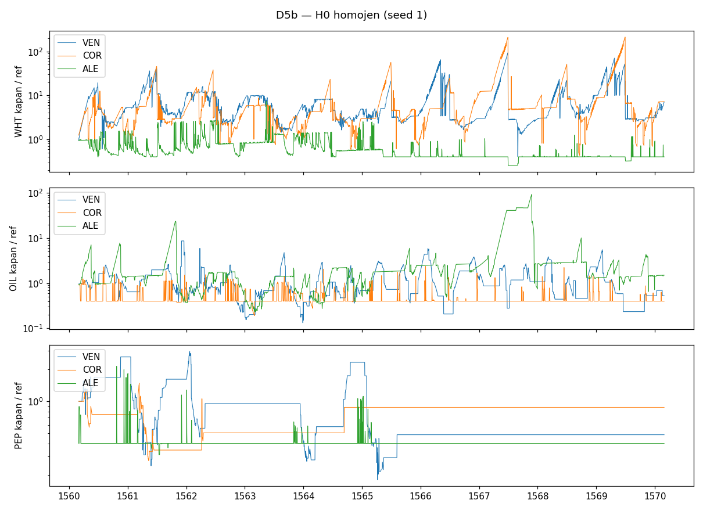
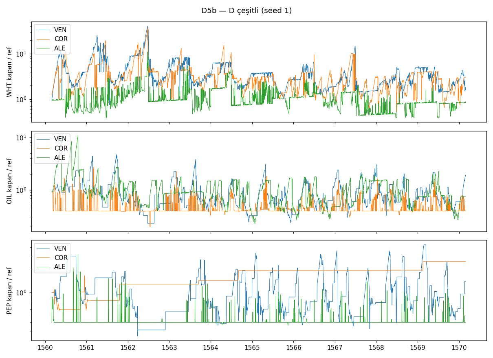

# Deney D5b: Tüccar Çeşitliliği ve Rakip Bilgisi
> Durum: tamamlandı (2026-10-23)
> Kod: [`sim/world5.py`](../../sim/world5.py) (`rival_info`, `diversity`: `_rivals`, `_risk`, `_hear_loads`, `_waiting`, M5 kişiliği), [`experiments/d5b_diversity.py`](../../experiments/d5b_diversity.py)
> Yeniden üretmek: `python3 experiments/d5b_diversity.py` (~4 dk)
> Karar: [K-014](../decisions.md). Tasarım: [wholesale-and-behavior §2](../design/wholesale-and-behavior.md). Önceki: [D5a3](D5a3.md)

> ⚠️ **Düzeltme notu (2026-10-26, [D5b2](D5b2.md) T2):** Bu rapordaki "kalan ince pazar tuzağı" (D'de %2, H1'de %16 kilitli) motorumuzdaki bir Zeno artifact'ıydı. Kapan'ın orantılı paylaşımı kalan kargoyu hiç sıfırlamıyordu; tüccarlar kırıntıyla "satıyor" durumunda kalıyordu. `dust_lot = 1` ile yeniden koşuldu (eski çıktı `experiments/out/d5b/dust0/`):
> - Kilitlenme D'de ve H1'de 0'a indi.
> - Ana sonuçlar değişmedi: H0 çöküşü 4/5 patlama ve %88 kilitli, rakip bilgisinin belirleyiciliği, kişilik getirileri.
> - DN'de 2/5 hasat öncesi kıtlık patlaması çıktı (D5b2 T3).

## Özet

**Soru (K-014):** D5'te homojen ve rakiplerinden habersiz tüccarlar aynı en kârlı nişe sürü hâlinde koşuyordu. D5a3'te de yüklü 23 gemiden 19'u yağ taşıyordu. İki şeyi eklersek ne olur?
- **Çeşitlilik:** düşünme derinliği, taklit eğilimi, servete bağlı risk, aşırı güven, ağ genişliği.
- **Rakip bilgisi:** "X, Y'ye Z yükledi" söylentisi ve limanda bekleyen gemilerin görünmesi.

Bu herding'i tamponlar mı (El Farol), yoksa taklit çağlayan mı doğurur?

**Cevap:**
1. **Belirleyici olan rakip bilgisi ✅.** Biber nişi eklenince eski tüccarlar (H0) çöküyor:
   - Bütün tüccarlar Korfu'da biber satmayı bekleyerek kilitleniyor.
   - Venedik'e buğday ithalatı ihtiyacın %19'u. Günlerin %60'ında Venedik yarı aç.
   - 5/5 patlama.

   Rakip bilgisi olan bütün kurulumlarda patlama 0/5, ithalat ihtiyacın %73-100'ü, yarı aç günler %2-5.
2. **Çeşitlilik toplamı değiştirmiyor, getirinin kime gittiğini değiştiriyor.** Hepsi düzey 1 homojen tüccarlar (H1) ile çeşitli tüccarlar (D) toplamda benzer sonuç veriyor. Ama çeşitli dünyada:
   - Düzey 0 (yalnızca fiyata bakan) tüccarlar yılda −%5 ile +%1 arası kazanıyor; düzey 1-2 tüccarlar +%37-39.
   - Taklitçiler ve aşırı güvenliler daha az kazanıyor.
3. **Taklit bu güçte çağlayan doğurmadı** (ablasyon: D ≈ DN).
4. **Kalan iki sorun:**
   - İnce pazar tuzağı: bekleyen tüccar fiyata bakıyor, satış hızına bakmıyor. Sonraki yuva.
   - Ticaret getirisi yılda %30-35, senet + risk çerçevesinin çok üstünde: giriş çok yavaş (D3b'deki rant düğmesi).

## Mekanizma

### Tüccar kişiliği (her yeni tüccar dağılımdan çekilir)

| Boyut | Model | Dağılım ⚠️ | Kaynak |
|---|---|---|---|
| **Düşünme derinliği** | Düzey 0: yalnızca fiyata bakar. Düzey 1: duyduğu rakip kargonun hepsini hedef pazara inecek sayar (kalabalık). Düzey 2: düzey 1'lerin o pazardan kaçınacağını öngörür, kalabalığın yarısını sayar. | Poisson(τ = 1,5), 2'de kesilmiş: %22 / %33 / %44 | Nagel (1995); Camerer, Ho & Chong (2004) |
| **Kalabalığın etkisi** | Beklenen fiyat × derinlik / (derinlik + kalabalık) (birim esneklik ⚠️); taşınabilecek miktar da kalabalık kadar azalır | — | — |
| **Taklit** | Rakibin yüklemesini "onlar bir şey biliyor" diye çekicilik sinyali olarak da okur: marja +taklit × %10 × (duyulan / derinlik) | Beta(2,5), ortalama 0,29 | Banerjee (1992); BHW (1992) |
| **Aşırı güven** | Beklentinin belirsizliği × katsayı (<1: belirsizliği küçümser) | log-normal, medyan 0,82 | Odean (1998); DHS (1998) |
| **Servete bağlı risk** | Risk kaçınması × (servet / başlangıç)^−½ (DARA); servet başlangıcın %40'ının altına düşünce +1 (safety-first) | — | Arrow (1965), Pratt (1964); Roy (1952) |
| **Ağ genişliği** | Söylenti duyma olasılığı (günlük) | 0,3 × log-normal(0, 0,5), [0,05, 0,9] | Information-model |

### Rakip bilgisi

| Bilgi | Nasıl yayılır |
|---|---|
| **"X, Y'ye Z yükledi"** | Gemi kalkınca o limanda söylenti olur; limandaki tüccarlar kişisel olasılıkla duyar. Gemiler bildikleri söylentileri gittikleri limana taşır. 60 gün sonra unutulur. |
| **Limanda bekleyen kargo** | Limandaki herkes satış bekleyen gemileri görür. Gemiler bildikleri limanlardaki durumu haber olarak taşır, haber de söylenti gibi duyulur. |
| **Kullanımı** | Hem yeni plan yaparken hem satamayıp rota değiştirirken (bkz. aşağıda 2. düzeltme) |

Bilgi, davranışın **sonucundan önce** geliyor: Yükleme söylentisi, kargo varmadan ve fiyat çökmeden haftalar önce duyulabiliyor.

### Uygulama sırasında yapılan iki düzeltme (ikisi de bu yuvanın içinde)
1. **Bekleyen kargo görünmüyordu:** İlk sürümde tüccar yalnızca yükleme söylentilerini biliyordu ve onları 60 gün sonra unutuyordu. Ama satılamayan kargo limanda yıllarca bekleyebiliyor. Gerçekte limandaki gemiler herkesin gözü önünde. Düzeltme: bekleyen kargo görünür ve haberle taşınır.
2. **Rota değiştirme kararı rakipleri yok sayıyordu:** H1'de Korfu'ya giden 297 biber kargosunun 195'i, Venedik'te satamayıp Korfu'ya yönelenlerdi. Rota değiştirme de bir hedef seçimi olduğu için aynı rakip bilgisini kullanmalı. Düzeltme yapıldı.

## Kurulum

D5a3'ün dünyası (REL rekabetçi perakende + fiyat keşfi), 3 liman. Mallar: buğday, yağ ve **biber**. Biber İskenderiye'den gelen değerli ve küçük hacimli bir niş; tüketicisi zenginler. 10 yıl, 5 seed.

| Kurulum | Tüccarlar |
|---|---|
| **H0** | Homojen, düzey 0, rakip bilgisi yok (önceki deneylerin tüccarı) |
| **H1** | Homojen, hepsi düzey 1, rakip bilgisi var |
| **D** | Çeşitli kişilikler + rakip bilgisi |
| **DN** | D, taklit kapalı (ablasyon) |

## Sonuçlar (5 seed medyanı, son 5 yıl)

### Sistem

| | H0 | H1 | D | DN |
|---|---|---|---|---|
| Patlama (>50× ref) | **5/5** | 0/5 | 0/5 | 0/5 |
| Venedik ithalatı / ihtiyaç: buğday | **0,19** | 0,83 | 0,93 | 0,90 |
| … yağ | **0,21** | 0,73 | 0,87 | 0,87 |
| … biber | **0,12** | 1,00 | 0,96 | 1,00 |
| Venedik'te yağsız günler | **%76** | %8 | %6 | %11 |
| Venedik'te bibersiz günler | **%93** | %8 | %9 | %9 |
| Venedik buğday en yüksek (× ref) | **344** | 14 | 21 | 13 |
| Venedik yarı aç günler | **%60** | %3 | %5 | %2 |
| Satış bekleyen tüccar payı | **%91** | %40 | %37 | %39 |
| 180 günden uzun bekleyen (son gün) | **%100** | %16 | %2 | %3 |
| Herding: aylık kalkışların yoğunlaşması (HHI) | 0,69 | 0,41 | 0,38 | 0,40 |
| Glut: 14 günde 30 günlük tüketimi aşan varış (yılda) | 6 | 23 | 25 | 28 |
| Fark / taşıma maliyeti: buğday | 12,5 | 6,4 | 6,5 | 6,5 |
| Tüccar sayısı | 32 | 43 | 39 | 39 |
| Medyan tüccar getirisi (yıllık, ömür boyu) | %23 | %34 | %34 | %30 |

Getiriler yaşayanlar, çıkanlar ve batanlar dahil hesaplandı (survivorship bias yok). Determinizm ✅, muhasebe ✅.

### Kişiliklere göre getiri (D; yıllık, ömür boyu, medyan)

| Düzey 0 | Düzey 1 | Düzey 2 | Taklit yüksek | Taklit düşük | Aşırı güvenli yarı | Temkinli yarı |
|---|---|---|---|---|---|---|
| **−%5** | %39 | %37 | %33 | %38 | %34 | %37 |

DN'de: düzey 0 +%1, düzey 1 %35, düzey 2 %38.

## Bulgular

### B1. Rakiplerinden habersiz tüccarlar küçük bir nişte kilitleniyor (fenomen; büyüklüğü artifact)
H0'da biber nişi eklenince, beş seed'in hepsinde tüccarların tamamı sonunda Korfu'da biber satmayı bekliyor. Korfu 18.000 nüfuslu ve günde 1,4 birim biber tüketiyor. Tüccarlar beş yıl bekliyor, Venedik'e buğday giden gemi kalmıyor, Venedik açlık çekiyor.

Mekanizma: Küçük bir pazarda fiyat yüksek görünüyor, herkes aynı sinyali görüp aynı yere gidiyor, varınca pazar doluyor. Literatürde bilinen El Farol problemi (Arthur 1994) ve herding; simülasyon yeniden üretti.

**Modele özgü bulgu:** D5'te gördüğümüz "en kârlı niş" sorununun kök nedeni rakip körlüğüymüş. Üçüncü bir mal eklemek, eski tüccarı tamamen çökertmeye yetiyor.

### B2. Rakip bilgisi bunu çözüyor; düzey 1 olmak yetiyor ✅
H1, D ve DN'de sistem çalışıyor. Kalabalığı hesaba katan tüccar, başkalarının yüklediği ya da limanda bekleyen kargoyu görünce başka bir pazarı seçiyor. Dikkat çekici olan şu: **Bütün tüccarlar aynı düzeyde olsa da (H1) bu yetiyor.** Bilgi farklı zamanlarda ve farklı kişilere ulaştığı için (söylenti, gemi), aynı kural farklı kararlar üretiyor. Çeşitliliği kişilikler değil, bilginin dağınıklığı yaratıyor.

Literatürde El Farol'un çözümü, ajanların farklı tahmin kurallarıydı (Arthur 1994; Challet & Zhang 1997). Bizim dünyamızda aynı rolü **bilginin yavaş ve eşitsiz yayılması** oynuyor. Bu modele özgü bir bulgu, ama kullanıcının bilgi modeliyle (söylenti, gemi) uyumlu.

### B3. Düşünmek kazandırıyor, taklit ve aşırı güven kaybettiriyor (yeniden üretim)
Çeşitli dünyada (D):
- **Düzey 0 tüccarlar zarar ediyor (−%5).** Düzey 1-2 tüccarlar %37-39 kazanıyor. Düzey 0'lar, ötekilerin kaçındığı kalabalık pazarlara gidiyor.
- **Taklit eğilimi yüksek olanlar** %33, düşük olanlar %38.
- **Aşırı güvenliler** %34, temkinliler %37.

Hepsi literatürle uyumlu:
- Bilişsel hiyerarşide üst düzeyler daha çok kazanır (Camerer, Ho & Chong 2004).
- Aşırı güven getiriyi düşürür (Barber & Odean 2000).
- Bilgi çağlayanları bireysel olarak maliyetlidir (BHW 1992).

Oyun için: Oyuncunun kazancı, NPC'lerin düşünmediği şeyi düşünmekten geliyor. Bu, İ10'un (fırsatlar sürtünmeden gelir) davranışsal karşılığı.

Uyarı: 5 seed, kişilik grupları küçük. Farklar yön olarak tutarlı ama büyüklükleri kesin değil.

### B4. Taklit bu güçte çağlayan doğurmadı
D (taklit açık) ile DN (kapalı) arasında sistem düzeyinde tutarlı bir fark yok:
- Glut D'de yılda 25, DN'de 28.
- HHI 0,38'e karşı 0,40.

Taklit bonusu küçük (en fazla %10 marj) ve rakip kalabalığıyla dengeleniyor. Çağlayanlar literatürde gerçek (Banerjee 1992), ama bizim kurulumda tetiklenmiyor. Büyüklüğü sonra ayarlanır (Y13). Taklitin gücü, çağlayanın ortaya çıkıp çıkmayacağını belirleyecek bir düğme.

### B5. Kalan sorun 1: ince pazar tuzağı (satış kararı) ⚠️ → sonraki yuva
Rakip bilgisine rağmen bazı seed'lerde 15-25 tüccar Korfu'da biberle bekliyor (H1'de 3/5, D'de 2/5, DN'de 2/5). Neden:
- Korfu'da biber az olduğu için dükkânların teklifi yüksek, yani fiyat yüksek görünüyor. Ama günde 1,4 birim satılabiliyor.
- Bekleyen tüccar rota değiştirmeyi düşünürken **fiyatı karşılaştırıyor, satış hızını değil**. Burada yüksek fiyattan yıllarca satmayı, Venedik'e gidip normal fiyattan hemen satmaya tercih ediyor.
- Ayrıca D5'ten kalan bir el kuralı var: Kargo başka pazarın 30 günlük tüketimine sığmıyorsa rota değiştirilemiyor.

Bu satış kararı yuvası: zamanın maliyeti (satış hızı × sermayenin fırsat maliyeti), kısmi satış, gerekirse zararına satış (fire sale). D5b'nin konusu değil. Sonraki deney bu.

### B6. Kalan sorun 2: getiriler çok yüksek, giriş çok yavaş ⚠️
Rakip bilgisi olan bütün kurulumlarda medyan tüccar yılda %30-35 kazanıyor. Buğday fiyat farkı hâlâ taşıma maliyetinin 6,5 katı. Kullanıcının çerçevesi (S-012): senet ≈ %4, baz ticaret = senet + risk primi, yılda %50 olmamalı. Neden:
- Giriş akışı ayda ~0,7 tüccar (gereken filonun %5'i). D3b'de gösterdiğimiz gibi giriş hızı rant düğmesi; yavaş giriş = kalıcı rant.
- Bu bir kalibrasyon sorusu (Y13). Ama yapısal bir not var: Giriş akışı başlangıçtaki filoya göre tanımlı, büyüyen ticarete göre değil.

### B7. Hasat öncesi buğday zirveleri hâlâ yüksek (13-21×)
D5a3'ten beri aynı. B6 ile bağlantılı: ithalat ihtiyacın %83-93'ünde, tüccar sayısı az. Giriş hızı ayarlanınca yeniden bakılacak.

## Tasarıma etkileri

| # | Etki | Nereye |
|---|---|---|
| 1 | **K-014 doğrulandı:** rakip yüklemeleri ve limanda bekleyen kargo söylenti/haber olarak yayılır; tüccar düşünme derinliğine göre kullanır. Hem plan yaparken hem rota değiştirirken. | decisions, spec, wholesale-and-behavior §2 |
| 2 | Çeşitlilik, kimin kazandığını belirler; sistemin istikrarını bilgi dağınıklığı sağlar | framework, codex |
| 3 | Taklitin gücü bir çağlayan düğmesi (Y13) | framework |
| 4 | **Sonraki yuva: satış kararı** (satış hızı, kısmi satış, fire sale, D5'in rota değiştirme kuralının yerine) | D5b2 |
| 5 | Giriş akışı ticaretin büyüklüğüne göre tanımlanmalı; getiri çerçevesi (S-012) kalibrasyonda | S-012 |
