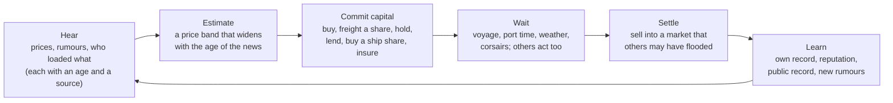
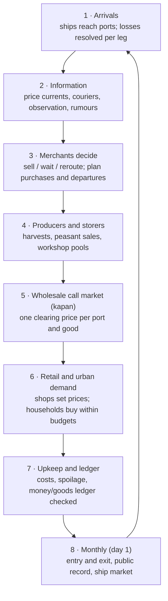

# Core loop

> Status: the simulation loop below is implemented and tested. The player loop is the design target; there is no playable build yet.

## The player's loop (design target)

The player is a merchant, not a manager of buildings. They start with a little capital and no ship ([vision](../vision.md)). Every turn of the loop is a bet made on old information:

What makes each step a decision rather than a click:

| Step | Friction that keeps it interesting | Evidence |
|---|---|---|
| Hear | Information travels by ship and rumour and goes stale | [Experiment 02](../experiments/02-information-delay.md): opportunities exist on 20-40% of days instead of 0.3% |
| Estimate | Old news is a distribution, not a number; it reverts toward the "usual price" | [Information model](information-model.md) |
| Commit | Capital, ship capacity, credit and entry barriers are limited | [Experiment 03](../experiments/03-entry-speed.md): entry speed sets the rent |
| Wait | Sea and corsair risk per leg and season; time in port | [Risk model](risk-model.md), [Experiment 05](../experiments/05-port-time.md) |
| Settle | Rivals heard the same news: herding and cobwebs | [Experiment 02](../experiments/02-information-delay.md), [D5b](../../docs/experiments/D5b.md) (Turkish) |

**Design rule:** opportunities come from frictions, not from NPC stupidity. NPCs follow the same rules as the player and are locally competent. [Experiment 01](../experiments/01-instant-information.md) shows why: with instant information, competent NPCs leave the player a bond-like return.

## The world's loop (implemented)

The world advances one day per tick. The order is fixed (determinism) and identical in the Python and Rust engines ([`world/mod.rs`](../../core/medi-core/src/world/mod.rs), `step`):

The player would act at step 3, with the same information and the same market as any NPC merchant.

## Layers of the world

| Layer | What is modelled | How |
|---|---|---|
| Population pools | Urban demand by income class; peasants | Not individuals. Linear Expenditure System + CES within grains; harvest cash needs |
| Port markets | Wholesale call market, shops, storers, producer pools | One clearing price a day; logit retail shares; storers hold the harvest surplus |
| Agents | Merchants with personality (depth of thinking, imitation, overconfidence, wealth-dependent risk) | Decide on stale, noisy information |
| Institutions | Bond rate, lenders, *colleganza*, public record, ship market | Free entry and exit tied to the bond rate |
| World | Map, seasons, sea risk, corsair pressure | Data-driven map (`core/maps/`), per-leg hazard |

Every mechanism, with its origin and status: [mechanism registry](mechanism-registry.md).
