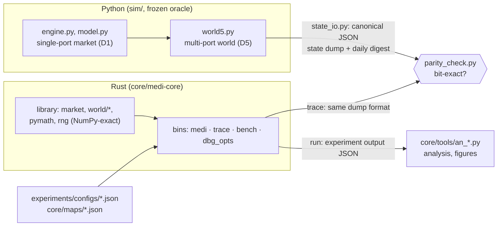

# Architecture

Two engines, one model. A Python reference engine was used to design the economy experiment by experiment. A Rust core reproduces it bit for bit, runs 30-60x faster, and is where every new mechanism now goes.

## Layers

| Path | What it is | Notes |
|---|---|---|
| `sim/` | Python reference engine (~3,300 lines in `world5.py`) | Frozen as the oracle of the current model ([K-033](../../docs/decisions.md)). New mechanisms are not added here. |
| `experiments/*.py` | One script per experiment, D1-D5 series | Each script header names its experiment, how to run it, and its report. Outputs go to `experiments/out/` (not in the repo). |
| `core/medi-core/` | Rust library + binaries (~9,700 lines) | No Python dependency. A future game would link the same library. |
| `core/tools/` | Python glue: config export, state dumps, parity, analysis | `state_io.py`, `parity_check.py`, `run_rs.py`, `run_m.sh`, `an_*.py`, `mapgen.py` |
| `core/maps/` | Map data: ports, regions, legs, supply plans | `east-med-v1.json`: 20 ports. Empty `map` in a config = the Python oracle's 6-port map. |
| `core/fixtures/` | NumPy-generated numeric fixtures for `cargo test` | Built by `core/tools/make_fixtures.py` with NumPy 2.4.4 |

## Inside the Rust core

| Module | Contents |
|---|---|
| `config.rs` | Config struct (Python field names). `validate()` rejects branches that were never ported, so a config cannot silently run the wrong model. |
| `pymath.rs` | Python/NumPy-exact numerics: `sum` (Neumaier), `round`, `%`, `//`, pairwise `mean`/`std`, `median`; transcendental functions via glibc `libm` |
| `rng/` | NumPy `PCG64` + `SeedSequence` and the distribution algorithms (ziggurat normal, Lemire integers, PTRS Poisson, Marsaglia-Tsang gamma/beta, shuffle) |
| `market.rs` | Single-port market: peasants, storers, shopkeepers, harvest |
| `world/mod.rs` | Daily step, in the Python engine's order |
| `world/info.rs` | Observation, rumours, arrivals, information relay |
| `world/trade.rs` | Expectations, rivals, options, departure, sale, mixed cargo |
| `world/kapan.rs` | Wholesale call market (*kapan*), retail prices and shares, urban demand, producer pools |
| `world/finance.rs`, `entry.rs`, `ships.rs` | Debt and lenders; entry/exit and public record; sea risk, corsair pressure, ship market |
| `world/init.rs`, `snapshot.rs`, `diag.rs` | Cold start, warm-start snapshots, diagnostic logs |
| `ledger.rs`, `digest.rs` | Money/goods ledger checked every day; canonical per-field state hash |

Rules that keep the code easy to change ([rust-core §3](../../docs/design/rust-core.md), Turkish):
- Function names and order follow the Python engine, so the two can be read side by side.
- One mechanism per file; config options are enums, not strings.
- Merchants live in an arena (`Vec<M5>`) and are referred to by id; ports and goods are small integer ids.
- Every new mechanism comes behind a config flag with `#[serde(default)]`. With the flag off, the output must match the previous run exactly.

## Data flow of an experiment

1. A config (`experiments/configs/m/PF.json`) names the map, the flags, and the seed.
2. `medi snapshot` runs a long cold spin-up and saves warm-start states, chosen by a rule fixed in advance ([D5b3g](../../docs/experiments/D5b3g.md), Turkish).
3. `medi run` starts from a snapshot and runs 10 years with diagnostics. The ledger is checked every day; an inconsistency aborts the run.
4. `core/tools/an_*.py` reads the output JSON: losses and tempo (`an_loss.py`), prices (`an_px.py`), information and reroutes (`an_info.py`).

## Removed
- `core/medi-py/`, a PyO3 binding skeleton. Running the `medi` binary from Python turned out to be enough, so the binding was never used. It was removed before publication.
