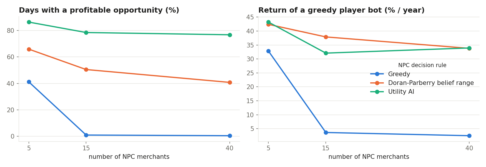

# 01 · Two ports, instant information (D2)

**Question.** Does carrying grain between a surplus port and a deficit port pull their prices together? And if every merchant knows both prices today, is there anything left for a player to find?

## Setup
- Alexandria produces 2.1x its needs (harvest in May); Istanbul produces half (harvest in July). Each port runs the single-port market model from the D1 series: shopkeepers, storers, peasants, urban demand.
- Voyage ~14 days in summer, ~21 in winter; freight about 8% of value; 3% customs in Istanbul; cargo loss 1.5% per voyage in summer, 5% in winter.
- Merchants buy in Alexandria, sell in Istanbul, return empty. Bankrupt merchants are replaced.
- **Information is instant and global**: everyone knows both ports' prices today.
- Three NPC decision rules race: **greedy** (buy if the margin after costs exceeds 5%), **Doran-Parberry** (Doran & Parberry 2010: each merchant learns a belief range from its own sales) and **utility AI** (accounts for rival cargo on the way, with personality-based risk appetite).
- A player bot using the greedy rule runs alongside the NPCs. 5, 15 or 40 NPC merchants, 10 seeds each.

## Result



| | No trade | Greedy, 15 merchants |
|---|---|---|
| Istanbul days in shortage | 55% | 6% |
| Price gap / transport cost | 12.7x | **1.07x** |
| Days with an opportunity (margin > 10% after all costs) | — | **1%** |
| Greedy player bot, % a year | — | **3.6%** |

## Reading
- **Reproduces the law of one price** (Cournot 1838; Samuelson 1952's spatial price equilibrium): with enough greedy merchants, the gap settles at the transport cost.
- **Reproduces the Grossman-Stiglitz point** (Grossman & Stiglitz 1980): when information is free, prices leave nothing to find. A player bot earns about what a bond pays. This is the "Bannerlord problem" of trading games, now measured.
- The other two rules leave opportunities open, but only because they are inefficient: Doran-Parberry NPCs earn 0% at 40 merchants while the greedy bot earns 34% in the same world. The player would be farming NPC mistakes.
- **Design consequence:** opportunities must come from frictions (information delay, capital, capacity, risk), not from weak NPCs. NPCs stay locally competent. This became a design principle and set up experiment 02.

## Reproduce
```
python3 experiments/d2_two_ports.py      # ~3 min, writes experiments/out/d2/summary.json
```
Full report (Turkish): [`docs/experiments/D2.md`](../../docs/experiments/D2.md)
