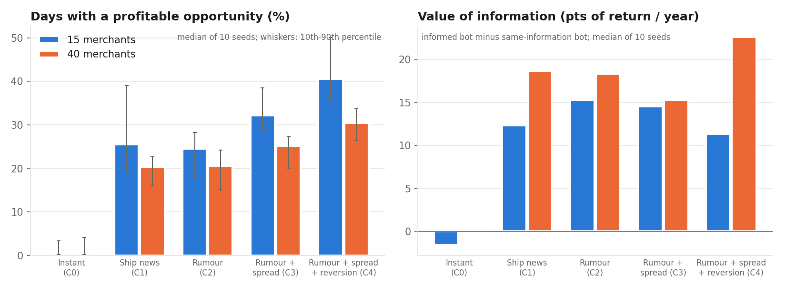

# 02 · Information delay (D3)

**Question.** Keep the competent greedy NPCs from [01](01-instant-information.md), but let information travel physically. Do opportunities come back? Does stale news make everyone rush to the same port?

## Setup
Same two-port world. Only two slots change:

| Slot | Candidates |
|---|---|
| Information | **instant** (control) · **ship**: a returning ship brings Istanbul's price on its departure day · **rumour**: the same news, heard with 30% probability per day (a simple Daley-Kendall rumour) |
| Expectation | **last**: the last observation is assumed to still hold · **spread**: a lognormal belief that widens with the age of the information; cautious merchants look at its lower end · **spread + reversion**: as above, and old information drifts toward the merchant's own median ("normal price") |

Two player bots: one with the same information as the NPCs, one with instant information. The gap between them is the **value of information**. 15 or 40 merchants, 10 seeds.

## Result



| | Instant (C0) | Delayed (C1-C4) |
|---|---|---|
| Days with an opportunity | 0.3% | **20-40%** |
| Mean opportunity length | ~1 day | **15-30 days** |
| Value of information | ~0 | **+11 to +23 points a year** |
| Informed bot | — | 18-28% a year |

## Reading
- **Delay alone brings opportunities back**, with the same competent NPCs. Opportunities now last two to four weeks, long enough for a player to notice and act.
- **The value of information** is known from Stigler (1961) and Grossman & Stiglitz (1980); the simulation reproduces it. What is specific to this model is its size, +11 to +23 points a year. That is large enough to make agents, correspondents and news networks worth buying in the game, without returns of 50% a year.
- **Cost of delay: herding.** With "last observation" expectations, everyone hears the same old "Istanbul is expensive" and loads at once. The cargo arrives together and the price collapses: a cobweb (Kaldor 1934, Ezekiel 1938), emerging from the delay itself. With 40 merchants the price gap falls to 0.4-0.9x the transport cost and bankruptcies rise.
- **Spread + reversion (C4) damps the herd best**: arrival irregularity 0.91 → 0.73, bankruptcies 0.5 → 0.1 a year, shortages closest to the instant case. It became the base expectation model. It also gives the player's price display: a band that widens with the age of the news ([information model](../design/information-model.md)).
- Side result: making merchants count rival cargo on the way failed in both versions (over-cautious, or a herd reacting to the same signal). It came back later, with rumours of who loaded what ([D5b](../../docs/experiments/D5b.md)).

## Reproduce
```
python3 experiments/d3_information.py    # ~4 min, writes experiments/out/d3/summary.json
```
Full report (Turkish): [`docs/experiments/D3.md`](../../docs/experiments/D3.md)
