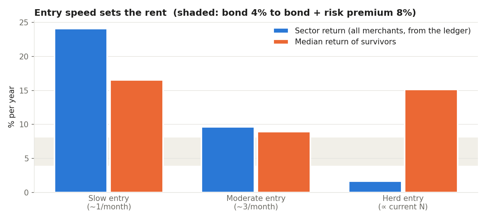

# 03 · Free entry and the bond rate (D3b)

**Question.** The design target: a bond yields about 4%; "ordinary" trade should earn bond + risk premium; good trading earns more, but not 50% a year. Can this emerge from entry and exit instead of being set by hand?

## Setup
- The best world from [02](02-information-delay.md) (rumour + spread + reversion), 20 years, 5 seeds, starting with 5, 15 or 40 merchants.
- **Exit:** a merchant trading below the bond rate over the last 12 months moves its money into bonds with some probability each month. Bankrupt merchants leave.
- **Entry:** when the median return of active merchants exceeds bond + risk premium (8%), new merchants enter. Three structures:
  - *slow pool*: about 1 new merchant a month (entry needs apprenticeship, capital, connections);
  - *moderate pool*: about 3 a month;
  - *herd*: entry proportional to the current number of merchants.
- **New measurement:** sector return over all capital that ever entered, from the ledger: money taken out by those who left, what bankrupts had left, all dividends, final wealth. This removes survivorship bias.

## Result



| Entry | Sector return | What happens |
|---|---|---|
| Slow (~1/month) | 19-26% | insiders earn a rent |
| **Moderate (~3/month)** | **6-11%** | **bond + risk, the target** |
| Herd (∝ N) | 1-2% | boom-bust between 5 and 120 merchants; the sector earns below the bond |

In every structure the informed bot earns 13-17%, 5-13 points above the uninformed bot.

## Reading
- **Reproduces known industrial-organisation results**: barriers to entry create rents, and free entry pushes economic profit down to the opportunity cost of capital plus risk (Bain 1956; Stigler 1968). Nothing new was discovered here; it is evidence that the model behaves correctly.
- **Entry speed is the rent dial.** In the game, guilds, citizenship rights and trade privileges are barriers to entry, so they have a measurable economic value. Joining a guild or winning a privilege is worth exactly the rent it protects.
- **Pork cycle.** The fleet cycles in every structure, because entry decisions look at the last 12 months (Hanau 1928). The cycle is a wanted phenomenon. Herd entry was rejected for two other reasons: its micro-behaviour is unrealistic (new entrants are not proportional to existing ones), and its swings hit the artificial cap of 120.
- **Survivorship bias is large.** Under herd entry, survivors' median return looks like 12-22% while the sector earns 1-2%. NPCs decide from survivor statistics, as real people do; our measurements never do.
- **Information keeps its value in equilibrium.** Competition erodes the ordinary merchant's margin, but not the informed merchant's advantage.

## Reproduce
```
python3 experiments/d3b_entry_exit.py    # ~12 min, writes experiments/out/d3b/summary.json
```
Full report (Turkish): [`docs/experiments/D3b.md`](../../docs/experiments/D3b.md)
