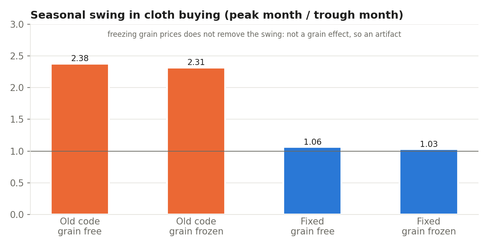

# 04 · A seasonal swing that was a bug (D4b)

**Question.** In the multi-good experiment (D4), urban cloth purchases swung strongly with the seasons in a world without shocks. The tempting story is an income effect: when grain is expensive before the harvest, households have less left for cloth. Is it that, or an artifact?

## Setup
- D4 world: one port, four goods, urban demand from a Linear Expenditure System with CES substitution between wheat and barley (Stone 1954).
- **Ablation:** freeze wheat and barley prices at their reference values *inside the households' budget decision*, while real purchase prices keep moving. If the cloth swing comes from grain prices, it must disappear.
- Second part: split urban demand into three income classes (rich, middle, poor) built from historical budget data ([consumer profiles](../../docs/research/history/consumer-profiles-16c.md), Turkish).

## Result



- With the old code, the swing stays at 2.3 even with grain frozen. So it is **not** coming from grain.
- Source in the code: the producer of a continuously made good (cloth) paced its sales by "days left until harvest", as if cloth had a harvest in January. With a fixed horizon for continuous goods, the swing falls to 1.03-1.06 and cloth volatility from 0.49 to 0.05.

## Reading
- Without the classification step, this would have been written up as an income effect. One ablation and one code reading turned it into a bug fix. The lesson was added to the method: every new type of good (continuous production, intermediate, imported) has to re-question the engine's seasonal assumptions.
- **The three income classes produced a real phenomenon.** In a 30% wheat shortfall:
  - the poor stop buying cloth for about 5 months (12-month average −42%);
  - the middle class cuts back by 10%;
  - the rich buy 7% *more*, because the cloth the poor cannot afford gets cheaper.
  
  This matches Sen's (1981) entitlement view of famine: what matters is who can still pay, not only how much grain there is. It emerged from prices and budgets; it was not scripted.
- Design consequence: cloth was split into coarse cloth (poor and middle) and fine cloth (rich). This gave the Labrousse mechanism (a bad harvest ruins the weavers of coarse cloth) somewhere to act.
- A second, quieter bug was found on the way: the class model mutated a shared list of good definitions, so later runs in the same process used wrong quantities. The determinism test could not catch it (same order, same wrong result); a failure to reproduce an earlier number did. Configuration objects are now copied, never mutated.

## Reproduce
```
python3 experiments/d4b_classes.py       # ~1 min, writes experiments/out/d4b/summary.json
```
Full report (Turkish): [`docs/experiments/D4b.md`](../../docs/experiments/D4b.md)
