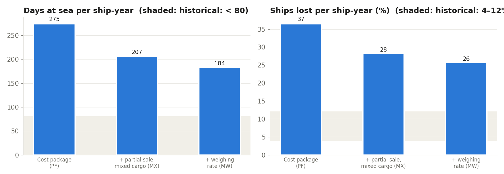

# 05 · Ships that never stay in port (M2)

**Question.** On the 20-port eastern Mediterranean map, the simulated fleet spent about 275 days a year at sea and lost about 37% of its ships a year. Historical ships spent fewer than 80 days at sea (Jones 1998) and lost on the order of 4-12% of the fleet a year. Per-voyage loss probabilities were already historical; ships simply made 3-5 times too many voyages. What is missing?

## Setup
- Rust core, 20 ports, 6 seeds x 10 years after a warm-up. Each step adds one mechanism behind a config flag; the previous step's run with the flag off reproduces bit for bit.
- **PF (cost package):** per-ship costs at historical levels: crew wages and rations, anchorage and harbour dues, customs on entry, wear per day at sea, and the ship's own value at risk.
- **MX (port call + mixed cargo):** handling speed per port, cargo split into lots by destination, partial sale, and the choice between selling here and keeping a lot in the hold for a better port. The departure rule is the marginal value theorem (Charnov 1976): leave when today's loading rate falls below the voyage's average rate.
- **MW (weighing rate):** high-value goods are sold only as fast as the official scales can weigh them (pepper 100 units a day, cloth 400). This level is a temporary proxy.

## Result



| | PF | MX | MW |
|---|---|---|---|
| Days at sea / ship-year | 275 | 207 | 184 |
| Ships lost / year | 37% | 28% | 26% |
| Loaded voyages / ship-year | 14.3 | 11.8 | 10.1 |

## Reading
- **Costs alone did not fix the tempo.** The cost package (PC, then PF) made route changes more accurate (reroutes that found a lower price than expected fell from 59% to 48%), but ships still sailed 265-275 days a year. Diagnosis: the missing piece was not a cost but **time in port**.
- **Time in port moves the tempo toward history.** It is known that port time and cargo collection dominate pre-industrial shipping productivity (Jones 1998); the simulation reproduces that direction. But at 184 days the fleet is still about twice as fast as history, and losses are still 2-6 times the target. The model is not calibrated yet; this page shows a structural step, not a fit.
- **Every step had a side effect on distribution.** Mixed cargo made lots wander between ports: a merchant comparing noisy estimates always finds some "better port" (the optimizer's curse, Smith & Winkler 2006). The weighing limit made pepper scarce in mid-sized ports (median price 4.7 → 13.4 x reference). These are recorded as open problems, not tuned away.
- **The run that crashed.** The next step (MK, sale agreements with storers) crashed on its first run. A lot closed at the dust threshold while a small agreement was still open; the next lot used the old market's storer index. It was fixed with an explicit delivery when a lot closes, plus assertions. The bug was in the engine, so it was not counted as a model finding.
- **What the diagnostics turned up next.** Dumping the full state showed that 77-94 of 186 storers had almost no cash in *every* variant, including PF: storers have no capital entry or exit, unlike shops. A likely consequence (not yet tested): without stock-holding capital, nobody buys the harvest surplus or buffers scarcity. The proposed next step is one capital entry/exit model for storers, workshops and pools ([open question S-027](../../docs/open-questions.md), Turkish).

## Reproduce
```
cargo build --release --manifest-path core/Cargo.toml
bash core/tools/run_m.sh PF          # and MX, MW; ~10 min each, writes experiments/out/m2/
OUT=m2 python3 core/tools/an_loss.py PF
```
Configs: [`experiments/configs/m/`](../../experiments/configs/m/). Full report (Turkish): [`docs/experiments/M2.md`](../../docs/experiments/M2.md). Historical sources: [shipping scale](../../docs/research/history/shipping-scale-16c.md), [ship life and piracy](../../docs/research/history/ship-life-piracy-16c.md) (Turkish).
